# 🎓 Отчет по лабораторной работе №5: Нормализация данных и классификация товаров

**Выполнил:** Евгений Белевитин  
**Группа:** Ипо8481  
**Дата:** 12.11.2026

---

## 📑 Оглавление
1. [Введение и постановка задачи](#intro)
2. [Подготовка окружения и запуск](#step1)
3. [Создание «плохой» таблицы и её анализ](#step2)
4. [Демонстрация аномалий](#step3)
5. [Резервное копирование](#step4)
6. [Проектирование чистой структуры (3NF)](#step5)
7. [Перенос данных и решение проблем](#step6)
8. [Проверка целостности (сверка сумм)](#step7)
9. [Архивация и создание дампов](#step8)
10. [Экспорт и фильтрация лога](#step9)
11. [Заключение](#conclusion)

---

## 🔹 Введение и постановка задачи

В этой лабораторной работе мы сталкиваемся с новой интересной задачей. У нас есть таблица заказов, но теперь в ней появилась **классификация товаров**. Это значит, что каждый товар относится к какой-то группе (например, «Электроника» или «Мебель»).

Проблема «плохой» таблицы в том, что название классификации дублируется в каждой строке заказа. Если мы захотим переименовать «Электронику», придётся менять это название во всех строках. А если мы ошибёмся хоть в одной — база начнёт «врать».

**Нормализация** — это процесс, при котором мы выносим справочники (клиентов, товары, классификации) в отдельные таблицы, а в таблице заказов оставляем только ссылки на них (ID). Это делает базу компактной, быстрой и надёжной.

**Наша цель:**
* Создать «плохую» таблицу `orders_bad` с дублированием.
* Показать, какие проблемы это вызывает.
* Разбить её на 5 связанных таблиц (`clients`, `categories`, `products`, `orders`, `order_items`).
* Проверить, что при переносе данные не потерялись.

---

## 🚀 Шаг 1. Подготовка окружения и запуск

Для начала мы развернули контейнер с MySQL. Чтобы не настраивать логирование вручную, мы заранее создали файл `my.cnf`, в котором указали параметры `general_log = 1` и `log_output = FILE`. Это говорит MySQL: «Записывай все запросы, которые делают пользователи, в отдельный файл».

После запуска контейнера мы почистили лог от системного мусора и подключились к базе.

📸 **Подтверждение:** 
На первом скриншоте видно, что конфигурационный файл создан в папке проекта. На втором — успешный вход в консоль MySQL.
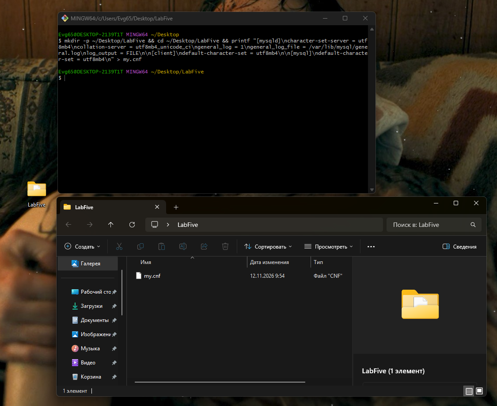
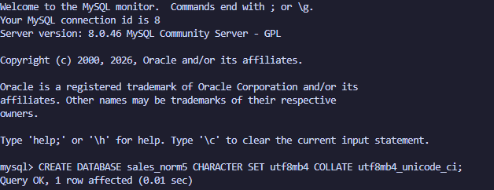

---

## 🗄️ Шаг 2. Создание «плохой» таблицы и её анализ

Создаём базу данных `sales_norm5` и таблицу `orders_bad`. В неё мы вставляем 6 строк с информацией о заказах, товарах и их классификациях. 

Уже на этом этапе видно, что таблица далека от идеала: название категории «Электроника» повторяется несколько раз, как и имена клиентов. Это называется **избыточностью**. Когда одни и те же данные записаны в нескольких местах, это всегда риск ошибки.

📸 **Подтверждение:** 
Скриншот показывает создание таблицы и вывод всех 6 строк.
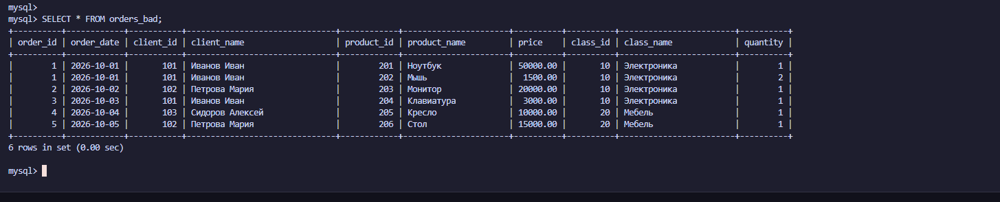

---

## 💥 Шаг 3. Демонстрация аномалий

Теория теорией, но лучше один раз увидеть. Мы решили проверить, что будет, если работать с такой «грязной» таблицей.

### 3.1. Аномалия обновления
Представьте, что компания решила переименовать категорию «Электроника» в «Электроника (Нов)». В нормальной базе это делается одной командой `UPDATE`. Но у нас название категории записано в нескольких строках. Мы обновили его только в одной строке (заказ №1) и увидели, что теперь в базе есть и «Электроника (Нов)», и «Электроника» одновременно. Это и есть **аномалия обновления** — база данных начала «врать».

📸 **Подтверждение:** 
На скриншоте видно, что у категории с `class_id = 10` в разных строках разные названия.
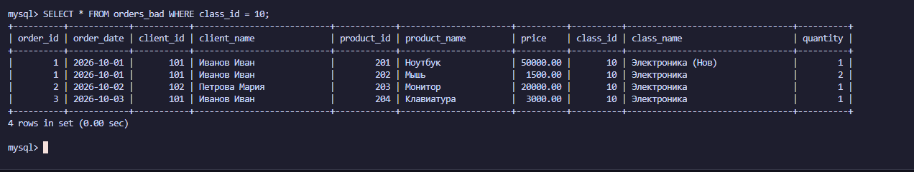

### 3.2. Аномалия удаления
Теперь представим, что клиент с ID 103 удалил свой заказ. Мы выполнили команду `DELETE`, и... клиент полностью исчез из базы. Мы потеряли информацию о том, что он вообще был в нашей системе! В нормальной базе клиенты должны храниться отдельно от заказов, чтобы удаление заказа не приводило к «стиранию» человека.

📸 **Подтверждение:** 
Скриншот показывает, что после удаления заказа клиента 103 его данные исчезли (`Empty set`).
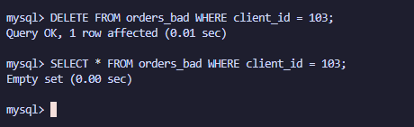

### 3.3. Аномалия вставки
Попробуем добавить новую категорию («Одежда») до того, как у неё появились товары. В итоге в строке появились `NULL` вместо данных о заказе. Это **аномалия вставки**: структура таблицы не позволяет нам хранить категорию отдельно от заказа.

📸 **Подтверждение:** 
На скриншоте видно, что у новой категории все поля заказа — `NULL`.
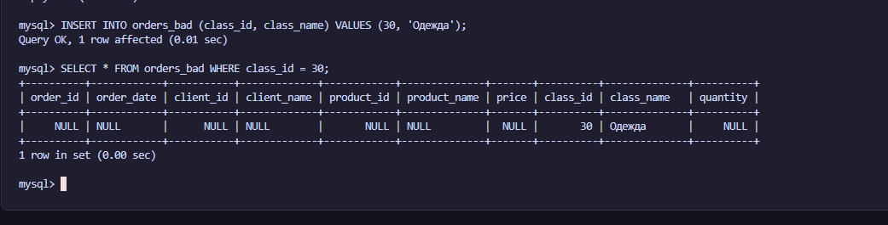

---

## 💾 Шаг 4. Резервное копирование

Перед тем как начать «перестройку» базы, мы сделали её резервную копию через `mysqldump`. Это наша «страховка»: если мы вдруг ошибёмся при переносе, то всегда сможем откатиться назад.

📸 **Подтверждение:** 
На скриншоте виден вывод `cat dump_bad.sql`. В дампе сохранились все наши грязные данные.
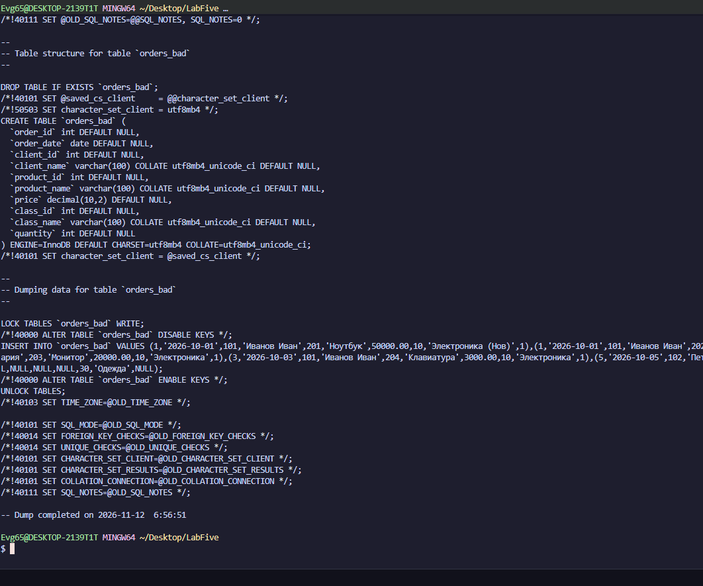

---

## 🏗️ Шаг 5. Проектирование чистой структуры (3NF)

Пришло время навести порядок. Мы разбили нашу одну таблицу на 5 маленьких, каждая из которых отвечает за свою сущность:
1. `clients` — клиенты (ID и имя).
2. `categories` — классификации товаров (ID и название).
3. `products` — товары (ID, название, цена и ссылка на классификацию).
4. `orders` — заказы (кто и когда).
5. `order_items` — позиции заказов (какой товар и в каком количестве).

Теперь информация о категории не зависит от заказов, а цена товара не дублируется в каждой строке.

📸 **Подтверждение:** 
Скриншот показывает список из 6 таблиц (5 новых и одна старая `orders_bad`).
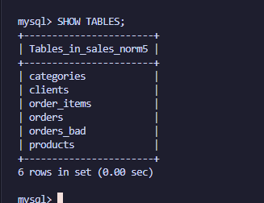

---

## 🔄 Шаг 6. Перенос данных и решение проблем

Это был самый интересный этап. **Мы столкнулись с проблемой!** 😱 
Когда мы пытались перенести данные из-за наличия `NULL` в старой таблице (после демонстрации аномалии вставки), MySQL выдавал ошибку. 

**Как мы это решили:** 
Мы использовали команду `INSERT ... SELECT` с фильтрацией `WHERE ... IS NOT NULL`. Это позволило нам перенести только корректные данные, отбросив «мусорные» строки, которые появились из-за аномалий. А чтобы MySQL не «запоминал» старые ID, мы очистили таблицы через `TRUNCATE` и создали их заново.

В итоге у нас получилось 5 таблиц, полностью заполненных корректными данными.

📸 **Подтверждение:** 
На скриншоте видно, что все таблицы (`clients`, `categories`, `products`, `orders`, `order_items`) заполнены.
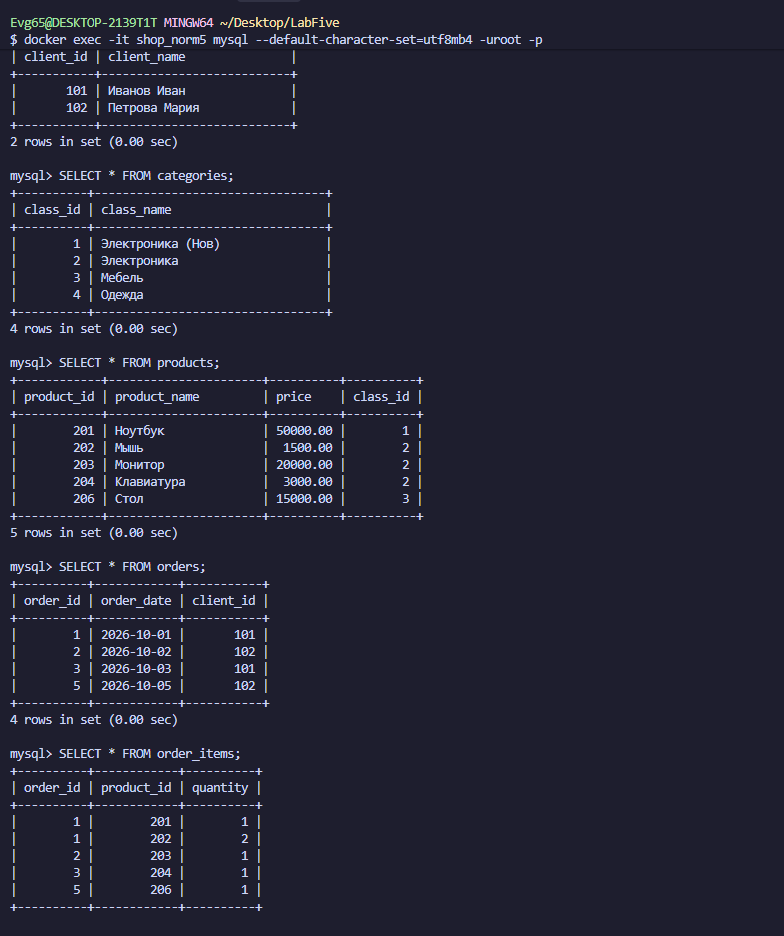

---

## ✅ Шаг 7. Проверка целостности (сверка сумм)

Как убедиться, что мы ничего не потеряли при переносе? Нужно сравнить **общую сумму** всех заказов до и после. 

Мы написали два запроса: один считает сумму в старой таблице `orders_bad`, а второй — в новой `order_items` (соединив её с `products`). И каково же было наше удивление, когда суммы **полностью совпали** (`91000.00`)! Значит, мы всё перенесли правильно, и ни один рубль не потерялся.

📸 **Подтверждение:** 
Скриншот показывает совпадение `total_old` и `total_new`.
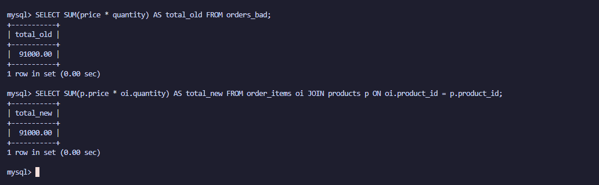

В качестве бонуса мы выполнили аналитический запрос: посчитали, на какую сумму продались товары из каждой категории. У «Электроники (Нов)» вышло 50000, у обычной «Электроники» — 26000, а у «Мебели» — 15000. Этот запрос показывает, насколько удобнее работать с нормализованной базой.

📸 **Подтверждение:** 
Скриншот с результатами `JOIN` и `GROUP BY` по категориям.
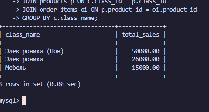

---

## 🗑️ Шаг 8. Архивация и создание дампов

Старая «плохая» таблица нам больше не нужна, но удалять её страшно. Поэтому мы переименовали её в `orders_bad_backup`. Теперь она хранится в базе как архив, но не мешает нам работать.

После этого мы сделали финальный дамп уже **чистой и нормализованной** базы.

📸 **Подтверждение:** 
Скриншот показывает, что таблица `orders_bad` переименована.
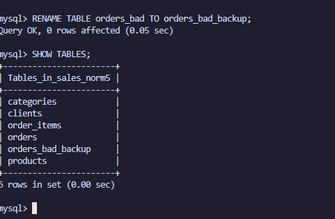

Скриншот с содержимым финального дампа `norm_dump.sql`.
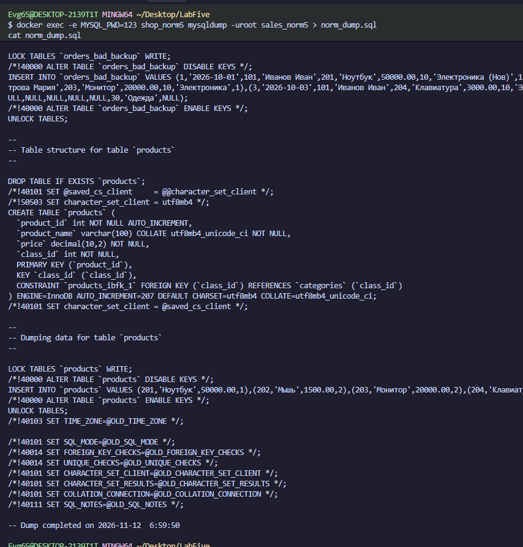

---

## 📜 Шаг 9. Экспорт и фильтрация лога

Последний штрих — выгрузить лог наших действий. В файле `general.log` записано всё, что мы делали. Но там есть и служебные записи (например, `Connect`, `Quit`, загрузка справочников). 

Мы использовали утилиту `grep`, чтобы отфильтровать только наши команды. Теперь в файле `my_actions.log` остались только осмысленные запросы (`SELECT`, `SHOW TABLES` и т.д.).

📸 **Подтверждение:** 
Скриншот с выводом `cat my_actions.log`.
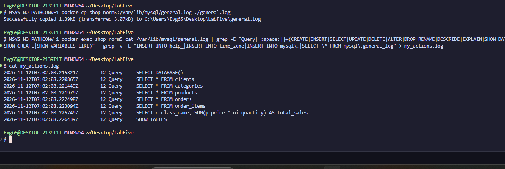

---

## 📌 Заключение

В ходе этой работы мы на собственном опыте убедились, почему нормализация так важна. Мы увидели, как «плохая» таблица порождает аномалии обновления, удаления и вставки, и как разбиение данных на связанные таблицы решает эти проблемы.

Мы научились:
* Проектировать структуру базы данных, устраняя дублирование.
* Работать с классификаторами (выносить категории в отдельный справочник).
* Переносить данные с помощью `INSERT ... SELECT`, минуя ошибки с первичными ключами.
* Проверять целостность данных через сравнение сумм.
* Настраивать логирование и фильтровать его от «мусора».

Теперь мы знаем: чтобы база данных была надёжной, каждый факт в ней должен храниться в одном месте, и это место должно быть защищено внешними ключами.

---

## 📂 Прикрепленные файлы
* [Скачать дамп «плохой» базы (dump_bad.sql)](./dump_bad.sql)
* [Скачать дамп нормализованной базы (norm_dump.sql)](./norm_dump.sql)
* [Скачать отфильтрованный лог (my_actions.log)](./my_actions.log)
* [Скачать конфигурационный файл (my.cnf)](./my.cnf)