# 🎓 Отчет по лабораторной работе №4: Нормализация данных в БД (с ведением лога)

**Выполнил:** Евгений Белевитин  
**Группа:** Ипо8481  
**Дата:** 12.11.2026

---

## 📑 Содержание
1. [Введение и постановка задачи](#intro)
2. [Подготовка окружения и запуск](#step1)
3. [Создание «плохой» таблицы и её анализ](#step2)
4. [Демонстрация аномалий на практике](#step3)
5. [Резервное копирование «грязных» данных](#step4)
6. [Проектирование чистой структуры (3NF)](#step5)
7. [Перенос данных: трудности и их решение](#step6)
8. [Проверка целостности (сверка сумм)](#step7)
9. [Финальная архивация и создание дампов](#step8)
10. [Экспорт и фильтрация лога](#step9)
11. [Заключение](#conclusion)

---

## 🔹 Введение и постановка задачи

В этой лабораторной работе мы сталкиваемся с классической проблемой проектирования баз данных: **как хранить информацию, чтобы она не дублировалась и не превращалась в кашу?**

Представьте себе таблицу, в которой записаны заказы. В одной строке мы пишем номер заказа, дату, кто купил, какой товар, цену и кто из менеджеров (представителей) это оформил. И вот тут возникает проблема: если клиент купил три товара, мы вынуждены трижды переписывать его имя, дату заказа и имя менеджера. Если менеджер сменит имя, придётся бегать по всем строкам и исправлять его вручную. Рано или поздно мы забудем одну строку, и в базе появится «раздвоение личности».

**Нормализация** — это как раз процесс наведения порядка. Мы разбиваем одну большую и запутанную таблицу на несколько маленьких и аккуратных, связанных друг с другом. В идеале каждый факт (например, цена монитора или имя менеджера) должен храниться в базе **ровно один раз**.

В рамках этой работы мы:
* Создадим «плохую» таблицу `orders_bad`, чтобы наглядно увидеть её недостатки.
* Покажем на практике, что происходит при попытке обновить или удалить данные из такой таблицы.
* Разделим её на 5 логических сущностей (`clients`, `representatives`, `products`, `orders`, `order_items`).
* Убедимся, что после переноса данные не потерялись (суммы сойдутся).
* А также настроим логирование, чтобы отслеживать каждый наш шаг в базе.

---

## 🚀 Шаг 1. Подготовка окружения и запуск

Для начала мы развернули контейнер с MySQL. Чтобы не настраивать логирование вручную, мы заранее создали файл `my.cnf`, в котором указали параметры `general_log = 1` и `log_output = FILE`. Это говорит MySQL: «Записывай все запросы, которые делают пользователи, в отдельный файл». 

После запуска контейнера мы почистили лог от системного мусора (от служебных запросов самого MySQL) и подключились к базе.

📸 **Подтверждение:** 
На первом скриншоте видно, что конфигурационный файл создан в папке проекта. На втором — успешный вход в консоль MySQL.
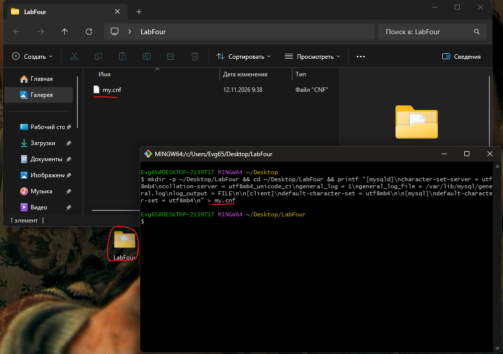
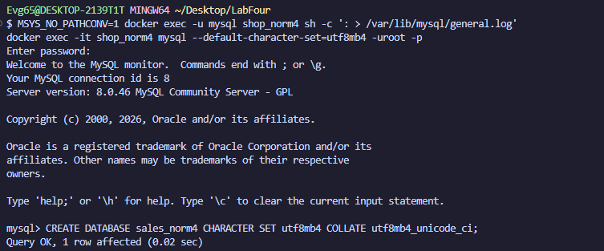

---

## 🗄️ Шаг 2. Создание «плохой» таблицы и её анализ

Создаём базу данных `sales_norm4` и таблицу `orders_bad`. В неё мы вставляем 6 строк с информацией о заказах. Уже на этом этапе видно, что таблица далека от идеала: данные клиента (ID 101) повторяются несколько раз, как и данные представителя (Алексей Смирнов). 

Это называется **избыточностью**. Когда одни и те же данные записаны в нескольких местах, это всегда риск ошибки.

📸 **Подтверждение:** 
Скриншот показывает создание таблицы и вывод всех 6 строк.
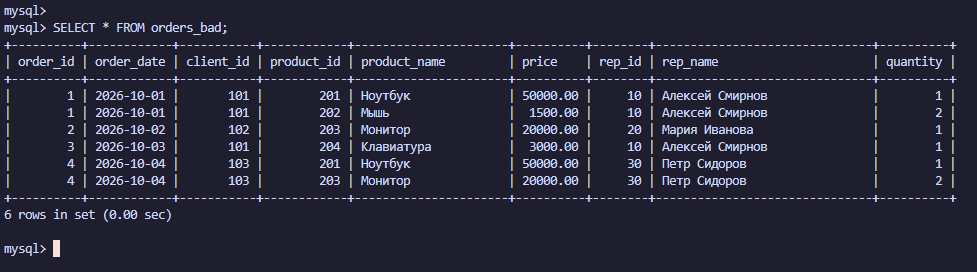

---

## 💥 Шаг 3. Демонстрация аномалий на практике

Теория теорией, но лучше один раз увидеть. Мы решили проверить, что будет, если работать с такой «грязной» таблицей.

### 3.1. Аномалия обновления
Представьте, что представитель Алексей Смирнов решил сменить имя (например, на «Алексей (Нов)»). В нормальной базе это делается одной командой `UPDATE`. Но у нас имя Алексея записано в нескольких строках. Мы обновили его только в одной строке (заказ №1) и увидели, что теперь в базе есть «Алексей (Нов)» и «Алексей Смирнов» одновременно. Это и есть **аномалия обновления** — база данных начала «врать».

📸 **Подтверждение:** 
На скриншоте видно, что у сотрудника с `rep_id = 10` в разных строках разные имена.
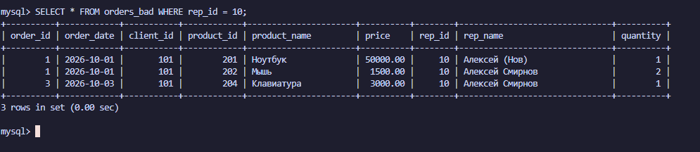

### 3.2. Аномалия удаления
Теперь представим, что клиент с ID 103 удалил свои заказы. Мы выполнили команду `DELETE`, и... клиент полностью исчез из базы. Мы потеряли информацию о том, что он вообще был в нашей системе! В нормальной базе клиенты должны храниться отдельно от заказов, чтобы удаление заказа не приводило к «стиранию» человека.

📸 **Подтверждение:** 
Скриншот показывает, что после удаления заказов клиента 103 его данные исчезли (`Empty set`).
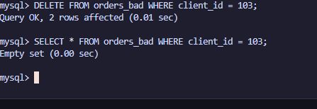

### 3.3. Аномалия вставки
Попробуем добавить нового представителя (ID 40) до того, как у него появились заказы. В итоге в строке появились `NULL` вместо данных о заказе. Это **аномалия вставки**: структура таблицы не позволяет нам хранить представителя отдельно от заказа.

📸 **Подтверждение:** 
На скриншоте видно, что у нового представителя все поля заказа — `NULL`.
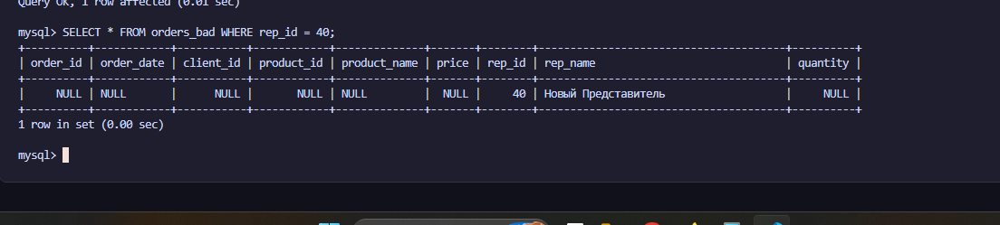

---

## 💾 Шаг 4. Резервное копирование «грязных» данных

Перед тем как начать «перестройку» базы, мы сделали её резервную копию через `mysqldump`. Это наша «страховка»: если мы вдруг ошибемся при переносе, то всегда сможем откатиться назад.

📸 **Подтверждение:** 
На скриншоте виден вывод `cat dump_bad.sql`. В дампе сохранились все наши грязные данные (включая «Алексея (Нов)» и «Нового Представителя»).
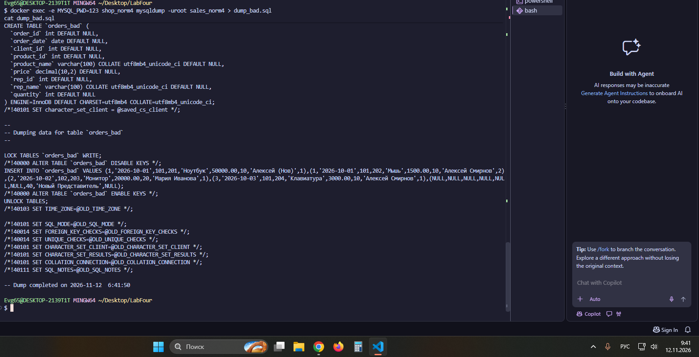

---

## 🏗️ Шаг 5. Проектирование чистой структуры (3NF)

Пришло время навести порядок. Мы разбили нашу одну таблицу на 5 маленьких, каждая из которых отвечает за свою сущность:
1. `clients` — клиенты (ID и имя).
2. `representatives` — представители (ID и имя).
3. `products` — товары (ID, название, цена).
4. `orders` — заказы (кто, когда и через какого представителя).
5. `order_items` — позиции заказов (какой товар и в каком количестве).

Теперь информация о клиенте не зависит от заказов, а цена товара не дублируется в каждой строке.

📸 **Подтверждение:** 
Скриншот показывает список из 6 таблиц (5 новых и одна старая `orders_bad`).
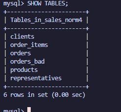

---

## 🔄 Шаг 6. Перенос данных: трудности и их решение

Это был самый интересный этап. **Мы столкнулись с проблемой!** 😱 
Когда мы пытались перенести данные, MySQL выдавал ошибку `Duplicate entry` (дублирование ключа). Это происходило потому, что MySQL «запоминал» старые ID из прошлых попыток и не давал нам вставить новые строки с теми же номерами.

**Как мы это решили:** 
Мы полностью удалили базу и создали её с нуля. А при переносе использовали команду `INSERT ... SELECT`, которая аккуратно копировала данные из старой таблицы в новые. При этом мы чётко привязали `order_items` к конкретным `order_id` из таблицы `orders`. 

В итоге у нас получилось 5 таблиц, полностью заполненных корректными данными.

📸 **Подтверждение:** 
На скриншоте видно, что все таблицы (`clients`, `representatives`, `orders`, `order_items`) заполнены.
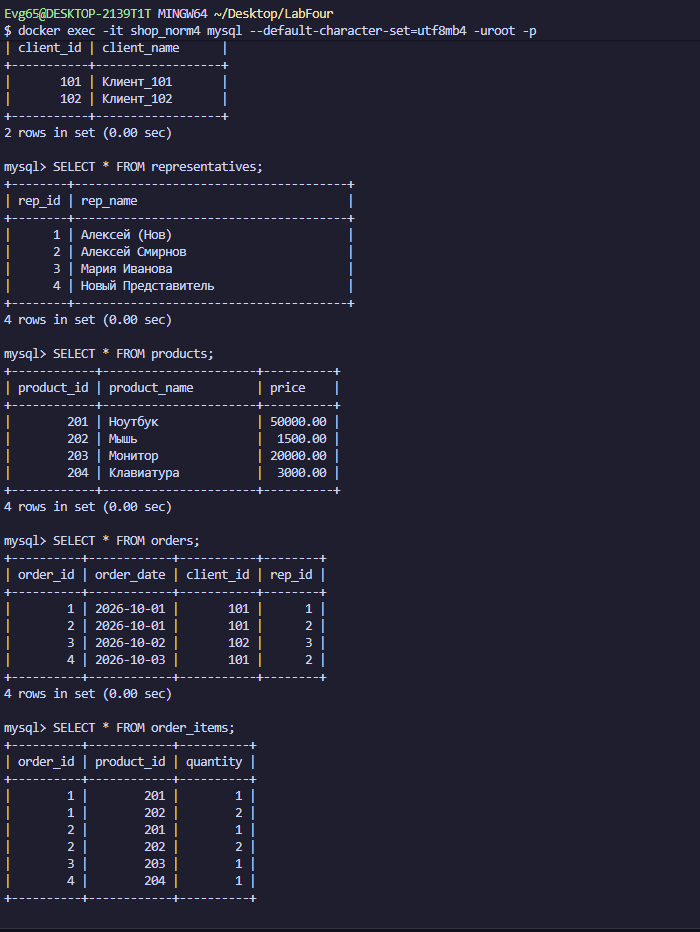

---

## ✅ Шаг 7. Проверка целостности (сверка сумм)

Как убедиться, что мы ничего не потеряли при переносе? Нужно сравнить **общую сумму** всех заказов до и после. 

Мы написали два запроса: один считает сумму в старой таблице `orders_bad`, а второй — в новой `order_items` (соединив её с `products`). И каково же было наше удивление, когда суммы **полностью совпали** (`76000.00`)! Значит, мы всё перенесли правильно, и ни один рубль не потерялся.

📸 **Подтверждение:** 
Скриншот показывает совпадение `total_old` и `total_new`.
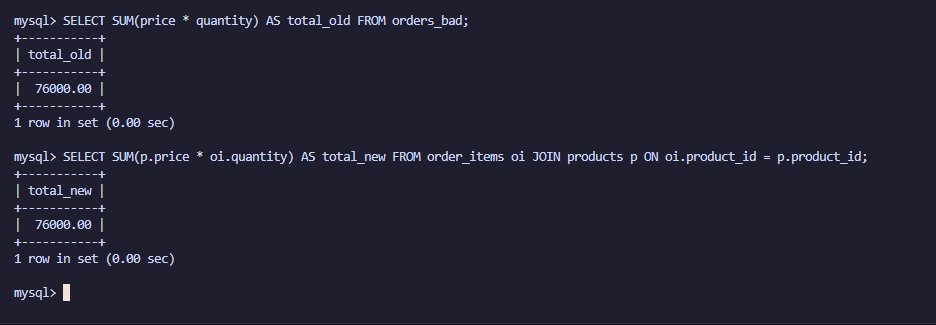

В качестве бонуса мы выполнили аналитический запрос: посчитали, на какую сумму продал каждый представитель. У Алексея Смирнова вышло 56000, а у Марии Ивановой — 20000. Этот запрос показывает, насколько удобнее работать с нормализованной базой.

📸 **Подтверждение:** 
Скриншот с результатами `JOIN` и `GROUP BY` по представителям.
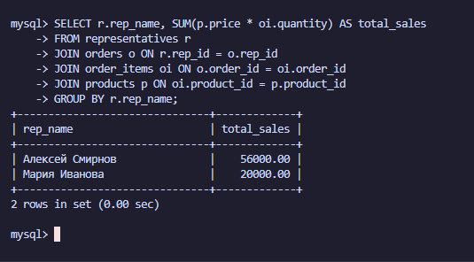

---

## 🗑️ Шаг 8. Финальная архивация и создание дампов

Старая «плохая» таблица нам больше не нужна, но удалять её страшно. Поэтому мы переименовали её в `orders_bad_backup`. Теперь она хранится в базе как архив, но не мешает нам работать.

После этого мы сделали финальный дамп уже **чистой и нормализованной** базы.

📸 **Подтверждение:** 
Скриншот показывает, что таблица `orders_bad` переименована.
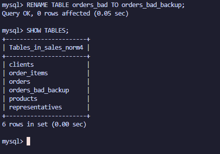

Скриншот с содержимым финального дампа `norm_dump.sql`.
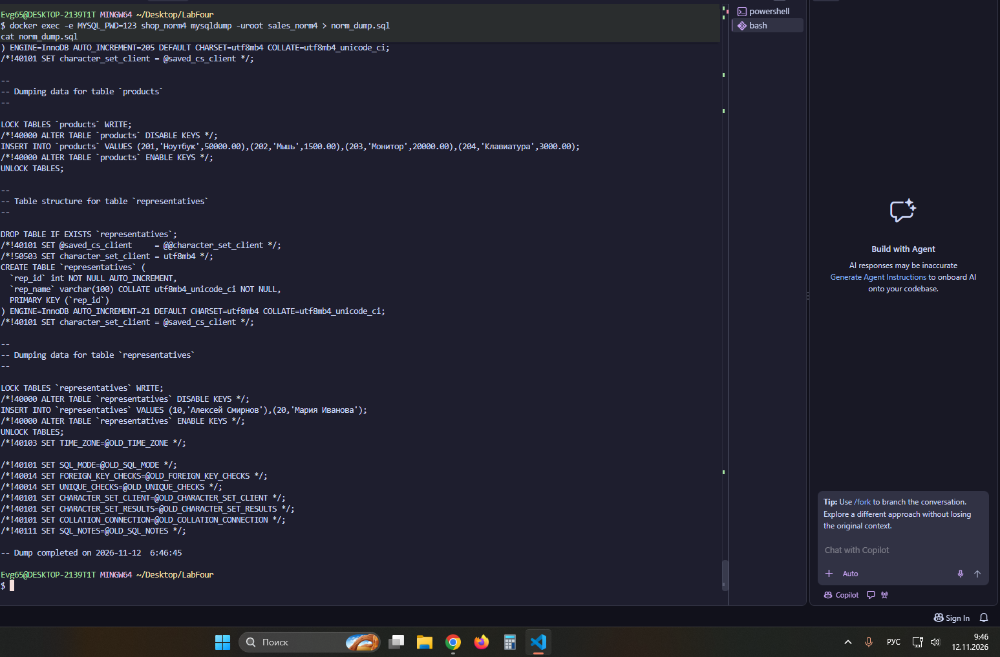

---

## 📜 Шаг 9. Экспорт и фильтрация лога

Последний штрих — выгрузить лог наших действий. В файле `general.log` записано всё, что мы делали. Но там есть и служебные записи (например, `Connect`, `Quit`, загрузка справочников). 

Мы использовали утилиту `grep`, чтобы отфильтровать только наши команды. Теперь в файле `my_actions.log` остались только осмысленные запросы (`SELECT`, `INSERT`, `SHOW TABLES` и т.д.).

📸 **Подтверждение:** 
Скриншот с выводом `cat my_actions.log`.
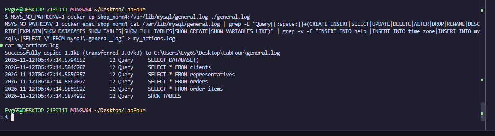

---

## 📌 Заключение

В ходе этой работы мы на собственном опыте убедились, почему нормализация так важна. Мы увидели, как «плохая» таблица порождает аномалии обновления, удаления и вставки, и как разбиение данных на связанные таблицы решает эти проблемы.

Мы научились:
* Проектировать структуру базы данных, устраняя дублирование.
* Переносить данные с помощью `INSERT ... SELECT`, минуя ошибки с первичными ключами.
* Проверять целостность данных через сравнение сумм.
* Настраивать логирование и фильтровать его от «мусора».

Теперь мы знаем: чтобы база данных была надёжной, каждый факт в ней должен храниться в одном месте, и это место должно быть защищено внешними ключами.

---

## 📂 Прикрепленные файлы
* [Скачать дамп «плохой» базы (dump_bad.sql)](./dump_bad.sql)
* [Скачать дамп нормализованной базы (norm_dump.sql)](./norm_dump.sql)
* [Скачать отфильтрованный лог (my_actions.log)](./my_actions.log)
* [Скачать конфигурационный файл (my.cnf)](./my.cnf)
