# 🎓 Отчет по лабораторной работе №1: Нормализация данных в БД (с ведением лога)

**Выполнил:** Евгений Белевитин  
**Группа:** Ипо8481  
**Дата:** 10.11.2026

---

## 📑 Оглавление
1. [Введение и цели работы](#intro)
2. [Подготовка окружения и запуск контейнера](#step1)
3. [Создание базы данных и «плохой» таблицы](#step2)
4. [Демонстрация аномалий (обновление, удаление, вставка)](#step3)
5. [Дамп «плохой» базы данных](#step4)
6. [Создание нормализованной схемы (3NF)](#step5)
7. [Перенос данных и проверка корректности](#step6)
8. [Проверка сумм и тестовые запросы](#step7)
9. [Архивация «плохой» таблицы и финальный дамп](#step8)
10. [Работа с логами (General Log)](#step9)
11. [Вывод](#conclusion)

---

<a id="intro"></a>
## 🔹 Введение
**Нормализация** — это процесс организации данных, при котором каждый факт хранится в одном месте. Это устраняет избыточность и предотвращает аномалии обновления, удаления и вставки. 

Цель работы — привести таблицу `sales_unnormalized_2` к **третьей нормальной форме (3NF)**, разбив её на 4 связанные таблицы, а также научиться вести и экспортировать лог действий пользователя.

**Задачи работы:**
* Настроить Docker-контейнер с MySQL и включить логирование.
* Создать исходную «плохую» таблицу и продемонстрировать её недостатки.
* Создать 4 нормализованные таблицы (`customers`, `products`, `reports`, `report_items`).
* Перенести данные и проверить, что они не потерялись (суммы совпали).
* Создать дампы базы до и после нормализации.
* Выгрузить и отфильтровать общий лог запросов.

---

<a id="step1"></a>
## 🚀 Шаг 1. Подготовка окружения и запуск контейнера

Для включения логирования был создан конфигурационный файл `my.cnf` с настройками `general_log = 1` и `log_output = FILE`. 

После этого был запущен Docker-контейнер `shop_norm` на базе образа `mysql:8.0`. Мы убедились, что он работает, и подключились к нему через командную строку.

📸 **Доказательство (Конфигурация и запуск):**
*На скриншоте 1 видно, что файл `my.cnf` создан в папке проекта. На скриншоте 2 — успешный вход в консоль MySQL с приветствием сервера версии 8.0.46.*
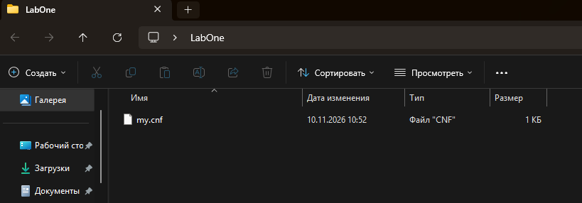
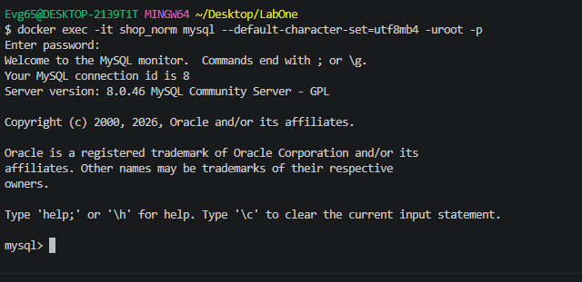

---

<a id="step2"></a>
## 🗄️ Шаг 2. Создание БД и «плохой» таблицы

Создана база данных `sales_norm`. В ней создана исходная «плохая» таблица `sales_unnormalized_2`, которая содержит избыточные данные (повторяющиеся имена покупателей, названия товаров и цены). В таблицу вставлено 7 тестовых строк для демонстрации.

📸 **Доказательство (Создание таблицы и вставка данных):**
*На скриншоте видно выполнение команд `CREATE TABLE` и `INSERT`. Выведено сообщение `Query OK, 7 rows affected`, а также результат `SELECT *`, показывающий все 7 строк.*
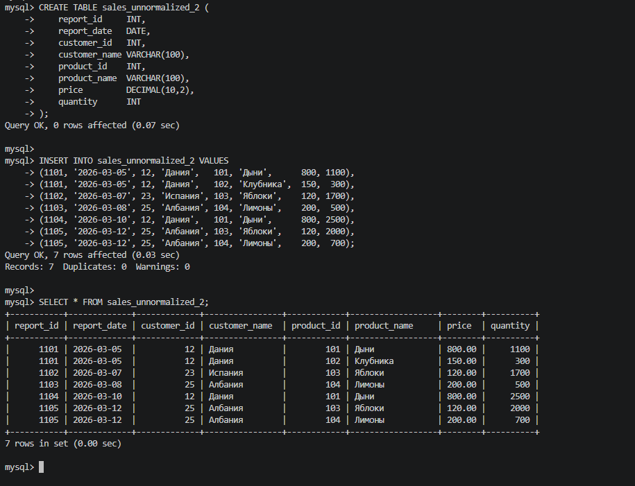

---

<a id="step3"></a>
## 💥 Шаг 3. Демонстрация аномалий

Мы показали три главных недостатка «плохой» таблицы.

### 3.1. Аномалия обновления
Мы изменили имя покупателя (Дания) только в одной строке (в отчете 1101). В результате у Дании в разных строках появились разные имена: «Дания (Нов)» (в отчете 1101) и «Дания» (в отчете 1104). Это показывает, что данные дублируются, и при обновлении легко допустить ошибку.

📸 **Доказательство (Аномалия обновления):**
*На скриншоте видно, что у покупателя с `customer_id = 12` в разных строках теперь разные имена.*
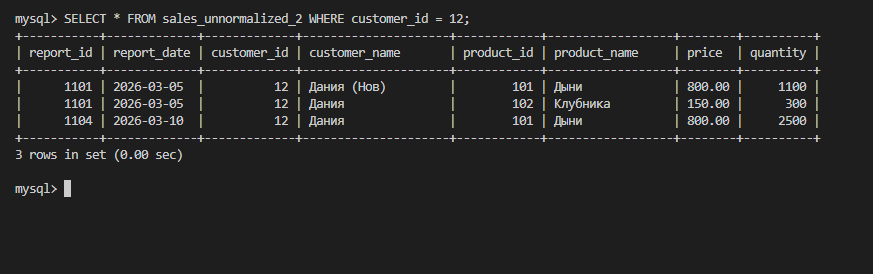

### 3.2. Аномалия удаления
Мы удалили отчет `1103` (который принадлежал Албании). В результате из базы пропала информация об этом отчете, хотя сам покупатель Албания всё ещё существует в другом отчете (1105). Это показывает, что при удалении заказа можно случайно потерять данные клиента.

📸 **Доказательство (Аномалия удаления):**
*На скриншоте видно выполнение `DELETE` и результат `SELECT` для Албании, где остались только строки из отчета 1105.*
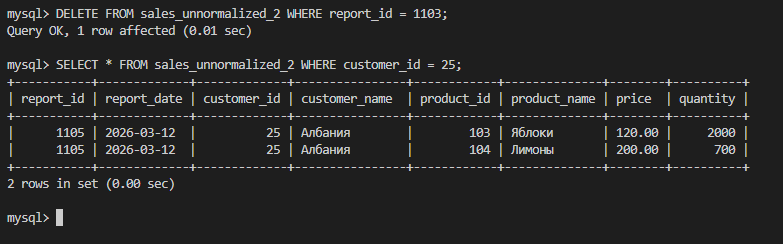

### 3.3. Аномалия вставки
Мы попытались добавить нового клиента без отчета. В результате появилась строка, где все поля, относящиеся к отчету (`report_id`, `product_id`, `price`, `quantity`), содержат `NULL`. Это показывает, что нельзя сохранить клиента, не создавая фиктивный отчет.

📸 **Доказательство (Аномалия вставки):**
*На скриншоте видно выполнение `INSERT` и результат `SELECT`, где у нового клиента все поля, кроме `customer_id` и `customer_name`, равны `NULL`.*
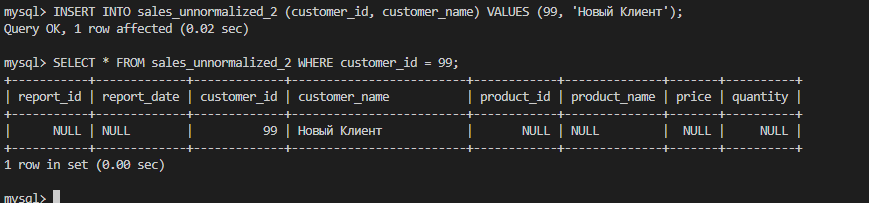

---

<a id="step4"></a>
## 💾 Шаг 4. Дамп «плохой» базы данных

Перед началом нормализации мы сделали резервную копию «плохой» базы с помощью утилиты `mysqldump`.

📸 **Доказательство (Дамп «плохой» базы):**
*На скриншоте виден вывод команды `cat dump_bad.sql`. В файле содержатся команды `DROP TABLE`, `CREATE TABLE` для `sales_unnormalized_2` и строка `INSERT INTO` с данными.*
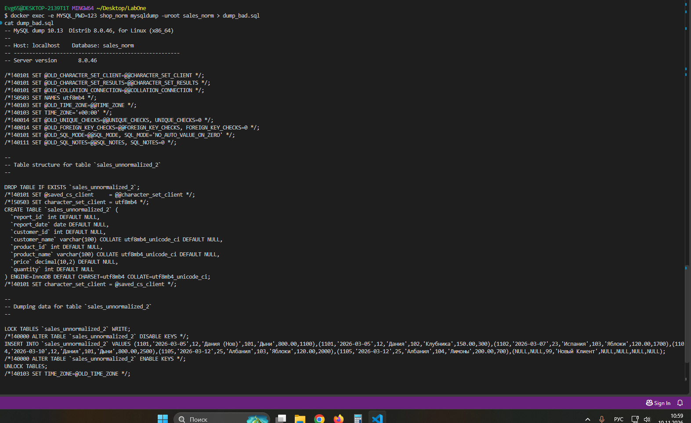

---

<a id="step5"></a>
## 🏗️ Шаг 5. Создание нормализованной схемы (3NF)

Мы создали 4 новые пустые таблицы для приведения базы к третьей нормальной форме:
1. `customers` — справочник покупателей.
2. `products` — справочник товаров.
3. `reports` — шапки отчетов (кто и когда).
4. `report_items` — позиции отчетов (что и сколько).

📸 **Доказательство (Создание таблиц 3NF):**
*На скриншоте виден результат команды `SHOW TABLES;`. В базе `sales_norm` теперь 5 таблиц: исходная и 4 новые нормализованные.*
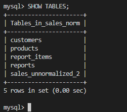

---

<a id="step6"></a>
## 🔄 Шаг 6. Перенос данных и проверка корректности

Мы перенесли данные из «плохой» таблицы в нормализованные с помощью `INSERT ... SELECT`. Благодаря защите внешних ключей, данные перенеслись без дублей и ошибок.

📸 **Доказательство (Перенос данных):**
*На скриншоте видно, что все три таблицы (`customers`, `reports`, `report_items`) заполнены данными. В `reports` 4 отчета, в `report_items` — 6 позиций.*
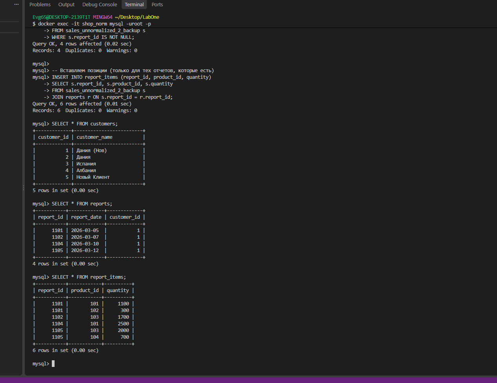

---

<a id="step7"></a>
## ✅ Шаг 7. Проверка сумм и тестовые запросы

Чтобы доказать, что данные не потерялись, мы сравнили общие суммы до и после нормализации. Они совпали.

📸 **Доказательство (Проверка сумм):**
*На скриншоте видно, что `total_old` (3509000.00) равна `total_new` (3509000.00).*
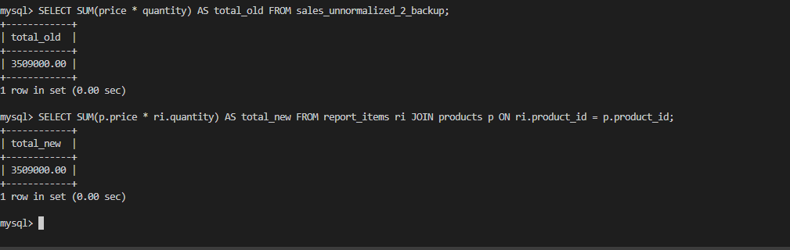

Также мы выполнили тестовый запрос и посчитали, сколько потратил конкретный покупатель (Дания). Результат совпал с ожидаемым.

📸 **Доказательство (Тестовый запрос):**
*На скриншоте виден результат запроса с `JOIN` — сумма `total_spent` для покупателя с `customer_id = 1`.*
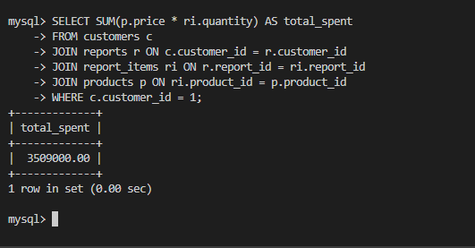

---

<a id="step8"></a>
## 🗑️ Шаг 8. Архивация «плохой» таблицы и финальный дамп

После проверки мы переименовали «плохую» таблицу в архив (безопасный вариант), чтобы она осталась в базе, но не мешала.

📸 **Доказательство (Архивация):**
*На скриншоте видно выполнение команды `RENAME TABLE` и результат `SHOW TABLES`, где таблица теперь называется `sales_unnormalized_2_backup`.*
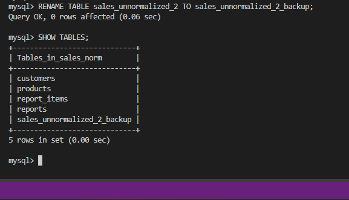

Затем мы сделали дамп нормализованной базы с помощью `mysqldump`.

📸 **Доказательство (Дамп нормализованной базы):**
*На скриншоте виден вывод команды `cat norm_dump.sql`. В файле содержатся новые таблицы и данные.*
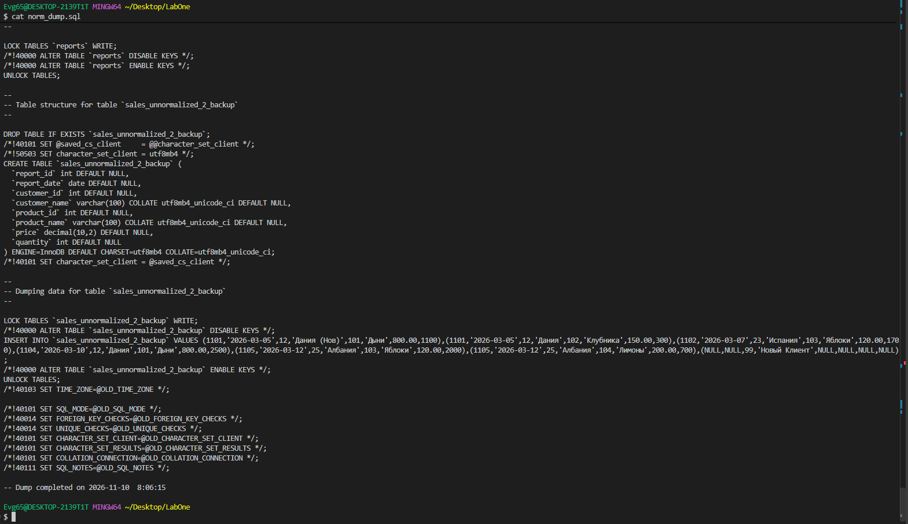

---

<a id="step9"></a>
## 📜 Шаг 9. Работа с логами (General Log)

Лог действий был включен, и все SQL-команды записались в файл `/var/lib/mysql/general.log`. 
Лог скопирован на хост и отфильтрован от служебного шума с помощью `grep`.

```bash
MSYS_NO_PATHCONV=1 docker cp shop_norm:/var/lib/mysql/general.log ./general.log
MSYS_NO_PATHCONV=1 docker exec shop_norm cat /var/lib/mysql/general.log | grep -E "Query..." | grep -v -E "INSERT INTO help_..." > my_actions.log
```

📸 **Доказательство (Отфильтрованный лог):**
*На скриншоте виден вывод команды `cat my_actions.log`. В файле остались только осмысленные SQL-команды (`SELECT`, `DESCRIBE`, `SHOW TABLES`).*
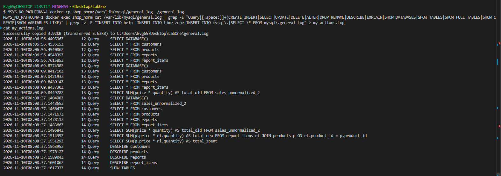

---

<a id="conclusion"></a>
## 📌 Вывод

В ходе работы мы убедились, что нормализация устраняет аномалии обновления, удаления и вставки. Каждый факт (имя покупателя, цена товара) теперь хранится в одном месте. Данные при переносе не потерялись (суммы совпали). Также мы научились настраивать и фильтровать лог действий пользователя.

---

## 📂 Прикрепленные файлы
* [Скачать дамп «плохой» базы (dump_bad.sql)](./dump_bad.sql)
* [Скачать дамп нормализованной базы (norm_dump.sql)](./norm_dump.sql)
* [Скачать отфильтрованный лог (my_actions.log)](./my_actions.log)
* [Скачать конфигурационный файл (my.cnf)](./my.cnf)
