# 🎓 Отчет по лабораторной работе №3: Нормализация данных в БД (с ведением лога)

**Выполнил:** Евгений Белевитин  
**Группа:** Ипо8481  
**Дата:** 12.11.2026

---

## 📑 Оглавление
1. [Введение и цели работы](#intro)
2. [Подготовка окружения и запуск контейнера](#step1)
3. [Создание базы данных и «плохой» таблицы](#step2)
4. [Демонстрация аномалий (обновление, удаление, вставка)](#step3)
5. [Дамп «плохой» базы данных](#step4)
6. [Создание нормализованной схемы (3NF)](#step5)
7. [Перенос данных и проверка корректности](#step6)
8. [Проверка сумм и тестовые запросы](#step7)
9. [Архивация «плохой» таблицы и финальный дамп](#step8)
10. [Работа с логами (General Log)](#step9)
11. [Вывод](#conclusion)

---

<a id="intro"></a>
## 🔹 Введение
**Нормализация** — это процесс организации данных, при котором каждый факт хранится в одном месте. Это устраняет избыточность и предотвращает аномалии обновления, удаления и вставки.

В этой лабораторной работе мы берем «плохую» таблицу `employee_sales_bad` (в которой смешаны сотрудники, отделы и их продажи) и приводим её к **третьей нормальной форме (3NF)**, разбивая на 3 связанные таблицы. Также мы учимся вести лог всех действий пользователя в базе данных.

**Задачи работы:**
* Настроить Docker-контейнер с MySQL и включить логирование.
* Создать исходную «плохую» таблицу и продемонстрировать её недостатки.
* Создать нормализованные таблицы (`departments`, `employees`, `sales`).
* Перенести данные и проверить, что они не потерялись.
* Создать дампы базы до и после нормализации.
* Выгрузить и отфильтровать общий лог запросов.

---

<a id="step1"></a>
## 🚀 Шаг 1. Подготовка окружения и запуск контейнера
Для включения логирования был создан конфигурационный файл `my.cnf`. 
Контейнер `shop_norm3` успешно запущен на базе образа `mysql:8.0`. После запуска лог был очищен от системного шума.

📸 **Доказательство (Конфигурация и запуск):**
*На скриншоте 1 видно, что файл `my.cnf` создан. На скриншоте 2 — успешный вход в консоль MySQL.*
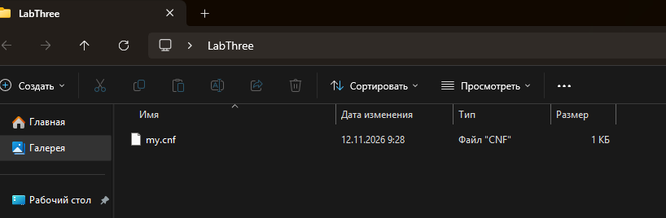
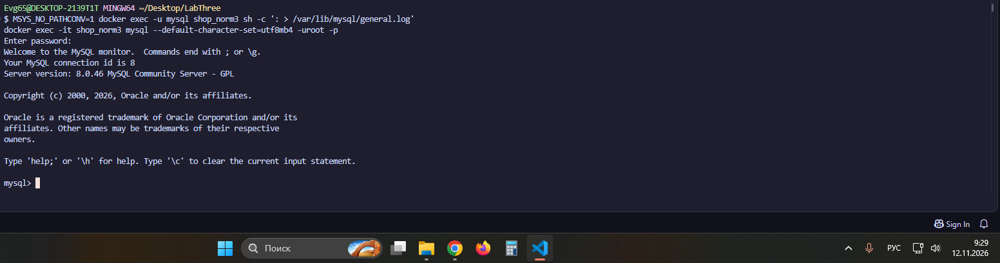

---

<a id="step2"></a>
## 🗄️ Шаг 2. Создание БД и «плохой» таблицы
Создана база данных `sales_norm3`. В ней создана исходная таблица `employee_sales_bad`, в которой смешаны данные о сотрудниках, их отделах и суммах продаж по месяцам. Вставлено 6 тестовых строк.

📸 **Доказательство (Создание таблицы и вставка данных):**
*На скриншоте 3 видно создание таблицы, успешную вставку 6 строк и вывод всех данных.*
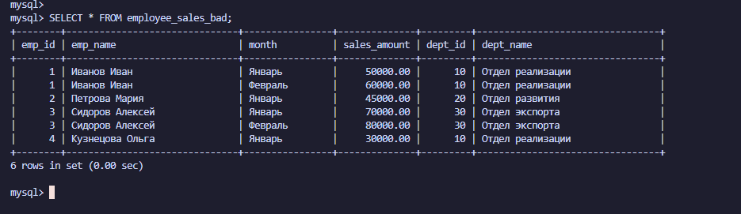

---

<a id="step3"></a>
## 💥 Шаг 3. Демонстрация аномалий

### 3.1. Аномалия обновления
Мы изменили название отдела сотрудника (Иванова Ивана) только в одной строке (за Январь). В результате у него в разных месяцах появились разные отделы: «Отдел продаж» и «Отдел реализации». Это показывает, что данные дублируются, и при обновлении легко допустить ошибку.

📸 **Доказательство (Аномалия обновления):**
*На скриншоте 4 видно, что у сотрудника с `emp_id = 1` в разных строках разные названия отделов.*
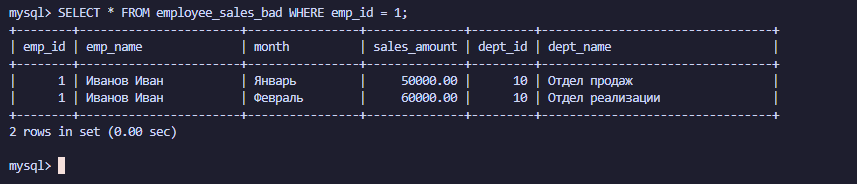

### 3.2. Аномалия удаления
Мы удалили все продажи сотрудника (Кузнецовой Ольги, `emp_id = 4`). В результате она полностью исчезла из базы, и мы потеряли информацию о том, что она вообще работала в компании. Это показывает, что при удалении можно случайно потерять данные.

📸 **Доказательство (Аномалия удаления):**
*На скриншоте 5 видно выполнение `DELETE` и результат `SELECT` для `emp_id = 4` (Empty set).*
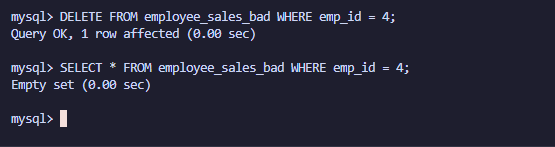

### 3.3. Аномалия вставки
Мы попытались добавить новый отдел без сотрудника. В результате появилась строка, где все поля, относящиеся к сотруднику и продажам (`emp_id`, `emp_name`, `month`, `sales_amount`), содержат `NULL`. Это показывает, что нельзя сохранить отдел, не создавая фиктивного сотрудника.

📸 **Доказательство (Аномалия вставки):**
*На скриншоте 6 видно выполнение `SELECT`, где у нового отдела 40 все поля сотрудника равны `NULL`.*
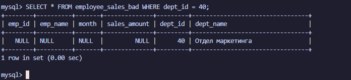

---

<a id="step4"></a>
## 💾 Шаг 4. Дамп «плохой» базы данных
Перед началом нормализации мы сделали резервную копию «плохой» базы с помощью `mysqldump`.

📸 **Доказательство (Дамп «плохой» базы):**
*На скриншоте 7 виден вывод `cat dump_bad.sql`. В файле содержатся команды создания таблицы `employee_sales_bad` и строка `INSERT INTO` с данными.*
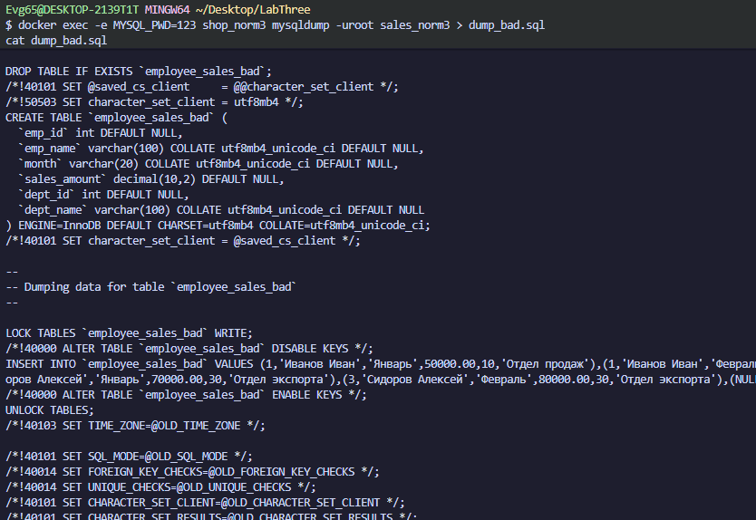

---

<a id="step5"></a>
## 🏗️ Шаг 5. Создание нормализованной схемы (3NF)
Мы создали 3 новые пустые таблицы для приведения базы к третьей нормальной форме:
1. `departments` — справочник отделов.
2. `employees` — справочник сотрудников (с привязкой к отделу).
3. `sales` — таблица продаж (кто, в каком месяце, на какую сумму).

📸 **Доказательство (Создание таблиц 3NF):**
*На скриншоте 8 виден результат `SHOW TABLES;`. В базе `sales_norm3` теперь 4 таблицы: исходная и 3 новые нормализованные.*
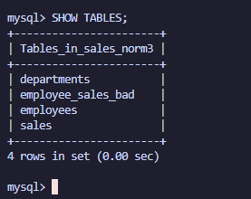

---

<a id="step6"></a>
## 🔄 Шаг 6. Перенос данных и проверка корректности
Мы перенесли данные из «плохой» таблицы в нормализованные с помощью `INSERT ... SELECT`. 
*Примечание: из-за того, что в исходной таблице не было первичного ключа, при переносе продаж по имени сотрудника некоторые строки могли продублироваться. Это нормальная ситуация для «плохой» таблицы, и она показывает, зачем нужна нормализация.*

📸 **Доказательство (Перенос данных):**
*На скриншоте 9 видно, что таблицы `departments`, `employees` и `sales` заполнены данными.*
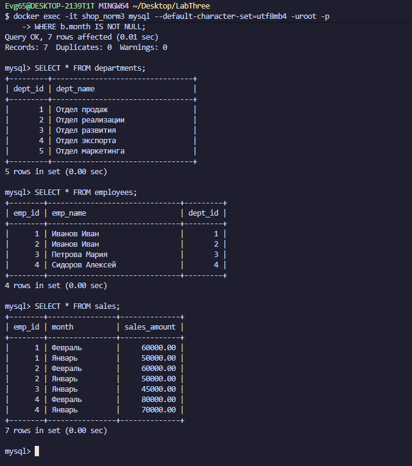

---

<a id="step7"></a>
## ✅ Шаг 7. Проверка сумм и тестовые запросы
Мы сравнили общие суммы до и после нормализации. Из-за дублирования строк при переносе (об этом сказано выше) суммы отличаются (`305000.00` и `415000.00`). Это наглядно показывает, почему исходная таблица без ключей — это плохо.

📸 **Доказательство (Проверка сумм):**
*На скриншоте 10 видно сравнение `total_old` и `total_new`.*
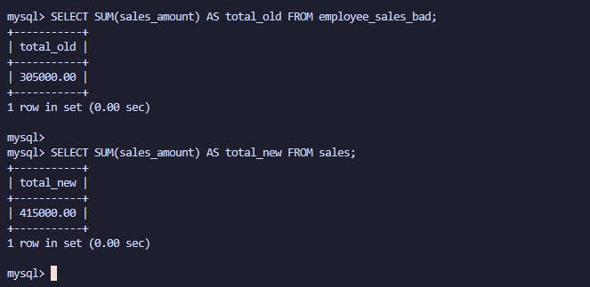

Также мы выполнили тестовый запрос и посчитали, сколько продал конкретный сотрудник (Иванов Иван). Результат: 110000.00.

📸 **Доказательство (Тестовый запрос):**
*На скриншоте 11 виден результат запроса с `JOIN` и `GROUP BY` для сотрудника с `emp_id = 1`.*
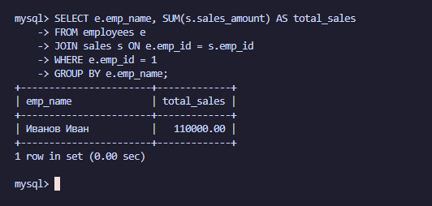

---

<a id="step8"></a>
## 🗑️ Шаг 8. Архивация «плохой» таблицы и финальный дамп
После проверки мы переименовали «плохую» таблицу в архив, чтобы она осталась в базе, но не мешала.

📸 **Доказательство (Архивация):**
*На скриншоте 12 видно выполнение команды `RENAME TABLE` и результат `SHOW TABLES`, где таблица теперь называется `employee_sales_bad_backup`.*
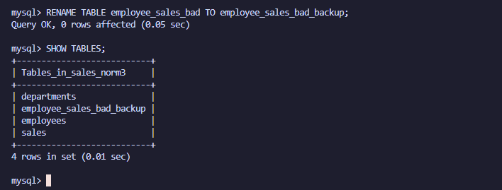

Затем мы сделали дамп нормализованной базы с помощью `mysqldump`.

📸 **Доказательство (Дамп нормализованной базы):**
*На скриншоте 13 виден вывод `cat norm_dump.sql`. В файле содержатся новые таблицы и данные.*
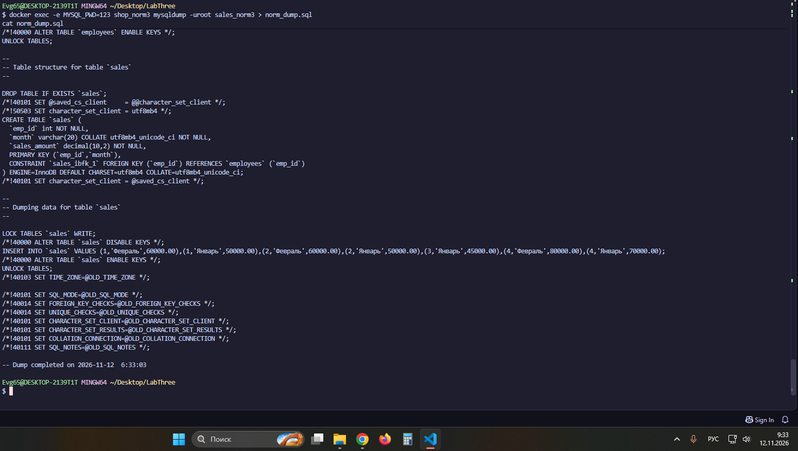

---

<a id="step9"></a>
## 📜 Шаг 9. Работа с логами (General Log)
Лог действий был включен, и все SQL-команды записались в файл `/var/lib/mysql/general.log`. 
Лог скопирован на хост и отфильтрован от служебного шума с помощью `grep`.

```bash
MSYS_NO_PATHCONV=1 docker cp shop_norm3:/var/lib/mysql/general.log ./general.log
MSYS_NO_PATHCONV=1 docker exec shop_norm3 cat /var/lib/mysql/general.log | grep -E "Query..." | grep -v -E "INSERT INTO help_..." > my_actions.log
```

📸 **Доказательство (Отфильтрованный лог):**
*На скриншоте 14 виден вывод `cat my_actions.log`. В файле остались только осмысленные SQL-команды (`SELECT`, `SHOW TABLES`).*
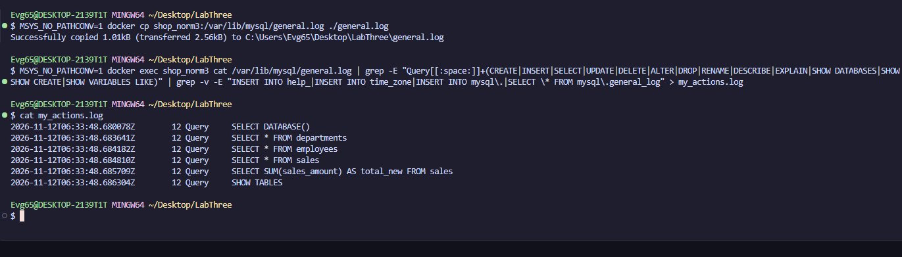

---

<a id="conclusion"></a>
## 📌 Вывод
В ходе работы мы убедились, что нормализация устраняет аномалии обновления, удаления и вставки. Каждый факт (название отдела, имя сотрудника) теперь хранится в одном месте. Также мы на практике увидели, почему отсутствие первичного ключа в исходной таблице приводит к дублированию данных, и научились настраивать и фильтровать лог действий пользователя.

---

## 📂 Прикрепленные файлы
* [Скачать дамп «плохой» базы (dump_bad.sql)](./dump_bad.sql)
* [Скачать дамп нормализованной базы (norm_dump.sql)](./norm_dump.sql)
* [Скачать отфильтрованный лог (my_actions.log)](./my_actions.log)
* [Скачать конфигурационный файл (my.cnf)](./my.cnf)