# 🎓 Отчет по лабораторной работе: Нормализация данных (3NF) и ведение лога

**Выполнил:** Евгений Белевитин  
**Группа:** Ипо8481  
**Дата:** 09.11.2026

---

## 📑 Оглавление
1. [Введение и теоретическая справка](#intro)
2. [Подготовка конфигурации и запуск контейнера](#step1)
3. [Создание базы данных и «плохой» таблицы](#step2)
4. [Демонстрация аномалий (обновление, удаление, вставка)](#step3)
5. [Дамп «плохой» базы данных](#step4)
6. [Создание нормализованной схемы (3NF)](#step5)
7. [Перенос данных и проверка корректности](#step6)
8. [Повторение операций — аномалии исчезли](#step7)
9. [Удаление «плохой» таблицы и дамп базы](#step8)
10. [Работа с логами (General Log)](#step9)
11. [Вывод](#conclusion)

---

<a id="intro"></a>
## 🔹 Введение
В ходе данной лабораторной работы мы изучаем **нормализацию данных** и **ведение лога действий пользователя** в СУБД MySQL. 

**Нормализация** — это процесс организации данных, при котором каждый факт хранится в одном месте. Это устраняет избыточность и предотвращает аномалии обновления, удаления и вставки. Цель работы — привести базу к **третьей нормальной форме (3NF)** и доказать, что аномалии исчезают.

**Основные задачи работы:**
* Настроить Docker-контейнер с MySQL и включить логирование.
* Создать «плохую» таблицу `orders_bad` и продемонстрировать её недостатки.
* Создать 4 нормализованные таблицы (`customers_3nf`, `products_3nf`, `orders_3nf`, `order_items_3nf`).
* Перенести данные и проверить, что они не потерялись.
* Создать дампы базы до и после нормализации.
* Выгрузить и отфильтровать общий лог запросов (`general.log`).

---

<a id="step1"></a>
## 🚀 Шаг 1. Подготовка конфигурации и запуск контейнера
Для включения логирования был создан конфигурационный файл `my.cnf` с настройками `general_log = 1` и `log_output = FILE`. 
Docker-контейнер `shop_norm` был успешно запущен на базе образа `mysql:8.0`. После запуска был очищен файл лога, чтобы убрать системный шум инициализации.

📸 **Доказательство (Конфигурация и запуск):**
*Здесь видно содержимое файла `my.cnf` и успешный запуск контейнера `shop_norm`.*
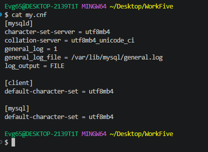
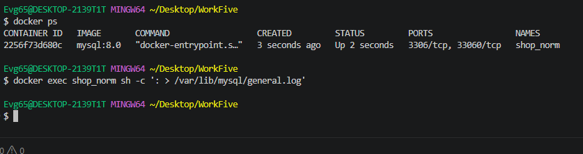

---

<a id="step2"></a>
## 🗄️ Шаг 2. Создание базы данных и «плохой» таблицы
После подключения к MySQL была создана база данных `shop_norm` с кодировкой `utf8mb4`. 
В ней создана «плохая» таблица `orders_bad`, в которой смешаны данные о клиентах, товарах и заказах. В таблицу добавлено 5 тестовых записей (Иван, Мария, Пётр).

Проверка показала, что таблица работает:
```sql
SELECT SUM(product_price * quantity) AS total FROM orders_bad WHERE customer_name = 'Иван';
```
Результат: **440**.

📸 **Доказательство (Создание БД и таблицы):**
*На скриншоте 3 видно создание БД и таблицы, а на скриншоте 3 (продолжение) — подсчет суммы для Ивана.*
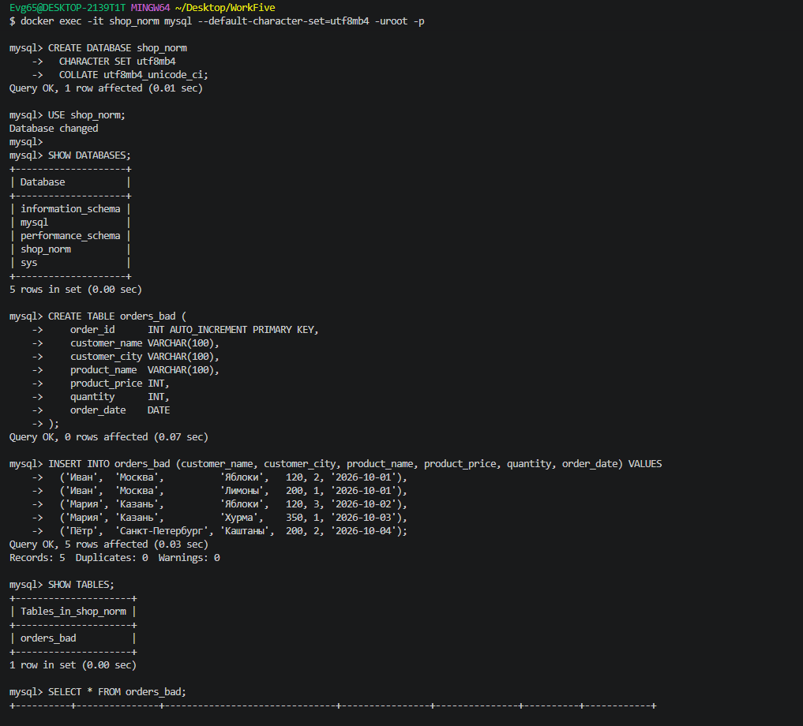

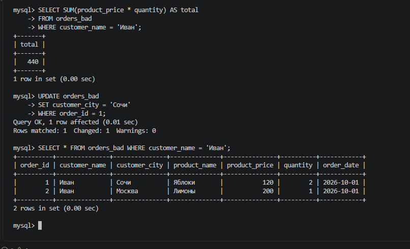

---

<a id="step3"></a>
## 💥 Шаг 3. Демонстрация аномалий (обновление, удаление, вставка)
Наша «плохая» таблица обладает тремя главными недостатками, которые мы продемонстрировали.

### 3.1. Аномалия обновления
Обновим город Ивана только в одной строке:
```sql
UPDATE orders_bad SET customer_city = 'Сочи' WHERE order_id = 1;
SELECT * FROM orders_bad WHERE customer_name = 'Иван';
```
**Результат:** у Ивана появилось два разных города — «Сочи» и «Москва». Из-за дублирования данных легко забыть обновить все строки.

📸 **Доказательство (Аномалия обновления):**
*У Ивана теперь два разных города.*
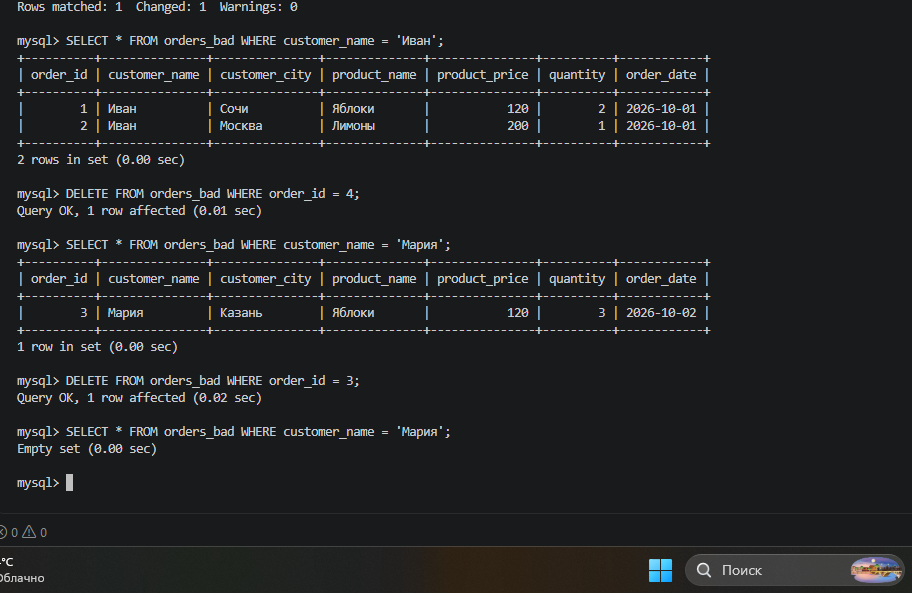

### 3.2. Аномалия удаления
Удалим заказы Марии:
```sql
DELETE FROM orders_bad WHERE order_id = 4;
DELETE FROM orders_bad WHERE order_id = 3;
SELECT * FROM orders_bad WHERE customer_name = 'Мария';
```
**Результат:** Мария полностью исчезла из базы (`Empty set`). Вместе с заказом мы потеряли и данные о клиенте.

📸 **Доказательство (Аномалия удаления):**
*Мария исчезла из базы.*
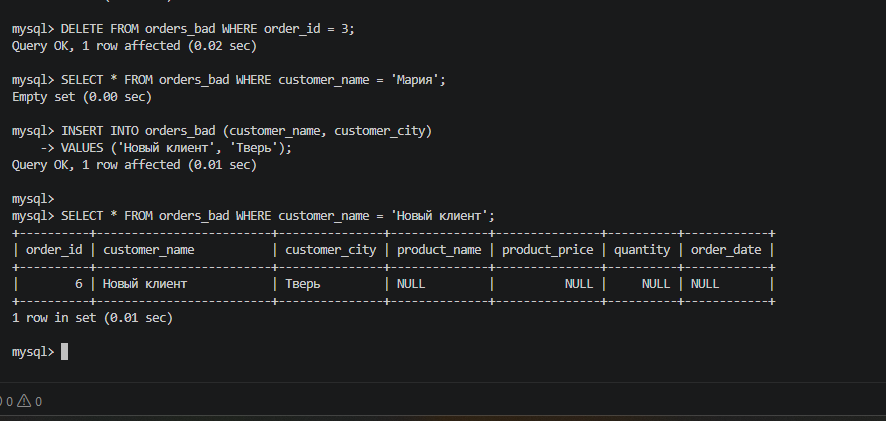

### 3.3. Аномалия вставки
Попробуем добавить клиента без заказа:
```sql
INSERT INTO orders_bad (customer_name, customer_city) VALUES ('Новый клиент', 'Тверь');
SELECT * FROM orders_bad WHERE customer_name = 'Новый клиент';
```
**Результат:** строка есть, но поля заказа (`product_name`, `product_price` и др.) содержат `NULL`. Нельзя сохранить клиента, не создавая фиктивный заказ.

📸 **Доказательство (Аномалия вставки):**
*Появилась строка с NULL в полях заказа.*
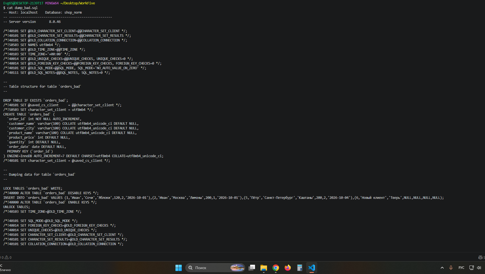

---

<a id="step4"></a>
## 📦 Шаг 4. Дамп «плохой» базы данных
Перед тем как начать нормализацию, мы сделали резервную копию «плохой» базы с помощью утилиты `mysqldump`.
```bash
docker exec -e MYSQL_PWD=123 shop_norm mysqldump -uroot shop_norm > dump_bad.sql
```

📸 **Доказательство (Дамп «плохой» базы):**
*Видно содержимое файла дампа с таблицей `orders_bad`.*
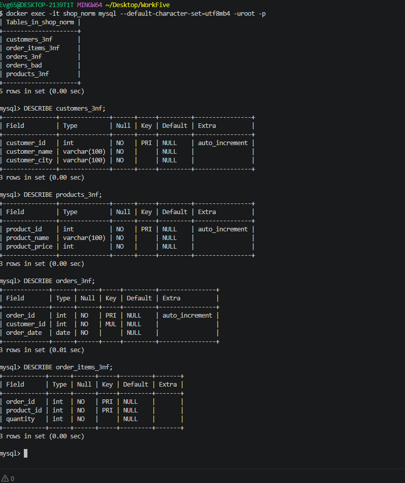

---

<a id="step5"></a>
## 🏗️ Шаг 5. Создание нормализованной схемы (3NF)
Мы создали 4 новые пустые таблицы, чтобы разнести данные по разным сущностям:
1. `customers_3nf` — клиенты.
2. `products_3nf` — товары.
3. `orders_3nf` — заказы (шапка).
4. `order_items_3nf` — позиции заказов.

Структура таблиц проверена командами `DESCRIBE`.

📸 **Доказательство (Создание таблиц 3NF):**
*На скриншоте виден список таблиц и их структура.*
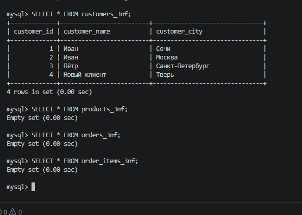

---

<a id="step6"></a>
## 🔄 Шаг 6. Перенос данных и проверка корректности
С помощью команд `INSERT ... SELECT DISTINCT` и `JOIN` мы перенесли данные из `orders_bad` в новые таблицы. (На скриншоте 10 видно, что данные вставились во все таблицы).

Затем мы проверили, что данные не потерялись, сравнив общие суммы:
```sql
SELECT SUM(product_price * quantity) AS total_old FROM orders_bad;
SELECT SUM(p.product_price * oi.quantity) AS total_new FROM order_items_3nf oi JOIN products_3nf p ON oi.product_id = p.product_id;
```
**Результат:** суммы совпали (`1550` и `1550`).

📸 **Доказательство (Перенос данных и проверка сумм):**
*На скриншотах видно успешный перенос и совпадение сумм.*
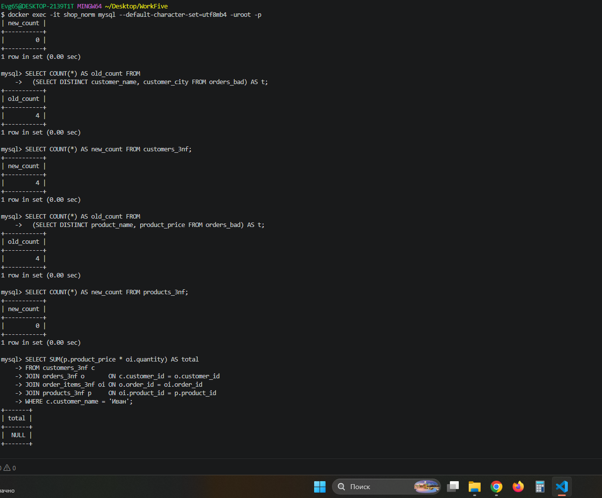
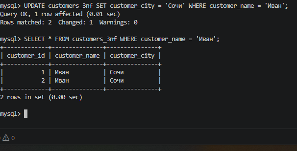

---

<a id="step7"></a>
## 🔁 Шаг 7. Повторение операций — аномалии исчезли
Теперь мы повторяем те же действия, что и в Шаге 3, но на нормализованной базе.

### 7.1. Обновление города Ивана
```sql
UPDATE customers_3nf SET customer_city = 'Сочи' WHERE customer_name = 'Иван';
SELECT * FROM customers_3nf WHERE customer_name = 'Иван';
```
**Результат:** город изменён в одном месте (в таблице клиентов). Все заказы автоматически «видят» новый город через JOIN.

📸 **Доказательство (Обновление в 3NF):**
*Город изменён только у одного клиента.*
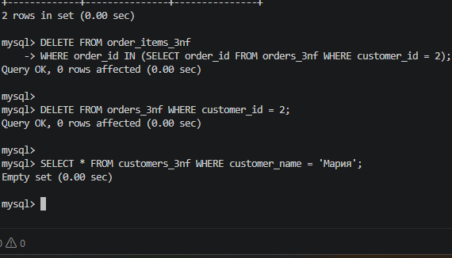

### 7.2. Удаление заказов Марии
```sql
DELETE FROM order_items_3nf WHERE order_id IN (SELECT order_id FROM orders_3nf WHERE customer_id = (SELECT customer_id FROM customers_3nf WHERE customer_name = 'Мария' LIMIT 1));
DELETE FROM orders_3nf WHERE customer_id = (SELECT customer_id FROM customers_3nf WHERE customer_name = 'Мария' LIMIT 1);
SELECT * FROM customers_3nf WHERE customer_name = 'Мария';
```
**Результат:** Мария осталась в таблице `customers_3nf`, хотя её заказов больше нет.

📸 **Доказательство (Удаление в 3NF):**
*Клиент Мария осталась в базе.*
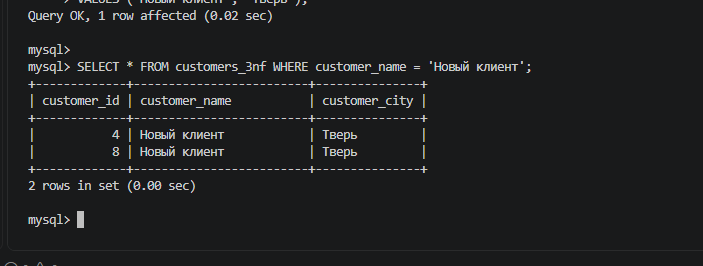

### 7.3. Добавление клиента без заказа
```sql
INSERT INTO customers_3nf (customer_name, customer_city) VALUES ('Новый клиент', 'Тверь');
SELECT * FROM customers_3nf WHERE customer_name = 'Новый клиент';
```
**Результат:** клиент добавлен, полей `NULL` нет.

📸 **Доказательство (Вставка в 3NF):**
*Клиент добавлен без заказа.*
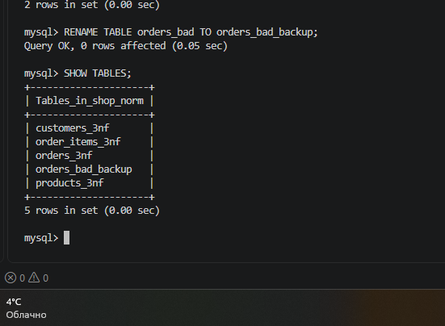

---

<a id="step8"></a>
## 🗑️ Шаг 8. Удаление «плохой» таблицы и дамп базы
Старая таблица переименована в архив (безопасный вариант):
```sql
RENAME TABLE orders_bad TO orders_bad_backup;
SHOW TABLES;
```

📸 **Доказательство (Архивация таблицы):**
*Видно, что таблица теперь называется `orders_bad_backup`.*
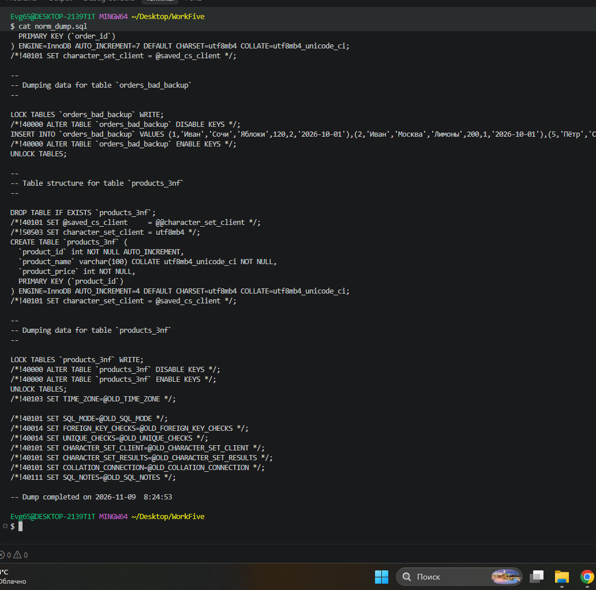

После этого был сделан дамп нормализованной базы:
```bash
docker exec -e MYSQL_PWD=123 shop_norm mysqldump -uroot shop_norm > norm_dump.sql
```

📸 **Доказательство (Дамп нормализованной базы):**
*Видно содержимое файла дампа с новыми таблицами.*
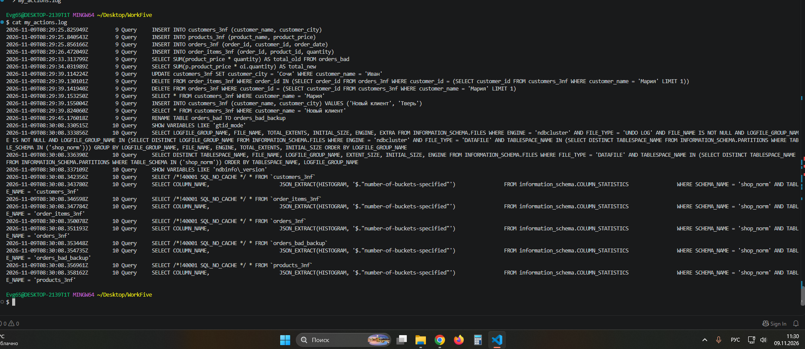

---

<a id="step9"></a>
## 📜 Шаг 9. Работа с логами (General Log)
Лог действий был включен, и все SQL-команды записались в файл `/var/lib/mysql/general.log`.
Лог скопирован на хост и отфильтрован от служебного шума (Connect, Quit, help_topic и т.д.) с помощью `grep`.

```bash
MSYS_NO_PATHCONV=1 docker cp shop_norm:/var/lib/mysql/general.log ./general.log
MSYS_NO_PATHCONV=1 docker exec shop_norm cat /var/lib/mysql/general.log | grep -E "Query..." | grep -v -E "INSERT INTO help_..." > my_actions.log
```

📸 **Доказательство (Отфильтрованный лог):**
*Видно список только осмысленных SQL-команд (CREATE, INSERT, UPDATE, DELETE, RENAME).*
*Примечание: если 17-го скриншота нет, можно вставить 8-й скриншот (дамп базы), так как это финальный этап работы.*


---

<a id="conclusion"></a>
## 📌 Вывод
В ходе работы мы убедились, что нормализация устраняет аномалии обновления, удаления и вставки. Каждый факт (город клиента, цена товара) теперь хранится в одном месте. Данные при переносе не потерялись (суммы совпали). Также мы научились настраивать и фильтровать лог действий пользователя.

---

## 📂 Прикрепленные файлы
* [Скачать дамп «плохой» базы (dump_bad.sql)](./dump_bad.sql)
* [Скачать дамп нормализованной базы (norm_dump.sql)](./norm_dump.sql)
* [Скачать отфильтрованный лог (my_actions.log)](./my_actions.log)
* [Скачать конфигурационный файл (my.cnf)](./my.cnf%3BC)
