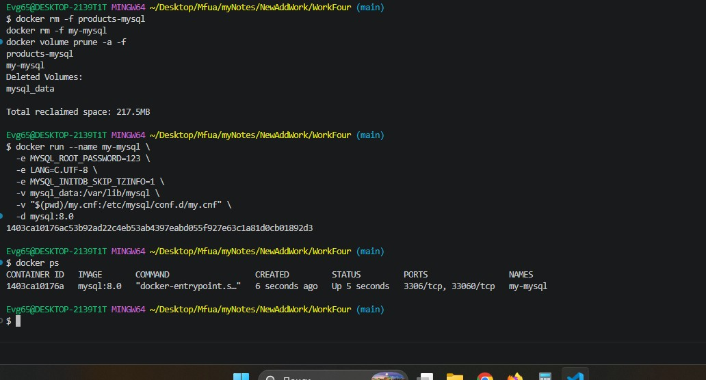
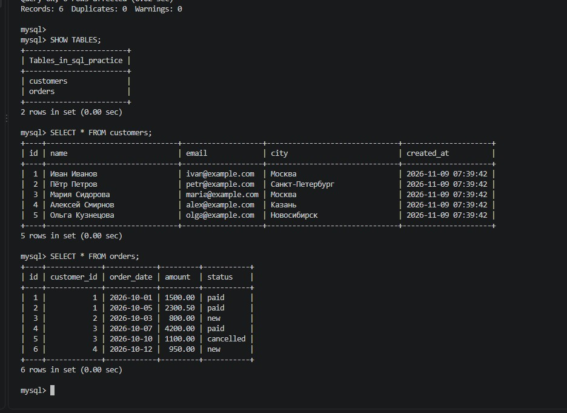
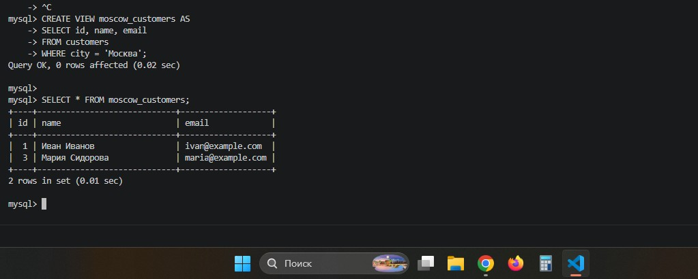
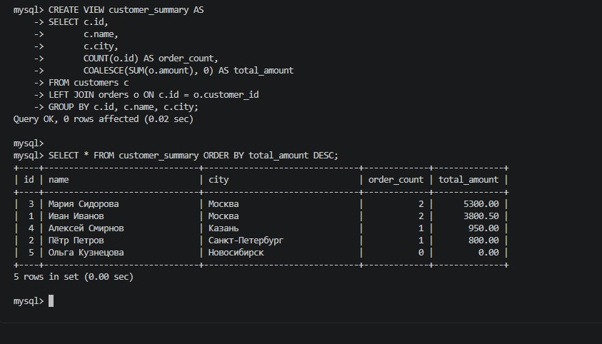
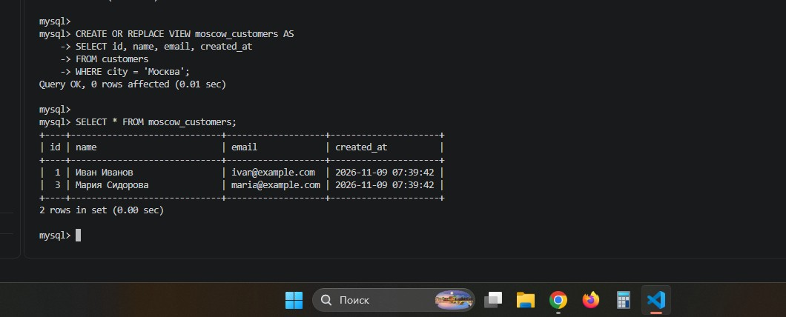
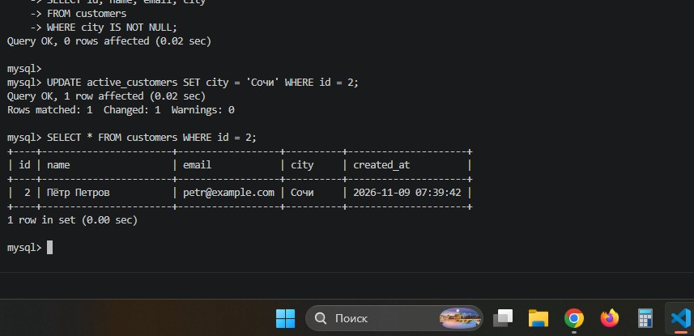
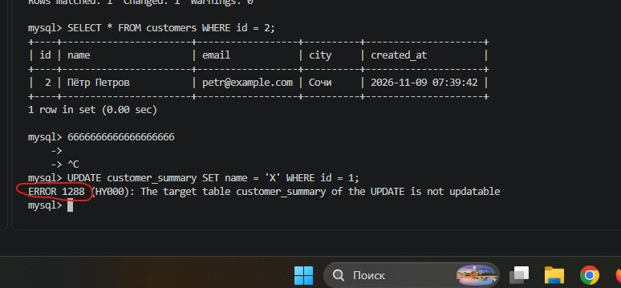
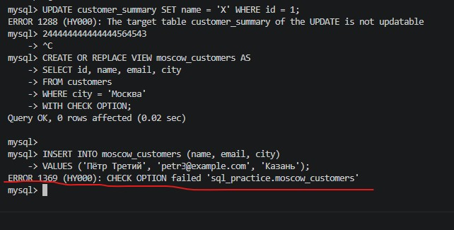
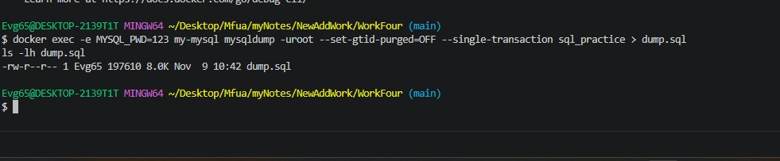
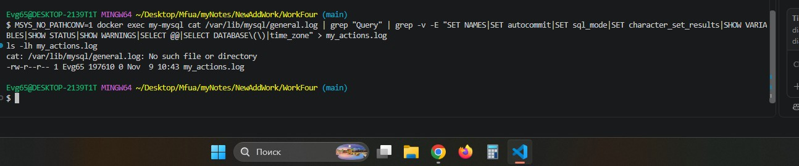

# 🎓 Отчет по лабораторной работе №4: Представления (VIEW) в MySQL

**Выполнил:** Евгений Белевитин  
**Группа:** Ипо8481  
**Дата:** 09.11.2026

---

## 📑 Оглавление
1. [Введение и теоретическая справка](#intro)
2. [Запуск контейнера и подготовка](#step1)
3. [Создание базы данных и таблиц](#step2)
4. [Создание простейшего представления](#step3)
5. [Представление с JOIN и агрегацией](#step4)
6. [Просмотр и изменение существующих VIEW](#step5)
7. [Обновляемые представления (UPDATE)](#step6)
8. [Ограничения обновляемых VIEW (Ошибка 1288)](#step7)
9. [WITH CHECK OPTION (Ошибка 1369)](#step8)
10. [Создание дампа базы данных](#step9)
11. [Работа с логами (General Log)](#step10)
12. [Вывод](#conclusion)

---

<a id="intro"></a>
## 🔹 Введение
В ходе данной лабораторной работы мы изучаем **представления (VIEW)** в СУБД MySQL. 

**Представление** — это сохранённый SQL-запрос, который выглядит как таблица. Вы обращаетесь к нему по имени, как к обычной таблице, но данных он не хранит — при каждом обращении запрос выполняется заново. Это мощный инструмент абстракции, контроля доступа и переиспользования логики.

**Основные задачи работы:**
*   Настроить Docker-контейнер с MySQL и включить логирование.
*   Создать учебную базу данных `sql_practice` с таблицами `customers` и `orders`.
*   Освоить создание простых и сложных VIEW (с JOIN и агрегацией).
*   Изучить ограничения представлений (необновляемые VIEW, WITH CHECK OPTION).
*   Создать резервную копию (дамп) базы данных и выгрузить лог.

---

<a id="step1"></a>
## 🚀 Шаг 1. Запуск контейнера и подготовка
Для корректного отображения кириллицы и включения логирования был создан конфигурационный файл `my.cnf` со следующими настройками:
*   `character-set-server = utf8mb4` — кодировка для хранения данных.
*   `general_log = 1` — включение общего лога.
*   `general_log_file = /var/lib/mysql/general.log` — путь к файлу лога.
*   `log_output = FILE` — запись логов в файл.

Затем был запущен Docker-контейнер `my-mysql` на базе стабильного образа `mysql:8.0` с монтированием тома `mysql_data` для сохранения данных между перезапусками. Проверка через `docker ps` подтвердила, что контейнер успешно работает в фоновом режиме (статус `Up`).

📸 **Доказательство (Запуск контейнера):**


---

<a id="step2"></a>
## 🗄️ Шаг 2. Создание базы данных и таблиц
После подключения к контейнеру через `docker exec` была создана учебная база данных `sql_practice` с кодировкой `utf8mb4`. 

В базе были созданы две связанные таблицы:
*   **`customers`** — для хранения данных о клиентах (id, имя, email, город, дата регистрации).
*   **`orders`** — для хранения заказов (id, id клиента, дата, сумма, статус).

Между таблицами настроена связь через внешний ключ (`FOREIGN KEY (customer_id) REFERENCES customers(id)`), что обеспечивает целостность данных (нельзя создать заказ для несуществующего клиента).

В таблицы были вставлены тестовые данные: 5 клиентов и 6 заказов. Проверка через `SHOW TABLES` и `SELECT *` подтвердила, что таблицы созданы, а данные успешно записались (русские буквы отображаются корректно).

📸 **Доказательство (Создание таблиц и вставка данных):**


---

<a id="step3"></a>
## 🔹 Шаг 3. Создание простейшего представления
Первым шагом было создание простого VIEW, которое фильтрует клиентов из Москвы. Это упрощает повторяющиеся запросы.

Без VIEW пришлось бы каждый раз писать `SELECT * FROM customers WHERE city = 'Москва';`.
С VIEW мы создаем сохраненный запрос:
```sql
CREATE VIEW moscow_customers AS
SELECT id, name, email
FROM customers
WHERE city = 'Москва';
```
Теперь к этому представлению можно обращаться как к обычной таблице:
```sql
SELECT * FROM moscow_customers;
```
**Результат:** выведены только 2 клиента (Иван Иванов и Мария Сидорова). Важно понимать, что данные не скопированы — при каждом обращении MySQL заново выполняет запрос.

📸 **Доказательство (Создание простого VIEW):**


---

<a id="step4"></a>
## 🔗 Шаг 4. Представление с JOIN и агрегацией
Следующим шагом было создание более сложного VIEW, которое объединяет две таблицы и выполняет агрегацию. Это позволяет получить готовую сводку по клиентам.

```sql
CREATE VIEW customer_summary AS
SELECT c.id,
       c.name,
       c.city,
       COUNT(o.id) AS order_count,
       COALESCE(SUM(o.amount), 0) AS total_amount
FROM customers c
LEFT JOIN orders o ON c.id = o.customer_id
GROUP BY c.id, c.name, c.city;
```
В этом запросе используется `LEFT JOIN` (чтобы показать всех клиентов, даже без заказов) и агрегатные функции `COUNT` и `SUM`. Функция `COALESCE` заменяет `NULL` на `0` для клиентов без заказов.

Проверка через `SELECT * FROM customer_summary ORDER BY total_amount DESC;` показала, что сводка построена корректно (Мария Сидорова на первом месте с суммой 5300.00).

📸 **Доказательство (Создание VIEW с агрегацией):**


---

<a id="step5"></a>
## 🔍 Шаг 5. Просмотр и изменение существующих VIEW
Для просмотра списка всех представлений используется команда:
```sql
SHOW FULL TABLES WHERE Table_type = 'VIEW';
```
Для просмотра определения (SQL-запроса, лежащего в основе) — `SHOW CREATE VIEW customer_summary\G`.

Для изменения существующего VIEW используется команда `CREATE OR REPLACE VIEW` (она перезаписывает старое определение новым, не удаляя VIEW). Мы добавили в `moscow_customers` столбец `created_at`.

📸 **Доказательство (Просмотр и изменение VIEW):**


---

<a id="step6"></a>
## ✏️ Шаг 6. Обновляемые представления (UPDATE)
Представление является обновляемым, если MySQL может однозначно сопоставить строку VIEW со строкой базовой таблицы. 

Мы создали `active_customers`, которое выбирает клиентов с непустым городом. Затем выполнили `UPDATE` через это VIEW:
```sql
UPDATE active_customers SET city = 'Сочи' WHERE id = 2;
```
Проверка через `SELECT * FROM customers WHERE id = 2;` показала, что данные в базовой таблице изменились (город Петра стал «Сочи»). Это доказывает, что VIEW — это «живой» интерфейс к таблице.

📸 **Доказательство (Обновление через VIEW):**


---

<a id="step7"></a>
## ❌ Шаг 7. Ограничения обновляемых VIEW (Ошибка 1288)
Не все VIEW можно обновлять. Если VIEW содержит агрегатные функции, `GROUP BY`, `DISTINCT` или `UNION`, MySQL не может однозначно определить, какую строку базовой таблицы менять.

Мы попытались выполнить `UPDATE customer_summary SET name = 'X' WHERE id = 1;`.
MySQL выдал ошибку: **`ERROR 1288 (HY000): The target table customer_summary of the UPDATE is not updatable`**.

Это правильное поведение, так как `customer_summary` содержит `COUNT` и `SUM` (агрегаты), которые нельзя «разложить обратно» на строки таблицы.

📸 **Доказательство (Ошибка 1288):**


---

<a id="step8"></a>
## 🛡️ Шаг 8. WITH CHECK OPTION (Ошибка 1369)
По умолчанию через VIEW можно вставить строку, которая не попадёт в его фильтр (и останется «невидимой»). Чтобы запретить такие вставки, используется `WITH CHECK OPTION`.

Мы создали VIEW `moscow_customers` с `WITH CHECK OPTION` и попытались вставить клиента из Казани. 
MySQL выдал ошибку: **`ERROR 1369 (HY000): CHECK OPTION failed 'sql_practice.moscow_customers'`**.

Это защита от «невидимых» вставок, которые нарушают условие `WHERE` внутри VIEW.

📸 **Доказательство (Ошибка 1369):**


---

<a id="step9"></a>
## 📦 Шаг 9. Создание дампа базы данных
Для сохранения резервной копии базы данных была использована утилита `mysqldump`. 
Мы выполнили команду с флагами `--set-gtid-purged=OFF` (чтобы избежать ошибок GTID при восстановлении) и `--single-transaction` (для согласованности данных).

В результате в папке проекта появился файл `dump.sql` размером 8.0 КБ. Важно: `mysqldump` по умолчанию включает в дамп не только таблицы, но и определения всех VIEW.

📸 **Доказательство (Создание дампа):**


---

<a id="step10"></a>
## 📝 Шаг 10. Работа с логами (General Log)
В `my.cnf` была включена настройка `general_log = 1` и `log_output = FILE`. Это означает, что все SQL-команды записываются в файл `/var/lib/mysql/general.log` внутри контейнера.

Мы проверили, что файл существует, и выгрузили его на хост-машину. Для удобства чтения лог был отфильтрован с помощью `grep` (отсечены служебные записи `SET NAMES`, `SHOW VARIABLES` и т.д.). Результат сохранен в файл `my_actions.log`, который содержит только осмысленные действия пользователя.

📸 **Доказательство (Работа с логами):**


---

<a id="conclusion"></a>
## 📌 Вывод
В ходе выполнения лабораторной работы были успешно изучены представления (VIEW) в MySQL. Мы научились создавать простые и сложные VIEW (с JOIN и агрегацией), изменять их и удалять. 

Отдельно были изучены ограничения: невозможность обновления VIEW с агрегатами (ошибка 1288) и защита от «невидимых» вставок с помощью `WITH CHECK OPTION` (ошибка 1369). 

Также были отработаны навыки создания резервных копий (дампов) базы данных и настройки логирования SQL-запросов в файл. Все поставленные задачи выполнены в полном объеме.

---

## 📂 Прикрепленные файлы
*   [Скачать дамп базы данных (dump.sql)](./dump.sql)
*   [Скачать отфильтрованный лог (my_actions.log)](./my_actions.log)
*   [Скачать конфигурационный файл (my.cnf)](./my.cnf)