# 🎓 Отчет по лабораторной работе №1: Интерактивная работа с MySQL в изолированном окружении Docker

**Выполнил:** Евгений Белевитин  
**Группа:** Ипо8481  
**Дата:** 09.11.2026

---

## 📑 Содержание
1. [Введение и задачи](#intro)
2. [Запуск контейнера MySQL](#step1)
3. [Подключение к MySQL](#step2)
4. [Создание базы данных и таблицы](#step3)
5. [Операции CRUD (UPDATE, DELETE)](#step4)
6. [Создание дампа базы данных](#step5)
7. [Просмотр и выборка данных](#step6)
8. [Вставка новых данных (INSERT)](#step7)
9. [Обновление данных (UPDATE)](#step8)
10. [Удаление данных (DELETE)](#step9)
11. [Удаление таблиц и базы данных](#step10)
12. [Управление Docker-контейнером](#step11)
13. [Работа с логами и проверка файлов](#step12)
14. [Вывод](#conclusion)

---

## 🔹 Введение
В ходе данной лабораторной работы необходимо было освоить базовые принципы работы с реляционной СУБД MySQL в изолированном окружении Docker. 
**Основные задачи:**
*   Запустить «чистый» контейнер с MySQL.
*   Подключиться к нему и создать базу данных.
*   Выполнить основные операции манипулирования данными (CRUD).
*   Сделать резервную копию (дамп) базы данных.
*   Настроить и выгрузить лог базы данных.

---

## 🚀 Шаг 1. Запуск контейнера MySQL
Для начала работы был создан конфигурационный файл `my.cnf`, в котором заданы параметры кодировки `utf8mb4` (для корректного отображения кириллицы) и включено логирование (`general_log = 1`).

С помощью команды `docker run` был запущен контейнер `my-mysql` на базе официального образа **LTS-версии** `mysql:8.0`. Использование именно этой версии гарантирует стабильную работу, так как тег `latest` может содержать экспериментальные функции. Данные базы сохраняются в Docker-томе `mysql_data`, что предотвращает их потерю при перезапуске контейнера.

📸 **Доказательство (Запуск контейнера):**
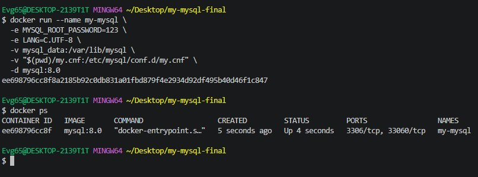

---

## 🔌 Шаг 2. Подключение к MySQL
После успешного запуска контейнера было выполнено подключение к интерактивной оболочке MySQL с помощью утилиты `docker exec`. 
Флаги `-it` обеспечили интерактивный режим, а параметр `--default-character-set=utf8mb4` — правильную кодировку при работе в терминале. После ввода пароля появилось приглашение `mysql>`, что свидетельствует об успешном подключении.

📸 **Доказательство (Подключение):**
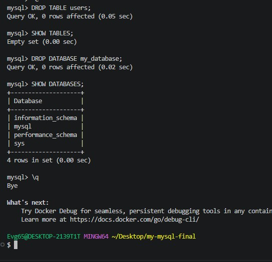

---

## 🗄️ Шаг 3. Создание базы данных и таблицы
Внутри оболочки MySQL была создана база данных `my_database` с кодировкой `utf8mb4`. 
Далее была создана таблица `users` со следующими полями:
*   `id` — уникальный идентификатор (автоинкремент, первичный ключ).
*   `name` — имя пользователя.
*   `email` — электронная почта (уникальное значение).

В таблицу были вставлены тестовые данные: три пользователя (Иван, Пётр, Мария). Проверка через `SELECT *` подтвердила успешное создание структуры и вставку данных.

📸 **Доказательство (Создание БД и таблицы):**
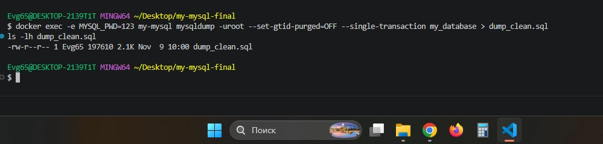

---

## ✏️ Шаг 4. Операции CRUD (UPDATE, DELETE)
Были отработаны базовые операции изменения данных:
*   **UPDATE:** изменено имя пользователя с `id = 1`.
*   **DELETE:** удален пользователь с `id = 2`.

После выполнения операций была произведена проверка через `SELECT *`, которая показала, что данные в таблице изменились в соответствии с запросами (имя обновилось, а удаленная запись исчезла).

📸 **Доказательство (UPDATE и DELETE):**
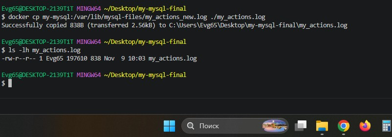

---

## 📦 Шаг 5. Создание дампа базы данных
Для создания резервной копии базы данных была использована утилита `mysqldump`. 
Были применены следующие флаги:
*   `--set-gtid-purged=OFF` — отключает запись GTID (глобальных идентификаторов транзакций), которые могут вызвать ошибки при восстановлении базы на другом сервере.
*   `--single-transaction` — гарантирует согласованность данных во время создания дампа.

В результате в папке проекта появился файл `dump_clean.sql`, содержащий все SQL-команды для воссоздания базы.

📸 **Доказательство (Создание дампа):**
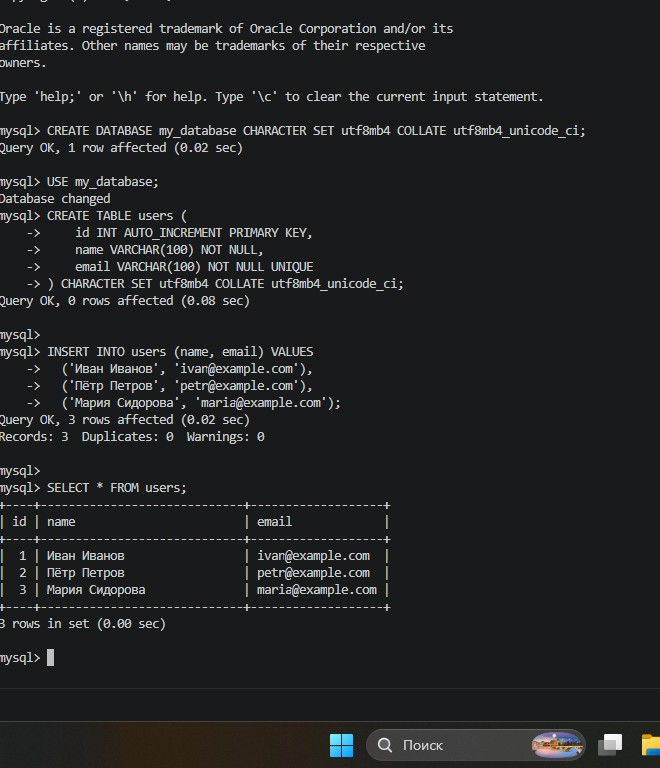

---

## 🔍 Шаг 6. Просмотр и выборка данных
Отработаны различные способы выборки данных из таблицы:
*   Выбор всех столбцов (`SELECT *`).
*   Выбор конкретных полей (`SELECT name, email`).
*   Использование параметра `\G` для вертикального вывода строки (удобно для чтения длинных записей).

📸 **Доказательство (Выборка данных):**
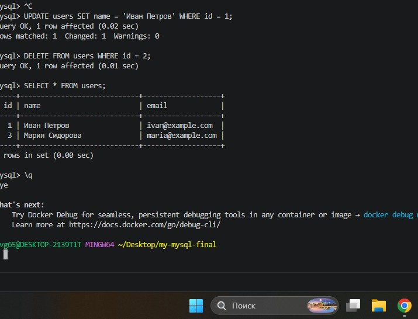

---

## ✍️ Шаг 7. Вставка новых данных (INSERT)
В таблицу `users` были добавлены две новые записи (Павел Иванов и Марк Аврелий). Проверка показала, что данные успешно добавились, и в таблице теперь 6 записей (с учетом ранее созданных).

📸 **Доказательство (Вставка):**
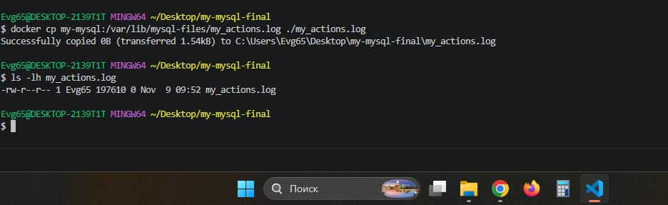

---

## 🔄 Шаг 8. Обновление данных (UPDATE)
Была выполнена операция обновления данных. В частности, было изменено имя пользователя по его `id`. 
Важно: всегда указывать условие `WHERE`, иначе обновление затронет все строки таблицы.

📸 **Доказательство (Обновление):**
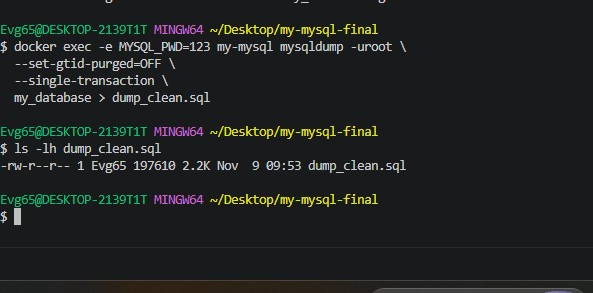

---

## 🗑️ Шаг 9. Удаление данных (DELETE)
Была удалена одна запись из таблицы `users` по её `id`. 
Проверка через `SELECT *` подтвердила, что запись была успешно удалена, а оставшиеся данные не пострадали.

📸 **Доказательство (Удаление):**
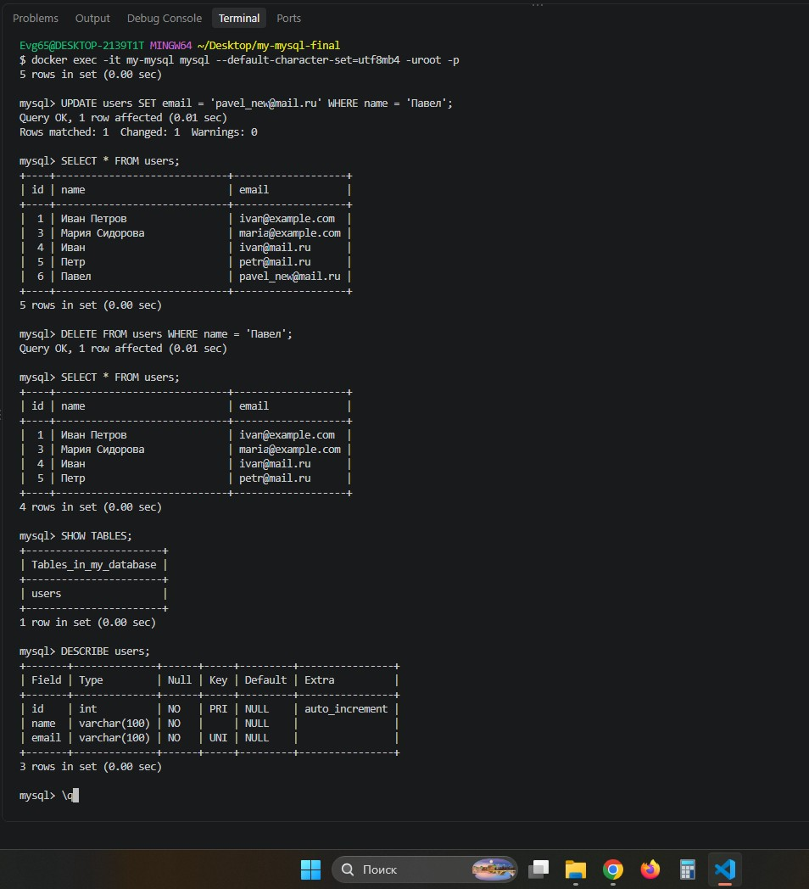

---

## 🧨 Шаг 10. Удаление таблицы и базы данных
Для полной очистки были выполнены деструктивные операции:
*   `DROP TABLE users` — удалена таблица со всеми данными.
*   `DROP DATABASE my_database` — удалена сама база данных.

Проверка через `SHOW TABLES` и `SHOW DATABASES` показала, что база и таблица успешно удалены.

📸 **Доказательство (Удаление таблицы и БД):**
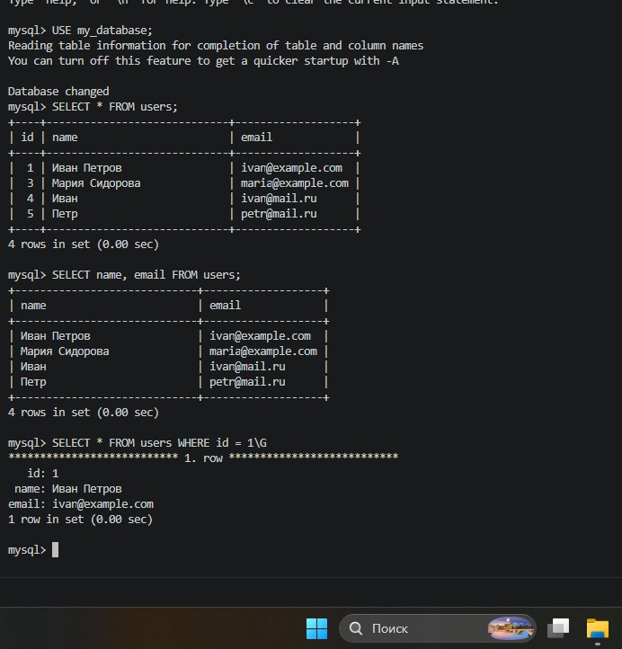

---

## 🧹 Шаг 11. Управление Docker-контейнером
Были отработаны команды управления контейнером:
*   `docker stop my-mysql` — остановка контейнера.
*   `docker start my-mysql` — запуск остановленного контейнера.
*   `docker logs my-mysql > log.txt` — выгрузка логов работы самого контейнера в файл.

📸 **Доказательство (Управление контейнером):**
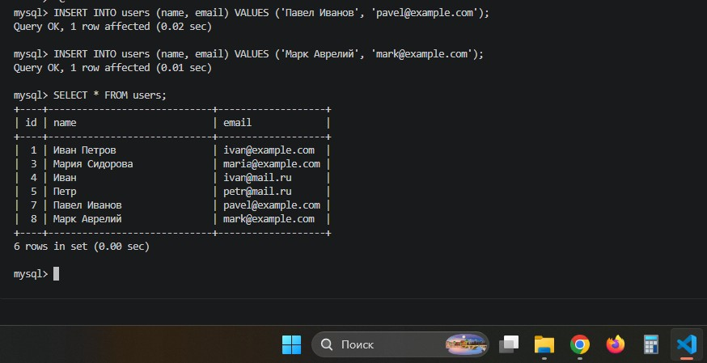

---

## 📝 Шаг 12. Работа с логами и проверка файлов
Так как в файле `my.cnf` была включена настройка логирования, все SQL-запросы фиксировались в системе. 
С помощью SQL-запроса `SELECT ... INTO OUTFILE` лог был выгружен в файл `my_actions.log`. Файл успешно скопирован из контейнера на хост-машину.

В папке проекта теперь находятся все необходимые файлы:
*   `dump_clean.sql` — дамп базы данных.
*   `my_actions.log` — лог выполненных SQL-запросов.
*   `log.txt` — лог работы Docker-контейнера.

📸 **Доказательство (Проверка лога и дампа):**
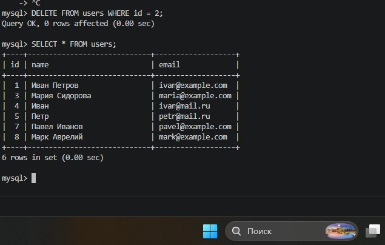

---

## 📌 Вывод
В ходе выполнения лабораторной работы были успешно решены все поставленные задачи. Я научился запускать MySQL в изолированном окружении Docker, подключаться к нему и выполнять основные операции с данными (создание, чтение, обновление, удаление). 

Отдельно были отработаны навыки создания резервных копий (дампов) с помощью `mysqldump` и настройки логирования SQL-запросов. Полученные знания позволяют безопасно работать с базами данных, не затрагивая основную систему.

---

## 📂 Прикрепленные файлы
*   [Скачать дамп базы данных (dump_clean.sql)](./dump_clean.sql)
*   [Скачать лог SQL-запросов (my_actions.log)](./my_actions.log)
*   [Скачать лог контейнера (log.txt)](./log.txt)