# 🎓 Отчет по лабораторной работе: Алиасы в SQL

**Выполнил:** Евгений Белевитин  
**Группа:** Ипо8481  
**Дата:** 10.11.2026

---

## 📑 Оглавление
1. [Введение и задачи](#intro)
2. [Подготовка окружения и запуск контейнера](#step1)
3. [Создание базы данных и таблиц](#step2)
4. [Алиасы таблиц (пример с JOIN)](#step3)
5. [Самосоединение (обязательный алиас)](#step4)
6. [Алиасы столбцов (агрегация)](#step5)
7. [Алиас в ORDER BY](#step6)
8. [Подзапрос с алиасом (производная таблица)](#step7)
9. [Дамп базы данных](#step8)
10. [Работа с логами (General Log)](#step9)
11. [Вывод](#conclusion)

---

<a id="intro"></a>
## 🔹 Введение
**Алиасы** (псевдонимы) — это временные имена, которые даются таблицам или столбцам в запросе. Они делают код короче, читабельнее и помогают разрешать неоднозначности (например, когда в двух таблицах есть столбец `id`).

**Задачи работы:**
* Настроить Docker-контейнер с MySQL и включить логирование.
* Создать учебную базу `alias_db` с таблицами `customers`, `orders`, `employees`.
* Изучить алиасы таблиц и столбцов на практике.
* Показать, где алиасы обязательны (самосоединение, подзапросы).
* Создать дамп базы данных и выгрузить лог действий.

---

<a id="step1"></a>
## 🚀 Шаг 1. Подготовка окружения и запуск контейнера
Для включения логирования был создан файл `my.cnf` с настройками `general_log = 1` и `log_output = FILE`. 
Контейнер `mysql_alias` запущен на базе образа `mysql:8.0`. После запуска лог был очищен от системного шума инициализации.

📸 **Доказательство (Конфигурация и запуск):**
*На скриншотах видно, что файл `my.cnf` создан, и контейнер успешно запущен.*
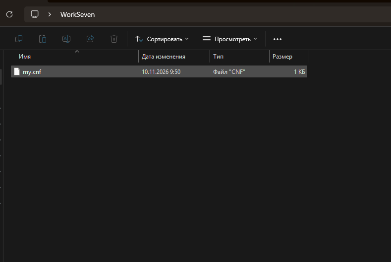
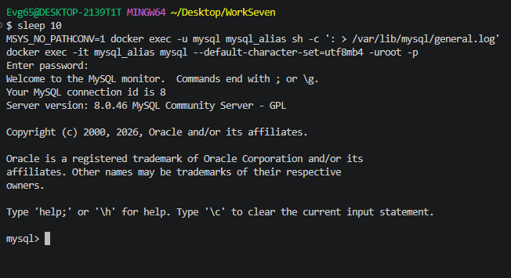

---

<a id="step2"></a>
## 🗄️ Шаг 2. Создание БД и таблиц
Создана база данных `alias_db` с кодировкой `utf8mb4`. В ней созданы три таблицы:
1. `customers` — клиенты (5 записей).
2. `orders` — заказы (6 записей).
3. `employees` — сотрудники (6 записей, с самоссылкой на менеджера).

📸 **Доказательство (Создание таблиц и вставка данных):**
*Видно успешное создание таблиц и вставку тестовых данных (сообщение `Query OK, 6 rows affected`).*
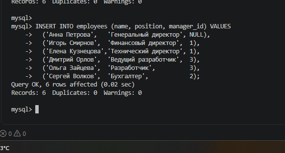

---

<a id="step3"></a>
## 🔗 Шаг 3. Алиасы таблиц (пример с JOIN)
Сначала выполнен запрос **без алиасов** — он длинный и громоздкий:
```sql
SELECT customers.name, orders.order_date, orders.amount
FROM customers JOIN orders ON customers.id = orders.customer_id;
```
Затем тот же запрос **с алиасами** — код стал короче и читабельнее:
```sql
SELECT c.name, o.order_date, o.amount
FROM customers c JOIN orders o ON c.id = o.customer_id;
```

📸 **Доказательство (Запрос без алиасов):**
*Результат запроса без алиасов (6 строк).*
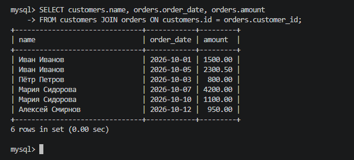

📸 **Доказательство (Запрос с алиасами):**
*Тот же результат, но код короче за счёт алиасов `c` и `o`.*
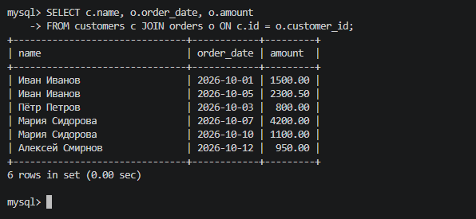

---

<a id="step4"></a>
## 🔄 Шаг 4. Самосоединение (обязательный алиас)
При соединении таблицы `employees` с самой собой алиасы **обязательны**, иначе MySQL не поймёт, к какой «копии» таблицы обращаться.
```sql
SELECT e.name AS employee, m.name AS manager
FROM employees e JOIN employees m ON e.manager_id = m.id;
```
**Результат:** выведен список сотрудников и их руководителей.

📸 **Доказательство (Самосоединение):**
*Видно 5 строк с колонками `employee` и `manager`.*
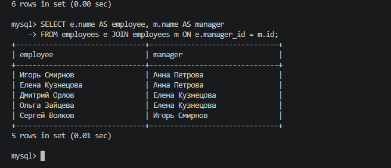

---

<a id="step5"></a>
## 📊 Шаг 5. Алиасы столбцов (агрегация)
Для агрегатных функций заданы понятные имена столбцов через `AS`:
```sql
SELECT customer_id, COUNT(*) AS order_count, SUM(amount) AS total_amount
FROM orders GROUP BY customer_id;
```
**Результат:** заголовки столбцов теперь называются `order_count` и `total_amount`, а не `COUNT(*)` и `SUM(amount)`.

📸 **Доказательство (Алиасы столбцов):**
*Видно 4 строки с понятными заголовками.*
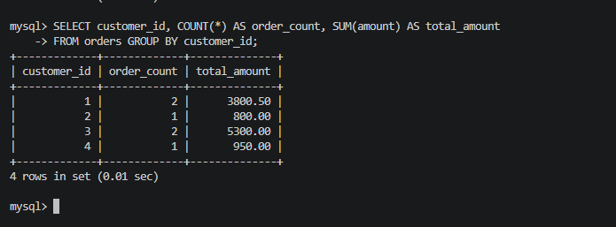

---

<a id="step6"></a>
## 🔢 Шаг 6. Алиас в ORDER BY
Алиас можно использовать в `ORDER BY`, так как сортировка выполняется после `SELECT`:
```sql
SELECT id, amount * 2 AS double_amount FROM orders ORDER BY double_amount DESC;
```
**Результат:** данные отсортированы по вычисляемому столбцу `double_amount`.

📸 **Доказательство (Сортировка по алиасу):**
*Видно 6 строк, отсортированных по убыванию.*
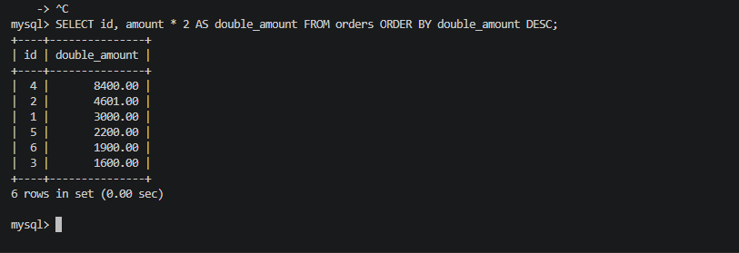

---

<a id="step7"></a>
## 🔍 Шаг 7. Подзапрос с алиасом (производная таблица)
При использовании подзапроса в `FROM` алиас **обязателен**:
```sql
SELECT c.name, o.total
FROM customers c
JOIN (SELECT customer_id, SUM(amount) AS total FROM orders GROUP BY customer_id) o 
ON c.id = o.customer_id
WHERE o.total > 2000;
```
**Результат:** выведены клиенты (Иван Иванов и Мария Сидорова), чья сумма заказов превышает 2000.

📸 **Доказательство (Подзапрос с алиасом):**
*Видно 2 строки с именами и суммами.*
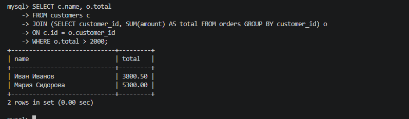

---

<a id="step8"></a>
## 💾 Шаг 8. Дамп базы данных
Создан резервный дамп базы `alias_db` с помощью `mysqldump`:
```bash
docker exec -e MYSQL_PWD=123 mysql_alias mysqldump -uroot --set-gtid-purged=OFF --single-transaction alias_db > alias_dump.sql
```
Дамп содержит все три таблицы и данные в них.

📸 **Доказательство (Дамп базы):**
*Видно содержимое файла `alias_dump.sql` (структура таблиц и INSERT-ы).*
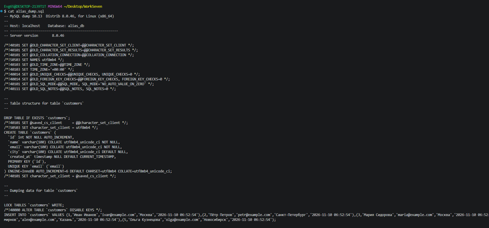

---

<a id="step9"></a>
## 📜 Шаг 9. Работа с логами (General Log)
Лог действий был включен, и все SQL-команды записались в файл `/var/lib/mysql/general.log`.
Лог скопирован на хост и отфильтрован от служебного шума с помощью `grep`.

```bash
MSYS_NO_PATHCONV=1 docker cp mysql_alias:/var/lib/mysql/general.log ./general.log
MSYS_NO_PATHCONV=1 docker exec mysql_alias cat /var/lib/mysql/general.log | grep -E "Query..." | grep -v -E "INSERT INTO help_..." > my_actions.log
```

📸 **Доказательство (Отфильтрованный лог):**
*Видно список только осмысленных SQL-команд: `SELECT c.name...`, `SELECT e.name AS employee...` и т.д.*
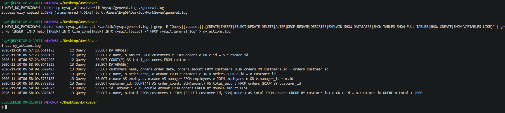

---

<a id="conclusion"></a>
## 📌 Вывод
В ходе работы мы изучили алиасы в SQL. Табличные алиасы (`c`, `o`, `e`, `m`) делают код короче и обязательны при самосоединении и для производных таблиц. Алиасы столбцов (`order_count`, `total_amount`) дают понятные имена результатам и позволяют ссылаться на них в `ORDER BY`, но недоступны в `WHERE`. Также мы создали дамп базы и настроили логирование действий пользователя.

---

## 📂 Прикрепленные файлы
* [Скачать дамп базы данных (alias_dump.sql)](./alias_dump.sql)
* [Скачать отфильтрованный лог (my_actions.log)](./my_actions.log)
* [Скачать конфигурационный файл (my.cnf)](./my.cnf)
