# 🎓 Отчет по лабораторной работе №3: Основные SQL-операции на примере двух таблиц

**Выполнил:** Евгений Белевитин  
**Группа:** Ипо8481  
**Дата:** 09.11.2026

---

## 📑 Оглавление
1. [Введение и цель работы](#intro)
2. [Запуск контейнера и создание БД](#step1)
3. [Создание таблиц](#step2)
4. [Вставка данных](#step3)
5. [Выборка и проекция](#step4)
6. [Объединение (UNION)](#step5)
7. [Разность (EXCEPT)](#step6)
8. [Пересечение (INTERSECT)](#step7)
9. [Декартово произведение (CROSS JOIN)](#step8)
10. [Соединение (JOIN и LEFT JOIN)](#step9)
11. [Создание дампа базы данных](#step10)
12. [Уборка (DROP) и восстановление](#step11)
13. [Вывод](#conclusion)

---

## 🔹 Введение
В ходе выполнения данной лабораторной работы необходимо было освоить базовые и продвинутые операции SQL для работы с множествами. 
**Основные задачи:**
*   Запустить чистый контейнер с СУБД MySQL.
*   Создать базу данных и две таблицы с товарами.
*   Отработать операции фильтрации (`WHERE`), проекции (`SELECT name`), объединения (`UNION`), разности (`EXCEPT`) и пересечения (`INTERSECT`).
*   Изучить работу соединений таблиц: `CROSS JOIN`, `INNER JOIN`, `LEFT JOIN`.
*   Создать резервную копию (дамп) базы данных.
*   Проверить процесс восстановления базы из дампа.

---

## 🚀 Шаг 1. Запуск контейнера и создание БД
Для корректного отображения кириллицы был создан конфигурационный файл `my.cnf` с настройками кодировки `utf8mb4`. 

С помощью команды `docker run` был запущен контейнер `products-mysql` на базе официального образа MySQL. После успешного запуска мы подключились к интерактивной оболочке MySQL с помощью `docker exec`.

Внутри оболочки была создана новая база данных `shop` с кодировкой `utf8mb4` и правилом сравнения `utf8mb4_unicode_ci`. Проверка через `SHOW DATABASES` подтвердила, что база успешно создана и выбрана для дальнейшей работы.

📸 **Доказательство (Создание БД):**
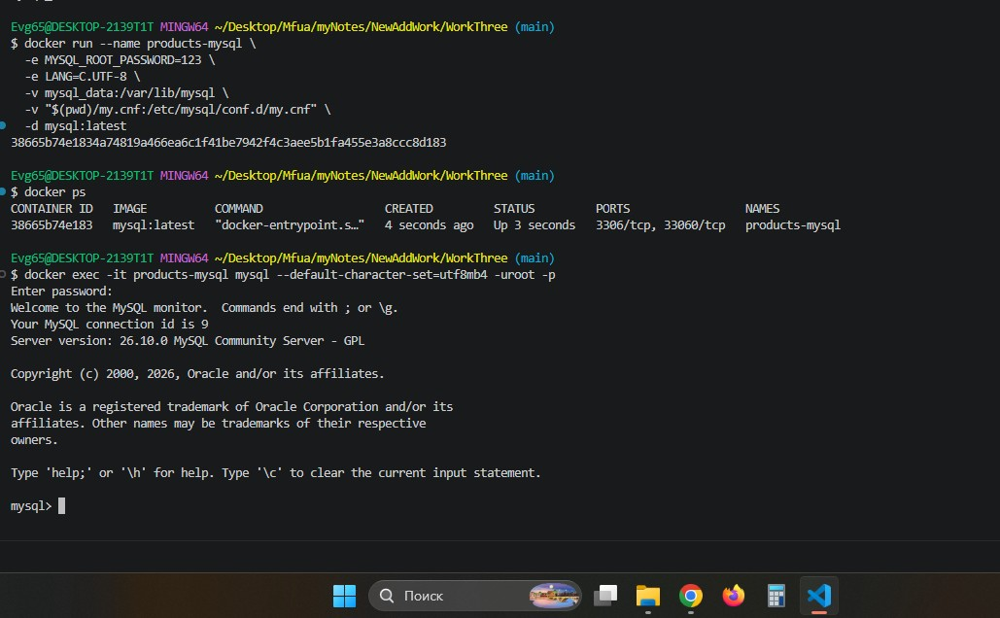

---

## 📋 Шаг 2. Создание таблиц
В созданной базе данных `shop` были созданы две таблицы с идентичной структурой:
*   `products1` — для хранения первого списка товаров.
*   `products2` — для хранения второго списка товаров.

Обе таблицы содержат два столбца:
*   `name` (тип `VARCHAR(100)`) — название товара.
*   `price` (тип `INT`) — цена товара.

Обе таблицы созданы с кодировкой `utf8mb4` для поддержки русских названий. Проверка через `SHOW TABLES` показала, что обе таблицы успешно созданы.

📸 **Доказательство (Создание таблиц):**
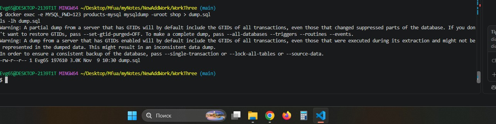

---

## ✍️ Шаг 3. Вставка данных
В таблицы были добавлены тестовые данные (фрукты и их цены). 
В `products1` добавлены: Дыни (800), Клубника (150), Яблоки (120), Лимоны (200).
В `products2` добавлены: Дыни (800), Клубника (150), Каштаны (200), Хурма (350).

Проверка через `SELECT *` для каждой таблицы подтвердила, что данные успешно записались, а русские буквы отображаются без ошибок кодировки.

📸 **Доказательство (Вставка данных):**
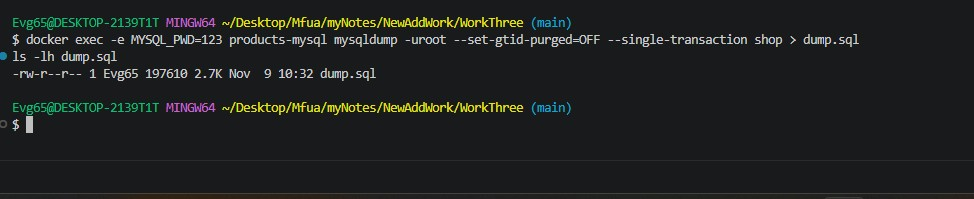

---

## 🔍 Шаг 4. Выборка и проекция
Были отработаны две базовые операции:
1.  **Выборка (WHERE):** С помощью запроса `SELECT * FROM products1 WHERE price > 150;` были отфильтрованы только те товары, цена которых строго больше 150. В результат попали Дыни и Лимоны.
2.  **Проекция (PROJECTION):** С помощью запроса `SELECT name FROM products1;` были выведены только названия товаров, без указания их цен. Это позволяет скрыть лишние данные.

📸 **Доказательство (WHERE и проекция):**
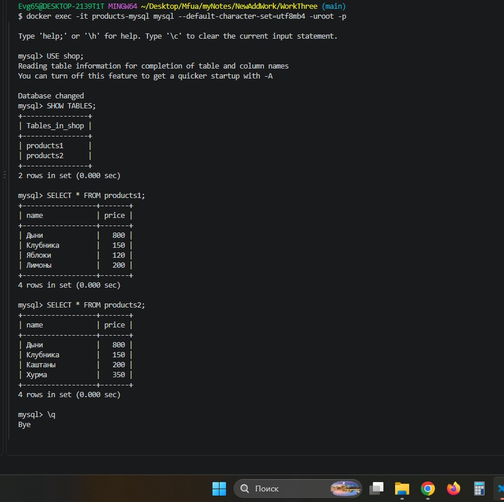

---

## 🔗 Шаг 5. Объединение (UNION)
Оператор `UNION` используется для объединения результатов двух `SELECT`-запросов в один набор строк. 

Мы выполнили `SELECT name FROM products1 UNION SELECT name FROM products2;`. 
Результат: единый список названий товаров из обеих таблиц. Важно, что `UNION` **удаляет дубликаты** (Дыни и Клубника встречались в обеих таблицах, но в результат попали только один раз).

📸 **Доказательство (UNION):**
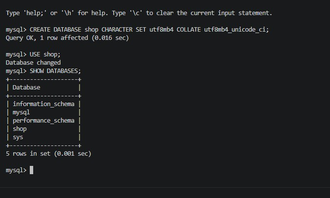

---

## ➖ Шаг 6. Разность (EXCEPT)
Оператор `EXCEPT` (в некоторых СУБД называется `MINUS`) возвращает строки, которые есть в первом результате, но отсутствуют во втором.

Мы выполнили `SELECT name, price FROM products1 EXCEPT SELECT name, price FROM products2;`.
Результат: Яблоки (120) и Лимоны (200). Эти товары есть только в первой таблице, во второй их нет.

📸 **Доказательство (EXCEPT):**
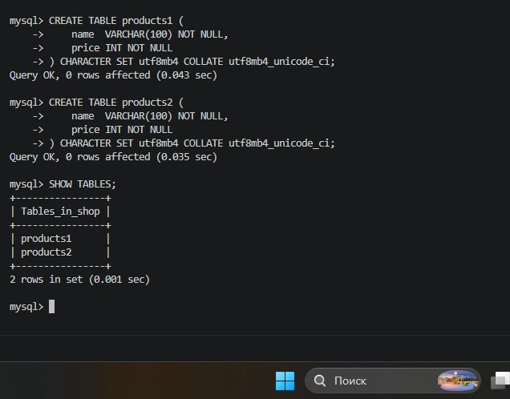

---

## 🔀 Шаг 7. Пересечение (INTERSECT)
Оператор `INTERSECT` возвращает только те строки, которые есть и в первом, и во втором результате (с полным совпадением всех столбцов).

Мы выполнили `SELECT name, price FROM products1 INTERSECT SELECT name, price FROM products2;`.
Результат: Дыни (800) и Клубника (150). Эти товары присутствуют в обеих таблицах с одинаковой ценой.

📸 **Доказательство (INTERSECT):**
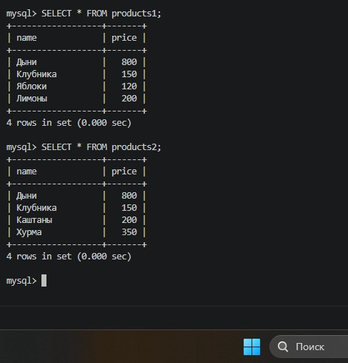

---

## 🧩 Шаг 8. Декартово произведение (CROSS JOIN)
`CROSS JOIN` создает все возможные комбинации строк из двух таблиц (без условия соединения).

Мы выполнили `SELECT ... FROM products1 t1 CROSS JOIN products2 t2;`.
Результат: 4 товара из первой таблицы × 4 товара из второй таблицы = **16 строк**. Каждый товар из `products1` был соединен с каждым товаром из `products2`.

📸 **Доказательство (CROSS JOIN):**
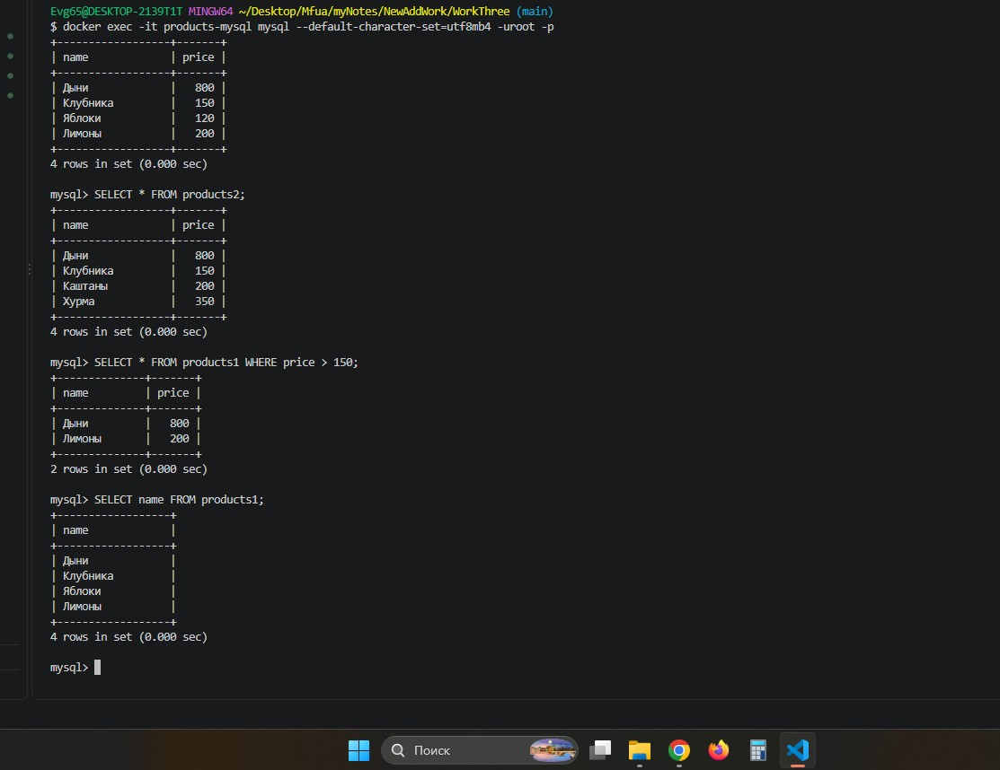

---

## 🔗 Шаг 9. Соединения (JOIN и LEFT JOIN)
Были отработаны два типа соединения таблиц по ключу (в нашем случае по названию товара):
1.  **INNER JOIN (JOIN):** Вывел только те строки, где есть совпадения в обеих таблицах. В результат попали Дыни (800) и Клубника (150).
2.  **LEFT JOIN:** Вывел все строки из левой таблицы (`products1`), даже если у них нет пары в правой (`products2`). Для Яблок и Лимонов в столбце `price2` появилось значение `NULL`.

📸 **Доказательство (JOIN):**
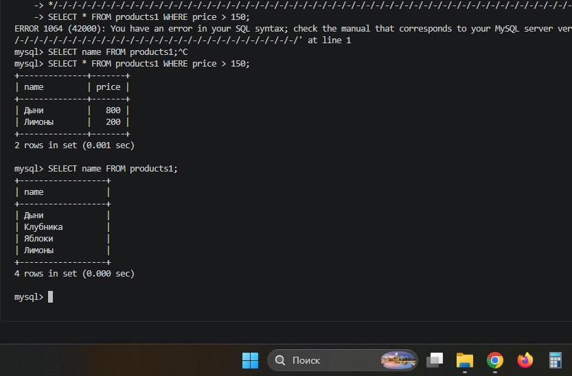

---

## 📦 Шаг 10. Создание дампа базы данных
Для сохранения резервной копии базы данных была использована утилита `mysqldump`. 
Мы выполнили команду с флагами `--set-gtid-purged=OFF` (чтобы избежать ошибок GTID при восстановлении) и `--single-transaction` (для согласованности данных). 

В результате в папке проекта появился файл `dump.sql`, содержащий все необходимые команды `CREATE TABLE` и `INSERT` для полного восстановления базы данных `shop`.

📸 **Доказательство (Создание дампа):**
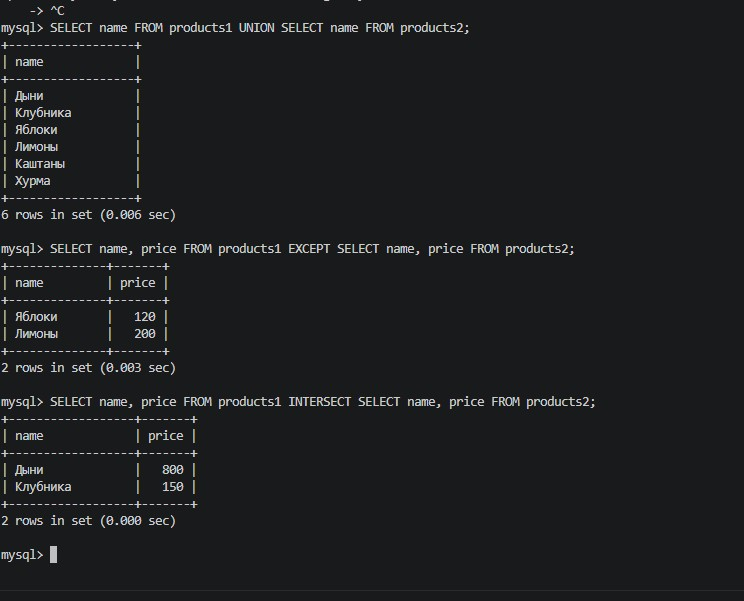

---

## 🧨 Шаг 11. Уборка (DROP) и восстановление БД
Для проверки навыков восстановления база данных `shop` была полностью удалена с помощью команды `DROP DATABASE shop`. Проверка через `SHOW DATABASES` подтвердила, что базы больше нет.

Затем база `shop` была создана заново как пустая, и в нее был импортирован дамп с помощью команды:
`docker exec -i products-mysql mysql -uroot -p123 shop < dump.sql`.

Проверка через `SHOW TABLES` и `SELECT *` подтвердила, что обе таблицы (`products1` и `products2`) и все данные в них полностью восстановились.

📸 **Доказательство (Восстановление):**
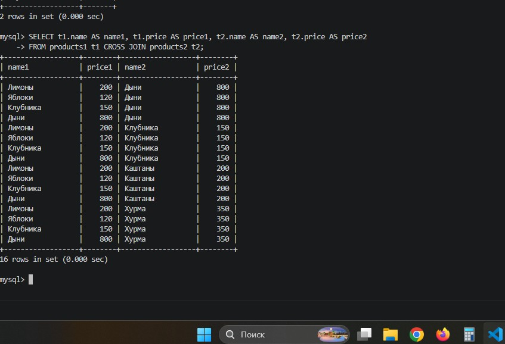
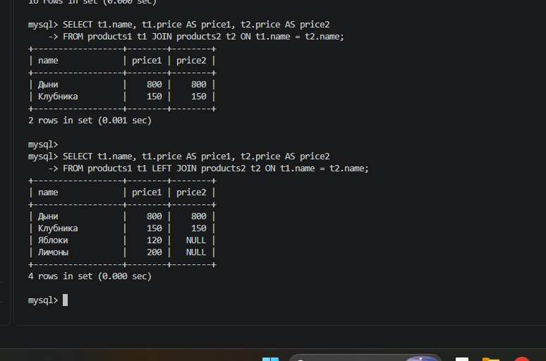

---

## 📌 Вывод
В ходе выполнения лабораторной работы были успешно изучены и отработаны на практике основные операции SQL для работы с множествами: `UNION`, `EXCEPT`, `INTERSECT`. 

Также были отработаны различные виды соединений таблиц: декартово произведение (`CROSS JOIN`), внутреннее соединение (`INNER JOIN`) и левое внешнее соединение (`LEFT JOIN`). 

Отдельно были освоены навыки создания резервной копии базы данных с помощью `mysqldump` и ее полного восстановления из дампа. Все поставленные задачи выполнены в полном объеме.

---

## 📂 Прикрепленные файлы
*   [Скачать дамп базы данных (dump.sql)](./dump.sql)
*   [Скачать конфигурационный файл (my.cnf)](./my.cnf)