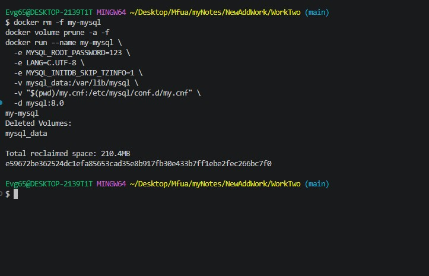
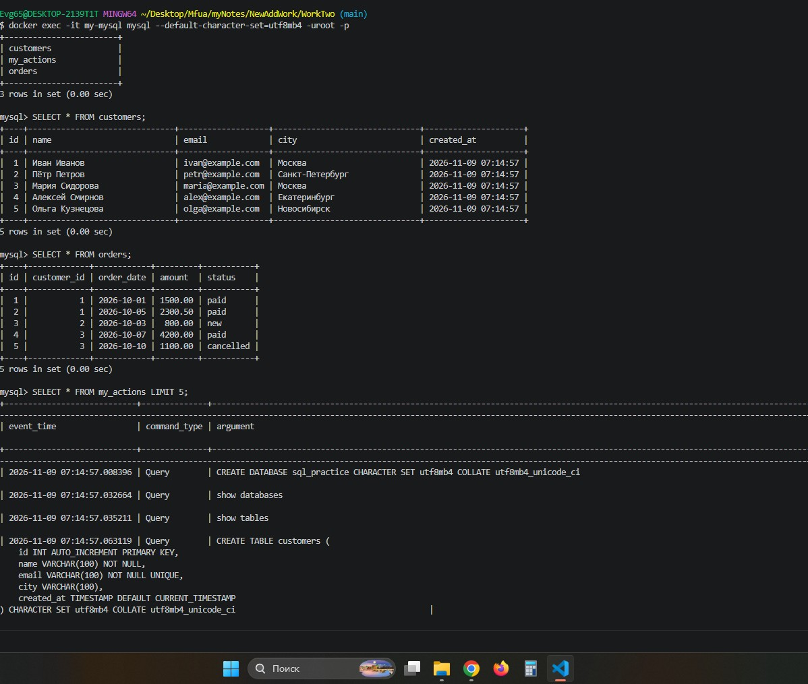
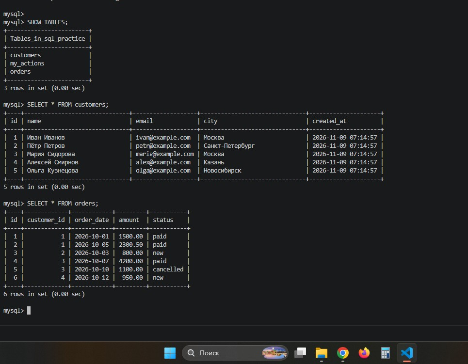
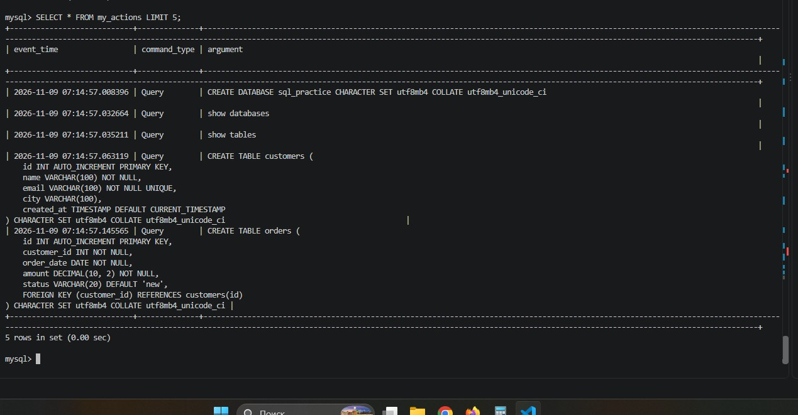
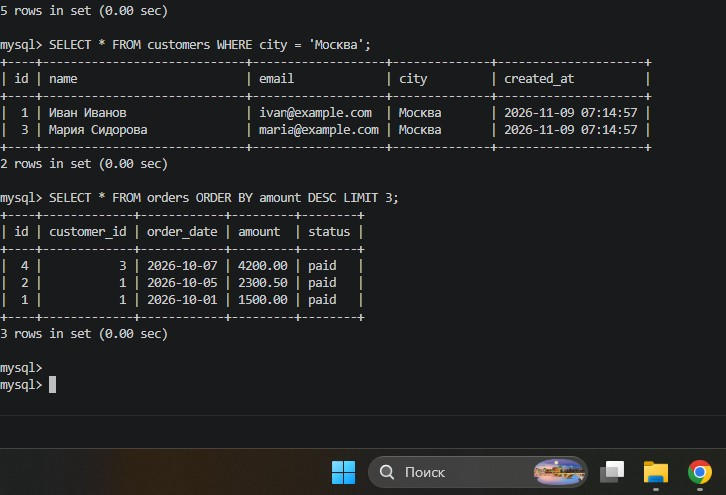
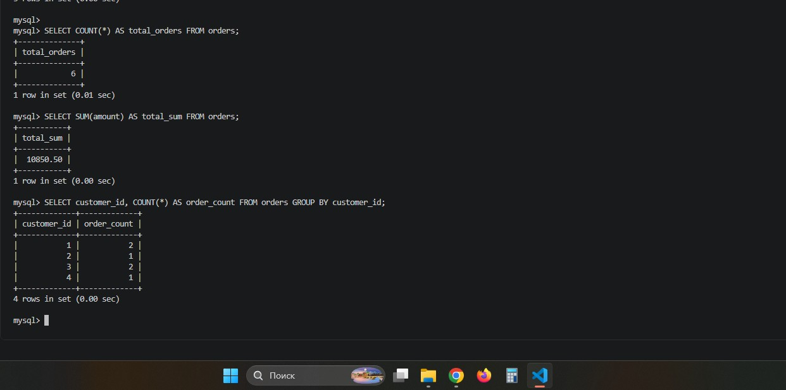
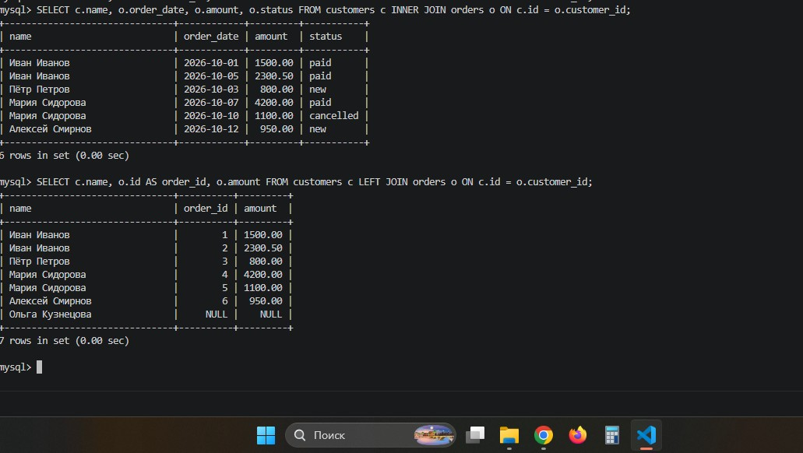
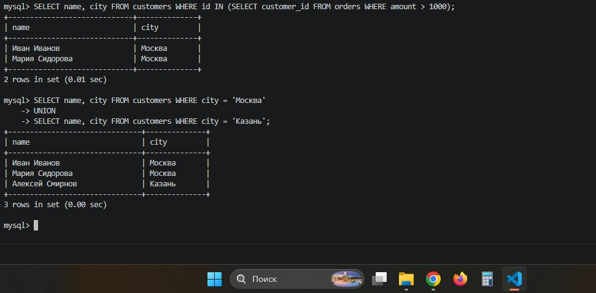
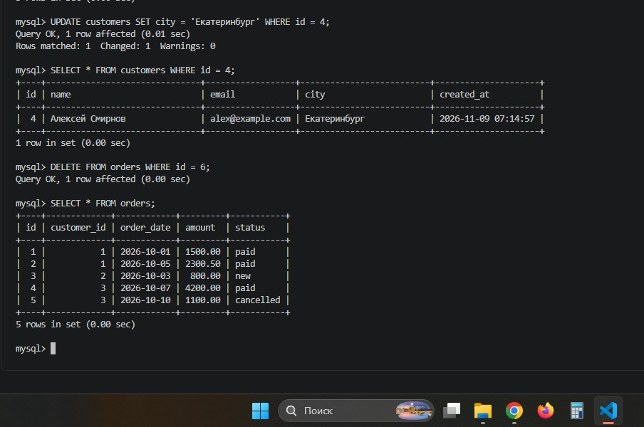
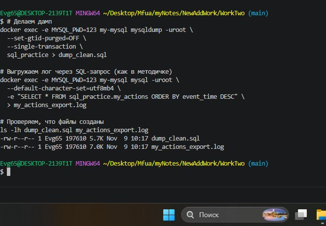

# 🎓 Отчет по лабораторной работе №2: Интерактивная работа с MySQL в изолированном окружении Docker

**Выполнил:** Евгений Белевитин  
**Группа:** Ипо8481  
**Дата:** 09.11.2026

---

## 📑 Содержание
1. [Введение и подготовка](#intro)
2. [Запуск контейнера](#step1)
3. [Настройка логирования и создание БД](#step2)
4. [Создание таблиц и вставка данных](#step3)
5. [Выборка данных (SELECT)](#step4)
6. [Агрегация и группировка](#step5)
7. [Соединения (JOIN)](#step6)
8. [Подзапросы и UNION](#step7)
9. [Обновление и удаление данных](#step8)
10. [Работа с логами и дампом](#step9)
11. [Удаление и восстановление БД](#step10)
12. [Вывод](#conclusion)

---

## 🔹 Введение
В ходе данной лабораторной работы мы изучаем продвинутые возможности MySQL в среде Docker. Основной упор делается на **логирование запросов** (с помощью `general_log`), создание **представлений (VIEW)** для фильтрации логов, а также на отработку сложных SQL-запросов (JOIN, подзапросы, UNION) и процессов резервного копирования.

---

## 🚀 Шаг 1. Подготовка и запуск контейнера
Был создан конфигурационный файл `my.cnf`, в котором активировано логирование и указано, что логи должны записываться в системную таблицу (а не в файл). Это необходимо для дальнейшего создания VIEW.

С помощью команды `docker run` был запущен контейнер `my-mysql` на базе стабильной версии MySQL 8.0. Для предотвращения проблем с часовыми поясами добавлен флаг `MYSQL_INITDB_SKIP_TZINFO=1`.

📸 **Доказательство (Запуск контейнера):**

---

## 🔌 Шаг 2. Настройка логирования и создание БД
После подключения к MySQL были выполнены команды для включения общего лога (`SET GLOBAL general_log = 'ON'`) и направления его в таблицу (`log_output = 'TABLE'`). 

Затем была создана учебная база данных `sql_practice` с правильной кодировкой `utf8mb4`. Для удобного чтения логов было создано представление (VIEW) `my_actions`, которое отфильтровывает системный шум и показывает только осмысленные действия пользователя.

📸 **Доказательство (Настройка БД и VIEW):**

---

## 📋 Шаг 3. Создание таблиц и вставка данных
В базе `sql_practice` были созданы две связанные таблицы:
*   `customers` — содержит информацию о клиентах (id, имя, email, город).
*   `orders` — содержит информацию о заказах (id, id клиента, дата, сумма, статус).
Между таблицами настроена связь через внешний ключ (`FOREIGN KEY`), что обеспечивает целостность данных.

В таблицы были вставлены тестовые данные: 5 клиентов и 6 заказов. Проверка через `SELECT *` подтвердила успешную вставку кириллицы и чисел.

📸 **Доказательство (Создание таблиц и вставка):**

---

## 🔍 Шаг 4. Выборка данных (SELECT)
Отработаны базовые и продвинутые методы выборки:
*   Выбор всех столбцов (`SELECT *`).
*   Выбор конкретных столбцов (`SELECT name, city`).
*   Фильтрация строк с помощью `WHERE` (например, поиск клиентов только из Москвы).
*   Сортировка результатов через `ORDER BY` (по убыванию суммы заказа).
*   Ограничение количества выводимых строк с помощью `LIMIT` (топ-3 самых дорогих заказа).

📸 **Доказательство (Различные выборки):**

---

## 📊 Шаг 5. Агрегатные функции и группировка
Применены функции для анализа данных:
*   `COUNT(*)` — подсчитано общее количество заказов.
*   `SUM(amount)` — вычислена общая сумма всех заказов.
*   `GROUP BY` — данные сгруппированы по `customer_id`, что позволило посчитать количество заказов и их сумму для каждого конкретного клиента.

📸 **Доказательство (Агрегация):**

---

## 🔗 Шаг 6. Соединения (JOIN)
Отработаны ключевые операторы соединения таблиц:
*   **`INNER JOIN`**: вывел только те строки, где есть совпадения в обеих таблицах (клиент сделал заказ). В результат попали имена клиентов и детали их заказов.
*   **`LEFT JOIN`**: вывел всех клиентов из левой таблицы, даже если у них нет заказов. В полях заказа для таких клиентов (например, Ольга Кузнецова) появился `NULL`.

📸 **Доказательство (JOIN):**

---

## 🧩 Шаг 7. Подзапросы и UNION
Отработана работа со сложными запросами:
*   **Подзапрос с `IN`**: найден список клиентов, которые сделали хотя бы один заказ на сумму более 1000.
*   **`UNION`**: объединены результаты двух запросов (клиенты из Москвы и клиенты из Казани) в один общий список без дубликатов.

📸 **Доказательство (Подзапросы):**

---

## ✏️ Шаг 8. Обновление (UPDATE) и удаление (DELETE) данных
*   С помощью `UPDATE` был изменен город клиента с `id = 4` на «Екатеринбург». Проверка через `SELECT` подтвердила изменение.
*   С помощью `DELETE` был удален заказ с `id = 6`. Проверка показала, что в таблице `orders` осталось 5 записей.
*   *Примечание:* Все эти действия были зафиксированы в логе.

📸 **Доказательство (UPDATE и DELETE):**

---

## 📝 Шаг 9. Работа с логами и создание дампа
С помощью SQL-запроса к VIEW `my_actions` был выгружен лог всех действий пользователя. Команда `docker exec ... > my_actions_export.log` сохранила этот лог в файл на хосте.
Затем был создан резервный дамп базы данных `sql_practice` в файл `dump_clean.sql` с использованием флагов `--set-gtid-purged=OFF` и `--single-transaction`. Размер дампа составил 5.7 КБ.

📸 **Доказательство (Логи и дамп):**

---

## 🧨 Шаг 10. Удаление и восстановление БД
База данных `sql_practice` была полностью удалена (`DROP DATABASE`), а затем создана заново.
С помощью команды `docker exec -i my-mysql mysql ... < dump_clean.sql` данные были успешно импортированы обратно.
Проверка через `SHOW TABLES` и `SELECT *` подтвердила, что все таблицы (`customers`, `orders`), данные и представление `my_actions` полностью восстановлены.

📸 **Доказательство (Восстановление):**

---

## 📌 Вывод
В ходе лабораторной работы были успешно освоены продвинутые методы работы с MySQL в Docker. 
Мы научились настраивать системное логирование в таблицу и фильтровать его с помощью VIEW, что позволяет отслеживать историю изменений базы данных. 
Также были отработаны сложные SQL-запросы с соединениями (JOIN), подзапросами и агрегатными функциями. Отдельно отработан процесс создания резервной копии (дампа) и полного восстановления базы данных из нее.

---

## 📂 Прикрепленные файлы
*   [Скачать дамп базы данных (dump_clean.sql)](./dump_clean.sql)
*   [Скачать выгруженный лог (my_actions_export.log)](./my_actions_export.log)