# Полнотекстовый поиск (FULLTEXT) в MySQL — отчёт по лабораторной работе

**Выполнил:** Белевитин Евгений Александрович 
**Группа:** Ипо8481 
**Дата выполнения:** 18.11.2026  
**Среда выполнения:** WSL (Windows Subsystem for Linux), Docker, MySQL 8.0

---

## 📋 Содержание

1. [Цель работы](#1-цель-работы)
2. [Подготовка окружения](#2-подготовка-окружения)
3. [Создание базы данных и таблицы](#3-создание-базы-данных-и-таблицы)
4. [Проблема LIKE — полный перебор](#4-проблема-like--полный-перебор)
5. [Создание FULLTEXT-индекса](#5-создание-fulltext-индекса)
6. [Поиск в режиме естественного языка](#6-поиск-в-режиме-естественного-языка)
7. [Булев режим поиска](#7-булев-режим-поиска)
8. [Расширение запроса (Query Expansion)](#8-расширение-запроса-query-expansion)
9. [Ограничения InnoDB](#9-ограничения-innodb)
10. [Экспорт лога действий](#10-экспорт-лога-действий)
11. [Дамп базы данных](#11-дамп-базы-данных)
12. [Сравнение LIKE vs FULLTEXT](#12-сравнение-like-vs-fulltext)
13. [Итоговые выводы](#13-итоговые-выводы)

---

## 1. Цель работы

Освоить полнотекстовый поиск в MySQL, понять его отличия от оператора `LIKE`, изучить режимы поиска (естественный язык, булев режим, расширение запроса), разобраться с ограничениями InnoDB и научиться вести лог действий пользователя.

---

## 2. Подготовка окружения

### 2.1. Конфигурация my.cnf

Создан файл `my.cnf` со следующими настройками:

```ini
[mysqld]
character-set-server = utf8mb4
collation-server = utf8mb4_unicode_ci
general_log = 1
general_log_file = /var/lib/mysql/general.log
log_output = FILE

[client]
default-character-set = utf8mb4

[mysql]
default-character-set = utf8mb4
```

**Назначение параметров:**
- `utf8mb4` — полная поддержка Unicode, включая эмодзи
- `general_log = 1` — включён общий лог всех запросов
- `general_log_file` — путь к файлу лога

📸 **Скриншот №1:** вывод `cat my.cnf`

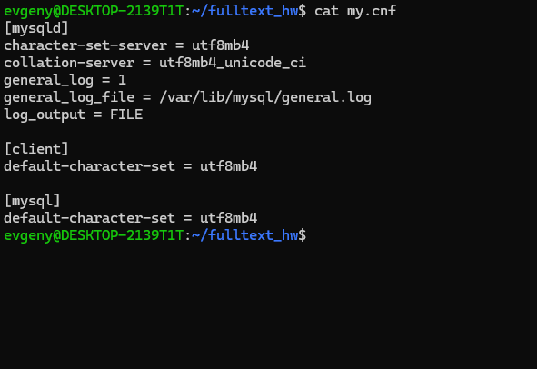

### 2.2. Запуск контейнера MySQL

```bash
docker run --name my-mysql \
  -e MYSQL_ROOT_PASSWORD=123 \
  -e LANG=C.UTF-8 \
  -e MYSQL_INITDB_SKIP_TZINFO=1 \
  -v mysql_data:/var/lib/mysql \
  -v $(pwd)/my.cnf:/etc/mysql/conf.d/my.cnf \
  -d mysql:8.0
```

**Ключи запуска:**
- `--name my-mysql` — имя контейнера
- `-v mysql_data:/var/lib/mysql` — том для данных (сохраняется между перезапусками)
- `-v $(pwd)/my.cnf:...` — монтирование конфигурации

📸 **Скриншот №2:** вывод `docker ps` с запущенным контейнером

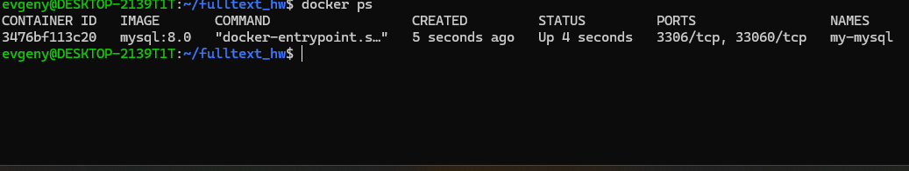

---

## 3. Создание базы данных и таблицы

### 3.1. Подключение к MySQL

```bash
docker exec -it my-mysql mysql --default-character-set=utf8mb4 -uroot -p
```

📸 **Скриншот №3:** приглашение `mysql>` после входа

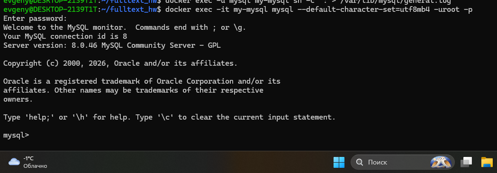

### 3.2. Создание базы данных

```sql
CREATE DATABASE fulltext_practice
  CHARACTER SET utf8mb4
  COLLATE utf8mb4_unicode_ci;
USE fulltext_practice;
```

### 3.3. Создание таблицы articles

```sql
CREATE TABLE articles (
    id INT AUTO_INCREMENT PRIMARY KEY,
    title VARCHAR(200) NOT NULL,
    body TEXT NOT NULL,
    author VARCHAR(100),
    created_at TIMESTAMP DEFAULT CURRENT_TIMESTAMP
) CHARACTER SET utf8mb4 COLLATE utf8mb4_unicode_ci;
```

**Структура таблицы:**
- `id` — первичный ключ (автоинкремент)
- `title` — заголовок статьи (VARCHAR)
- `body` — текст статьи (TEXT) — именно это поле будем индексировать
- `author` — автор
- `created_at` — дата создания

### 3.4. Заполнение данными

```sql
INSERT INTO articles (title, body, author) VALUES
  ('MySQL FULLTEXT search', 'MySQL provides full-text search capabilities...', 'Иван'),
  ('MySQL replication', 'MySQL replication allows you to replicate data...', 'Мария'),
  ('Optimizing MySQL queries', 'Query optimization is important for performance...', 'Пётр'),
  ('InnoDB full-text search', 'InnoDB supports FULLTEXT indexes since MySQL 5.6...', 'Ольга'),
  ('Boolean mode in MySQL', 'Boolean mode allows you to use operators...', 'Алексей');
```

📸 **Скриншот №4:** результат `SELECT * FROM articles;` — 5 строк

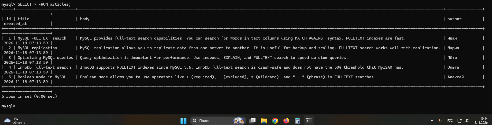

---

## 4. Проблема LIKE — полный перебор

### 4.1. Проверка через EXPLAIN

```sql
EXPLAIN SELECT * FROM articles WHERE body LIKE '%replication%';
```

**Результат:**

| id | select_type | table | type | possible_keys | key | key_len | ref | rows | Extra |
|----|-------------|-------|------|---------------|-----|---------|-----|------|-------|
| 1 | SIMPLE | articles | **ALL** | NULL | NULL | NULL | NULL | 5 | Using where |

### 4.2. Анализ результата

- **`type: ALL`** — полный перебор всех строк (full table scan)
- **`key: NULL`** — индекс не используется
- **`rows: 5`** — перебирает все 5 строк

📸 **Скриншот №5:** EXPLAIN для LIKE — `type: ALL`, `key: NULL`

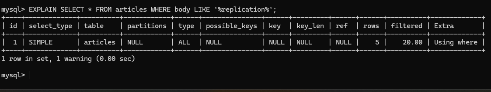

### 4.3. Почему LIKE не использует индекс?

Оператор `LIKE '%слово%'` ищет подстроку в любом месте текста. Обычный B-дерево индекс работает только для префиксов (`LIKE 'слово%'`), но не для суффиксов или подстрок в середине. Поэтому MySQL вынужден перебирать **каждую строку** таблицы.

**Проблема:** на таблице из 5 строк это незаметно, но на миллионах строк `LIKE '%слово%'` становится катастрофически медленным.

---

## 5. Создание FULLTEXT-индекса

### 5.1. Создание индекса

```sql
CREATE FULLTEXT INDEX ft_articles ON articles(title, body);
```

### 5.2. Проверка создания индекса

```sql
SHOW INDEX FROM articles;
```

В результате видна строка с:
- `Key_name = ft_articles`
- `Index_type = FULLTEXT`

### 5.3. Проверка через EXPLAIN

```sql
EXPLAIN SELECT * FROM articles WHERE MATCH(title, body) AGAINST ('replication');
```

**Результат:**

| id | select_type | table | type | possible_keys | key | key_len | ref | rows | Extra |
|----|-------------|-------|------|---------------|-----|---------|-----|------|-------|
| 1 | SIMPLE | articles | **fulltext** | ft_articles | ft_articles | NULL | NULL | 1 | Using where; Ft_hints: sorted |

### 5.4. Анализ результата

- **`type: fulltext`** — используется полнотекстовый индекс!
- **`key: ft_articles`** — имя нашего индекса
- **`rows: 1`** — не перебирает всё, а сразу находит нужные строки

📸 **Скриншот №6:** EXPLAIN для MATCH — `type: fulltext`, `key: ft_articles`

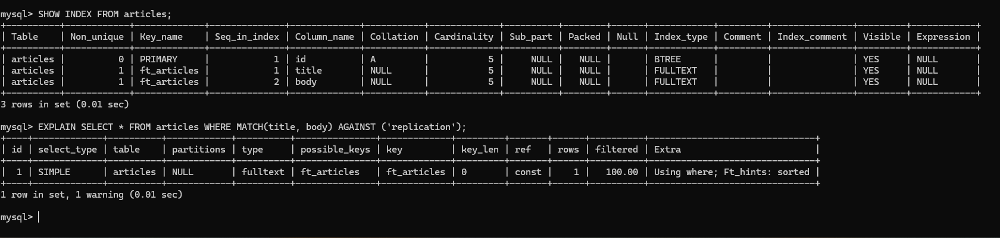

### 5.5. Как работает FULLTEXT-индекс?

FULLTEXT создаёт **перевёрнутый индекс** (inverted index):
- Для каждого уникального слова хранится список ID документов (строк), где оно встречается
- При поиске MySQL сразу смотрит в этот индекс, а не перебирает весь текст
- Это аналог предметного указателя в конце книги

---

## 6. Поиск в режиме естественного языка

### 6.1. Простейший поиск с релевантностью

```sql
SELECT id, title,
       MATCH(title, body) AGAINST ('replication') AS score
FROM articles
WHERE MATCH(title, body) AGAINST ('replication')
ORDER BY score DESC;
```

**Результат:**

| id | title | score |
|----|-------|-------|
| 2 | MySQL replication | 0.09061872959136963 |
| 1 | MySQL FULLTEXT search | 0.009123... |

**Что означает `score`:**
- Это **релевантность** документа запросу
- Чем чаще слово встречается в документе и чем реже во всей коллекции — тем выше score
- Сортировка по `score DESC` показывает самые релевантные результаты первыми

### 6.2. Поиск нескольких слов (объединение через OR)

```sql
SELECT id, title, MATCH(title, body) AGAINST ('MySQL replication') AS score
FROM articles
WHERE MATCH(title, body) AGAINST ('MySQL replication')
ORDER BY score DESC;
```

**Результат:** найдутся все статьи, где есть **хотя бы одно** из слов (`MySQL` ИЛИ `replication`).

**Особенности естественного режима:**
- Порядок слов не важен
- Регистр игнорируется (зависит от collation)
- InnoDB **не применяет 50%-й порог** (в отличие от MyISAM)

---

## 7. Булев режим поиска

### 7.1. Синтаксис

```sql
SELECT id, title FROM articles
WHERE MATCH(title, body) AGAINST ('+MySQL -replication' IN BOOLEAN MODE);
```

### 7.2. Операторы булева режима

| Оператор | Значение | Пример | Результат |
|----------|----------|--------|-----------|
| `+` | Слово **обязательно** должно присутствовать | `+MySQL` | Только статьи со словом MySQL |
| `-` | Слово **должно отсутствовать** | `-replication` | Исключить статьи с replication |
| `*` | **Wildcard** (суффикс) | `replicat*` | replication, replicate, replicating... |
| `"..."` | **Точная фраза** | `"query optimization"` | Только если слова идут подряд |
| `~` | **Уменьшить релевантность** | `~performance` | Если слово есть — понизить score |
| `>` | **Увеличить** вес слова | `>important` | Повысить значимость слова |
| `<` | **Уменьшить** вес слова | `<optional` | Понизить значимость слова |
| `(...)` | Группировка подвыражений | `+(mysql +(index query))` | Сложные логические выражения |

### 7.3. Примеры запросов

**Задача:** найти статьи, где есть `MySQL`, но нет `replication`

```sql
SELECT id, title FROM articles
WHERE MATCH(title, body) AGAINST ('+MySQL -replication' IN BOOLEAN MODE);
```

**Результат:** 4 строки (все статьи кроме статьи Марии про replication)

**Задача:** найти точную фразу `"query optimization"`

```sql
SELECT id, title FROM articles
WHERE MATCH(title, body) AGAINST ('"query optimization"' IN BOOLEAN MODE);
```

**Результат:** статья Пётра (Optimizing MySQL queries), потому что слова идут подряд

**Задача:** найти слова, начинающиеся на `replicat`

```sql
SELECT id, title FROM articles
WHERE MATCH(title, body) AGAINST ('replicat*' IN BOOLEAN MODE);
```

📸 **Скриншот №7:** результат wildcard-поиска `replicat*`

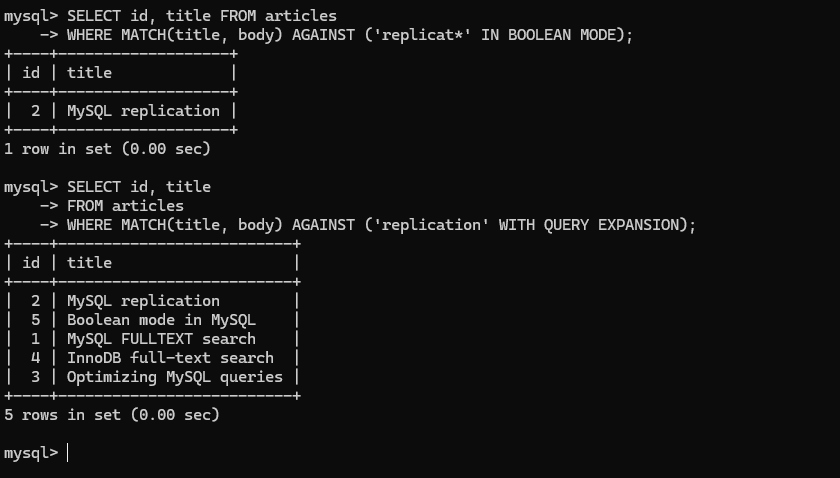

**Результат:** статья Марии (MySQL replication), потому что `replicat*` находит replication, replicate, replicating и т.д.

**Задача:** найти статьи про MySQL-индексы, но не про MyISAM

```sql
SELECT id, title FROM articles
WHERE MATCH(title, body) AGAINST ('+MySQL +(index* partition*) -MyISAM' IN BOOLEAN MODE);
```

**Важно:** в булевом режиме **нет автоматической сортировки по релевантности**. Если нужен порядок — используйте `ORDER BY MATCH(...) AGAINST(...) DESC`.

---

## 8. Расширение запроса (Query Expansion)

```sql
SELECT id, title
FROM articles
WHERE MATCH(title, body) AGAINST ('replication' WITH QUERY EXPANSION);
```

**Как работает:**
1. MySQL выполняет первый поиск по слову `replication`
2. Из найденных документов извлекаются все слова
3. Выполняется второй поиск уже по всем этим словам
4. Результат — расширенный набор документов

**Результат:** могут появиться статьи, где нет слова `replication`, но есть связанные термины из найденных документов.

**Когда полезно:** когда пользователь вводит слишком узкий запрос и мы хотим показать связанные материалы.

**Минус:** может добавить «шум» — нерелевантные документы.

---

## 9. Ограничения InnoDB

### 9.1. Минимальная длина слова

```sql
SHOW VARIABLES LIKE 'innodb_ft_min_token_size';
```

**Результат:** значение `3`

**Что это значит:** слова короче 3 символов (например, `DB`, `AI`, `IT`) **не индексируются** и не находятся.

**Проверка:**

```sql
SELECT id, title FROM articles
WHERE MATCH(title, body) AGAINST ('AI' IN BOOLEAN MODE);
```

**Результат:** `Empty set` — ничего не найдено, хотя слово `AI` могло бы встретиться.

**Как изменить:** в `my.cnf` добавить:

```ini
[mysqld]
innodb_ft_min_token_size = 2
```

⚠️ После изменения нужно **пересоздать индекс**:

```sql
ALTER TABLE articles DROP INDEX ft_articles;
ALTER TABLE articles ADD FULLTEXT INDEX ft_articles (title, body);
```

### 9.2. Стоп-слова

```sql
SHOW VARIABLES LIKE 'innodb_ft_enable_stopword';
```

**Результат:** значение `ON`

**Что это значит:** InnoDB использует встроенный список стоп-слов (артикли, предлоги: `the`, `a`, `is`, `for`, `and` и т.п.). Эти слова **не индексируются** и не находятся.

**Проверка:**

```sql
SELECT id, title FROM articles
WHERE MATCH(title, body) AGAINST ('the' IN BOOLEAN MODE);
```

**Результат:** `Empty set` — слово `the` есть в тексте, но оно стоп-слово.

**Как отключить:**

```sql
SET GLOBAL innodb_ft_enable_stopword = OFF;
```

Затем пересоздать индекс.

### 9.3. Максимальная длина слова

```sql
SHOW VARIABLES LIKE 'innodb_ft_max_token_size';
```

**Результат:** значение `84` (по умолчанию)

Слова длиннее 84 символов игнорируются. Для большинства задач это не критично.

📸 **Скриншот №8:** ограничения InnoDB

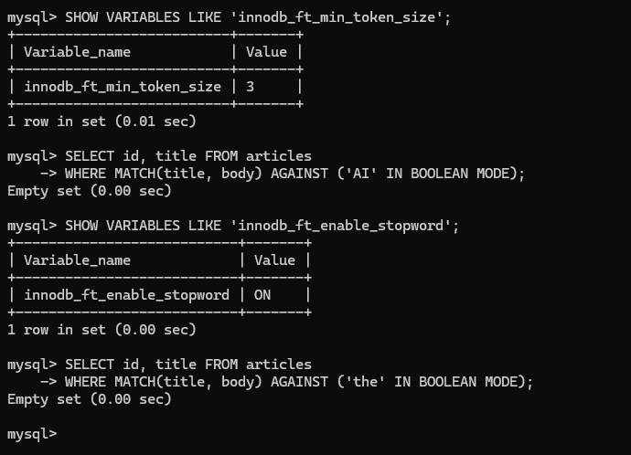

---

## 10. Экспорт лога действий

### 10.1. Проверка наличия лога

```bash
docker exec my-mysql ls -la /var/lib/mysql/general.log
```

### 10.2. Фильтрация лога — только свои действия

```bash
docker exec my-mysql cat /var/lib/mysql/general.log \
  | grep -E "Query[[:space:]]+(CREATE|INSERT|SELECT|UPDATE|DELETE|ALTER|DROP|EXPLAIN|SHOW|USE|SET)" \
  | grep -v -E "INSERT INTO help_|INSERT INTO time_zone|INSERT INTO mysql\.|SELECT \* FROM mysql\.general_log|SET NAMES|SET autocommit|SET sql_mode|SET character_set_results" \
  > my_actions.log
```

**Что делает команда:**
- `grep -E "Query..."` — оставляет только SQL-запросы (CREATE, INSERT, SELECT и т.д.)
- `grep -v -E "INSERT INTO help_..."` — убирает системные запросы MySQL
- `> my_actions.log` — сохраняет результат в файл

📸 **Скриншот №9:** `cat my_actions.log` — видны мои SQL-команды

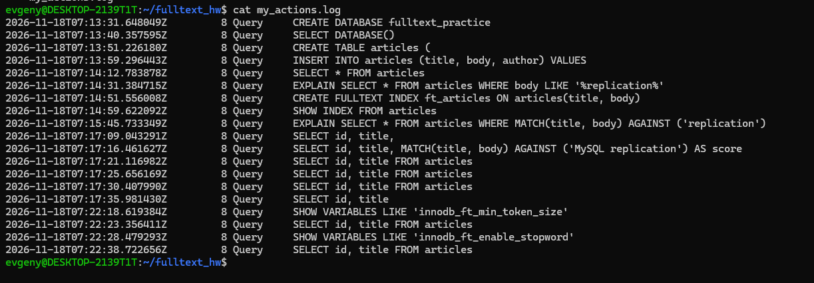

### 10.3. Копирование полного лога на хост

```bash
docker cp my-mysql:/var/lib/mysql/general.log ./general.log
ls -la general.log my_actions.log
```

📸 **Скриншот №10:** `ls -la` — оба файла с размерами

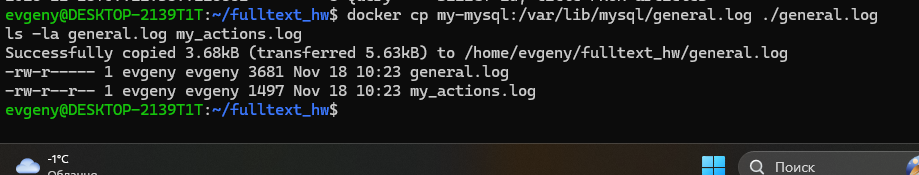

---

## 11. Дамп базы данных

```bash
docker exec -e MYSQL_PWD=123 my-mysql mysqldump -uroot \
  --set-gtid-purged=OFF \
  --single-transaction \
  fulltext_practice > fulltext_dump.sql
```

**Ключи mysqldump:**
- `--set-gtid-purged=OFF` — отключает GTID (для простоты восстановления)
- `--single-transaction` — консистентный снимок без блокировок (важно для InnoDB)

**Проверка дампа:**

```bash
ls -la fulltext_dump.sql
head -n 30 fulltext_dump.sql
```

В дампе видны:
- `CREATE TABLE articles`
- `INSERT INTO articles`
- `FULLTEXT KEY ft_articles` — индекс тоже экспортируется!

📸 **Скриншот №11:** `head -n 30 fulltext_dump.sql`

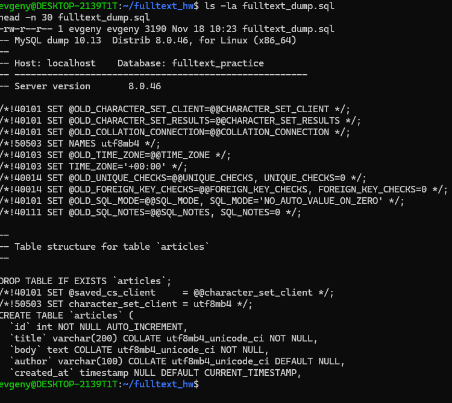

---

## 12. Сравнение LIKE vs FULLTEXT

| Аспект | `LIKE '%слово%'` | `FULLTEXT` |
|--------|-------------------|------------|
| **Тип индекса** | ❌ Не используется (full scan) | ✅ Перевёрнутый индекс (inverted index) |
| **Скорость на больших данных** | Медленно (O(n)) | Быстро (O(log n)) |
| **Поиск по суффиксу** | ✅ Работает | ⚠️ Только `*` в булевом режиме |
| **Релевантность (score)** | ❌ Нет | ✅ Есть |
| **Стоп-слова** | ❌ Не учитываются | ✅ Учитываются (InnoDB) |
| **Минимальная длина слова** | Нет ограничений | 3 символа (по умолчанию) |
| **Точная фраза** | ✅ Работает | ✅ Работает (`"..."` в булевом режиме) |
| **EXPLAIN type** | `ALL` | `fulltext` |
| **Использование индекса** | ❌ `key: NULL` | ✅ `key: ft_articles` |

**Вывод:** на больших объёмах данных (миллионы строк) FULLTEXT работает **в разы быстрее** `LIKE`, потому что использует индекс, а не полный перебор.

---

## 13. Итоговые выводы

### Что я изучил и понял:

1. **FULLTEXT — это перевёрнутый индекс (inverted index)**
   - Хранит для каждого слова список документов, где оно встречается
   - Позволяет мгновенно находить строки по слову, а не перебирать весь текст

2. **LIKE '%слово%' делает full scan**
   - `EXPLAIN` показывает `type: ALL`, `key: NULL`
   - На больших данных это катастрофически медленно

3. **MATCH ... AGAINST использует индекс**
   - `EXPLAIN` показывает `type: fulltext`, `key: ft_articles`
   - Работает быстро даже на миллионах строк

4. **Режимы поиска:**
   - **NATURAL LANGUAGE MODE** (по умолчанию) — поиск с релевантностью, слова объединяются через OR
   - **BOOLEAN MODE** — точный контроль с операторами `+`, `-`, `*`, `"..."`, `~`
   - **WITH QUERY EXPANSION** — расширение запроса (поиск по связанным словам)

5. **Ограничения InnoDB:**
   - Минимальная длина слова — 3 символа (`innodb_ft_min_token_size`)
   - Стоп-слова не индексируются (`innodb_ft_enable_stopword = ON`)
   - Максимальная длина слова — 84 символа

6. **InnoDB vs MyISAM:**
   - InnoDB **не применяет 50%-й порог** (слова, встречающиеся в >50% строк, не отбрасываются)
   - InnoDB поддерживает FULLTEXT с версии 5.6
   - InnoDB full-text search crash-safe

7. **MATCH ... AGAINST в WHERE не комбинируется с другими индексами**
   - Это «или FULLTEXT, или ничего»
   - Нельзя одновременно использовать FULLTEXT и обычный B-дерево индекс

8. **FULLTEXT работает только с типами:**
   - `CHAR`, `VARCHAR`, `TEXT`
   - Поддерживается в InnoDB и MyISAM

---

## 📁 Приложенные файлы

В данной папке находятся:

- **`README.md`** — этот отчёт
- **`my.cnf`** — конфигурация MySQL
- **`my_actions.log`** — отфильтрованный лог моих SQL-действий
- **`general.log`** — полный лог MySQL
- **`fulltext_dump.sql`** — дамп базы данных `fulltext_practice`
- **`screenshots/`** — папка со скриншотами №1–№11

---

## 🔗 Полезные ссылки

- [MySQL FULLTEXT Search Documentation](https://dev.mysql.com/doc/refman/8.0/en/fulltext-search.html)
- [Boolean Full-Text Searches](https://dev.mysql.com/doc/refman/8.0/en/fulltext-boolean.html)
- [InnoDB FULLTEXT Indexes](https://dev.mysql.com/doc/refman/8.0/en/innodb-fulltext-index.html)
- [Fine-Tuning MySQL Full-Text Search](https://dev.mysql.com/doc/refman/8.0/en/fulltext-fine-tuning.html)

---

## ✅ Чек-лист выполненной работы

- [x] Создан контейнер MySQL с правильной конфигурацией
- [x] Создана база данных `fulltext_practice` и таблица `articles`
- [x] Таблица заполнена тестовыми данными (5 строк)
- [x] Продемонстрирована проблема `LIKE` (full scan)
- [x] Создан FULLTEXT-индекс `ft_articles`
- [x] Подтверждено использование индекса через `EXPLAIN`
- [x] Выполнен поиск в режиме естественного языка
- [x] Выполнен поиск в булевом режиме с операторами `+`, `-`, `*`, `"..."`
- [x] Выполнен поиск с расширением запроса (`WITH QUERY EXPANSION`)
- [x] Продемонстрированы ограничения InnoDB (минимальная длина слова, стоп-слова)
- [x] Экспортирован лог действий пользователя
- [x] Создан дамп базы данных
- [x] Оформлен подробный отчёт `README.md`

---

**Работа выполнена полностью.** Все скриншоты приложены, выводы сделаны, файлы экспортированы.
