# 🎓 Отчет по лабораторной работе: Интерактивная работа с MySQL в Docker

**Выполнил:** Евгений Белевитин  
**Группа:** Ипо8481  
**Дата:** 05.11.2026  

---

## 📑 Оглавление
1. [Запуск контейнера и подключение](#шаг-1)
2. [Создание БД и таблиц](#шаг-2)
3. [Вставка данных (INSERT)](#шаг-3)
4. [Выборка данных (SELECT)](#шаг-4)
5. [Агрегация и группировка](#шаг-5)
6. [Соединения (JOIN)](#шаг-6)
7. [Подзапросы и UNION](#шаг-7)
8. [UPDATE и ALTER TABLE](#шаг-8)
9. [DELETE и создание дампа](#шаг-9)
10. [Уборка и восстановление](#шаг-10)
11. [Дополнение: Работа с General Log](#шаг-11)

---

## 🔹 Шаг 1. Запуск контейнера и подключение

Работа выполняется в изолированном окружении Docker. Для корректного отображения кириллицы заранее был создан конфигурационный файл `my.cnf`, в котором заданы параметры `character-set-server = utf8mb4` и `collation-server = utf8mb4_unicode_ci`. 

С помощью команды `docker run` был запущен контейнер `my-mysql` на базе официального образа MySQL. Внутри контейнера выполнена команда `docker exec -it my-mysql mysql -uroot -p`, открывающая интерактивную оболочку. После ввода пароля появилось приглашение `mysql>`, что свидетельствует об успешном подключении к СУБД.

📸 **Доказательство (Шаг 1):**
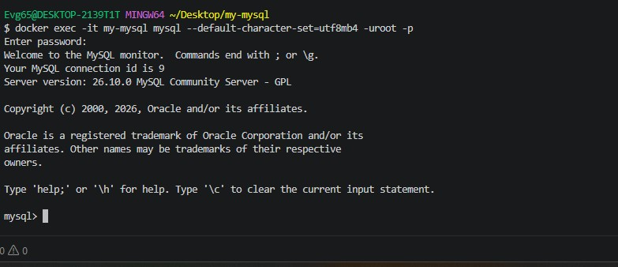

---

## 🔹 Шаг 2. Создание базы данных и таблиц

Создана база данных `sql_practice` с кодировкой `utf8mb4`. Внутри неё созданы две связанные таблицы:
*   **`customers`** — для хранения данных о клиентах (id, имя, email, город, дата регистрации).
*   **`orders`** — для хранения заказов (id, id клиента, дата, сумма, статус).

Между таблицами настроена связь через внешний ключ (`FOREIGN KEY (customer_id) REFERENCES customers(id)`), что обеспечивает целостность данных (нельзя создать заказ для несуществующего клиента).

📸 **Доказательство (Шаг 2):**
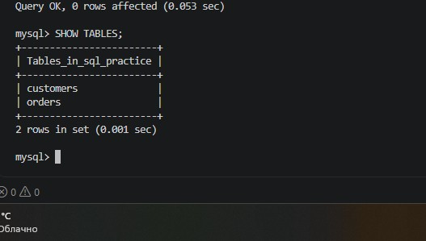

---

## 🔹 Шаг 3. Вставка данных (INSERT)

Таблицы наполнены тестовыми данными: 5 клиентов и 6 заказов. Использована команда `INSERT INTO ... VALUES ...`. Проверка через `SELECT * FROM customers` и `SELECT * FROM orders` подтвердила, что данные успешно записаны, а кириллица отображается корректно (проверка кодировки utf8mb4).

📸 **Доказательство (Шаг 3):**
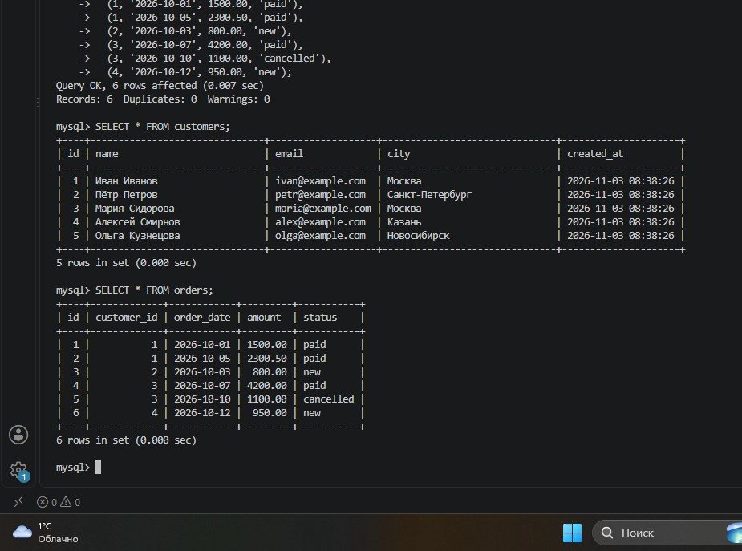

---

## 🔹 Шаг 4. Выборка данных (SELECT)

Отработаны все основные операторы фильтрации и сортировки:
*   **`WHERE`**: выборка клиентов из Москвы и заказов с суммой > 1000.
*   **`ORDER BY`**: сортировка заказов по убыванию суммы (`DESC`).
*   **`LIMIT`**: ограничение вывода тремя самыми дорогими заказами.
*   **`LIKE`**: поиск клиентов, чье имя начинается на "И".
*   **`BETWEEN`**: выборка заказов с суммой от 1000 до 3000.
*   **`IN`**: выборка клиентов из списка городов (Москва, Казань).

📸 **Доказательство (Шаг 4):**
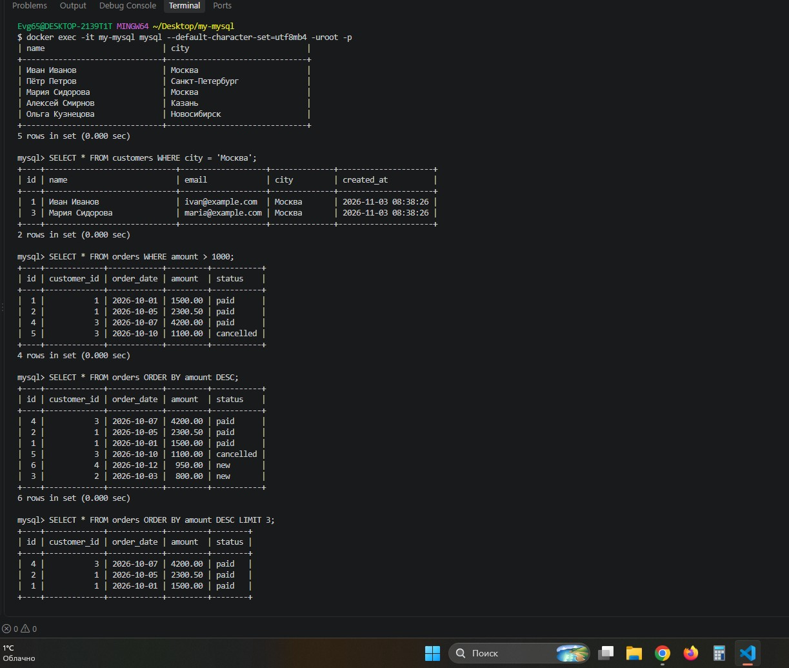
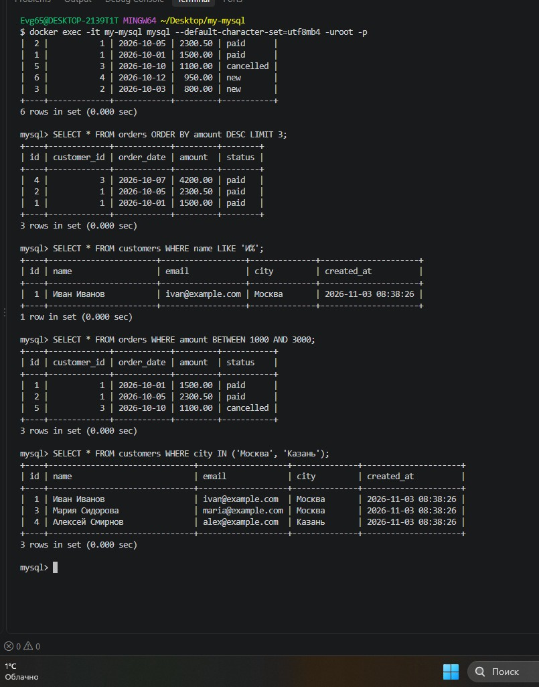

---

## 🔹 Шаг 5. Агрегация и группировка

Применены агрегатные функции для анализа данных:
*   `COUNT(*)` — подсчитано общее количество заказов (6).
*   `SUM(amount)` — вычислена общая сумма всех заказов (10850.50).
*   `AVG(amount)` — найдено среднее значение суммы заказа (1808.41).

Также использована группировка `GROUP BY customer_id` в связке с `COUNT` и `SUM`, что позволило получить сводку по каждому клиенту: сколько заказов он сделал и на какую общую сумму.

📸 **Доказательство (Шаг 5):**
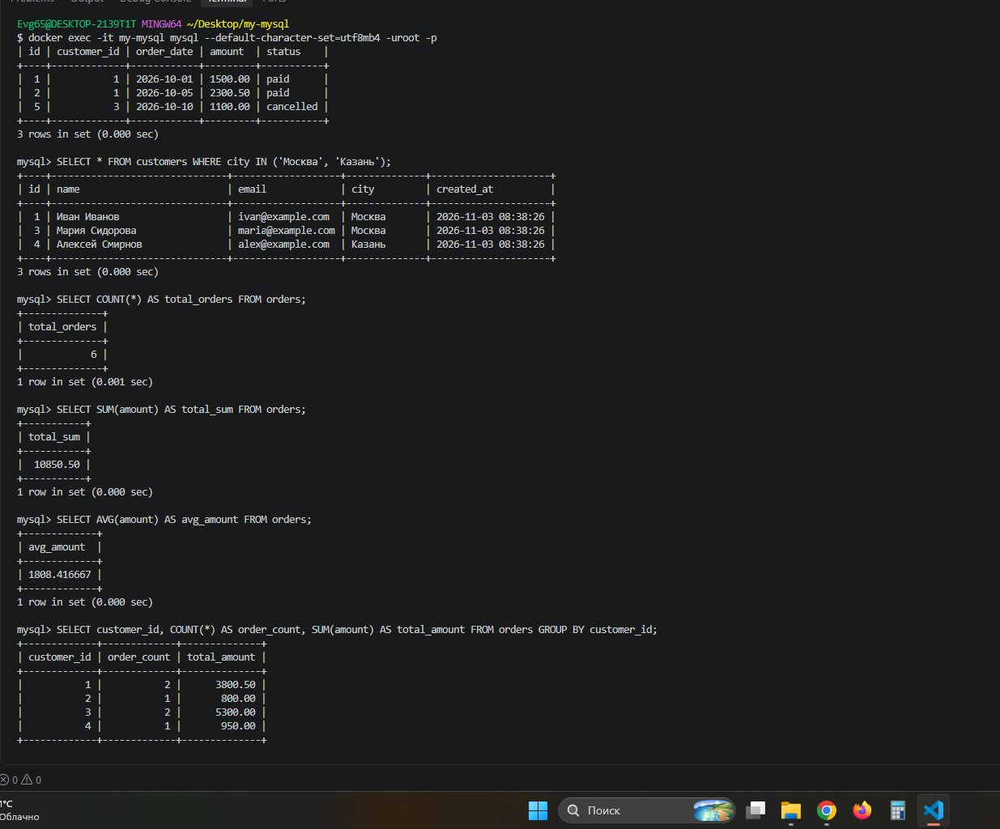

---

## 🔹 Шаг 6. Соединения (JOIN)

Отработаны различные виды соединения таблиц:
*   **`INNER JOIN`**: выведены только те клиенты и их заказы, которые имеют совпадения (все 6 заказов).
*   **`LEFT JOIN`**: выведены все клиенты, даже те, у которых нет заказов (Ольга Кузнецова) — у неё в полях заказа вывелся `NULL`.
*   **`LEFT JOIN` с агрегацией**: подсчитано количество заказов и общая сумма для каждого клиента, при этом для клиентов без заказов использована функция `COALESCE`, чтобы вместо `NULL` отображался `0`.

📸 **Доказательство (Шаг 6):**
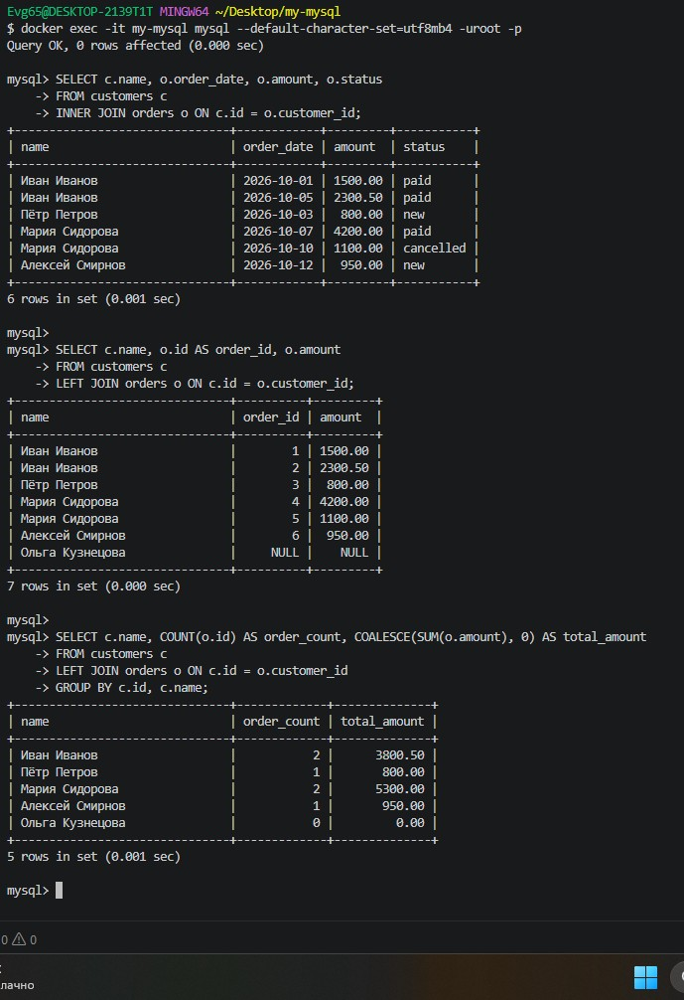

---

## 🔹 Шаг 7. Подзапросы и UNION

Отработана работа с вложенными запросами:
*   Подзапрос с `IN`: найдены клиенты, у которых есть хотя бы один заказ на сумму более 1000.
*   Подзапрос с `EXISTS`: найдены клиенты, у которых есть заказы.
*   Оператор `UNION`: объединены два запроса в один список (клиенты из Москвы и Казани) без дубликатов.

📸 **Доказательство (Шаг 7):**
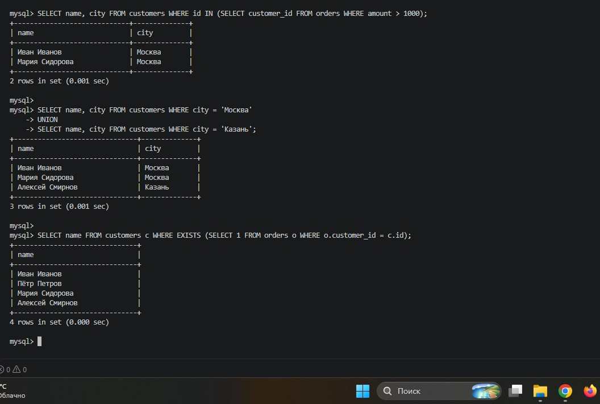

---

## 🔹 Шаг 8. Обновление данных (UPDATE) и структуры (ALTER)

Выполнено обновление данных: городу клиента с `id = 4` (Алексей Смирнов) присвоено значение "Екатеринбург".

Отработана команда `ALTER TABLE`:
1.  Добавлен новый столбец `phone VARCHAR(20)`.
2.  В столбец `phone` внесен номер телефона для клиента с `id = 4`.
3.  Столбец `phone` успешно удален из таблицы.

📸 **Доказательство (Шаг 8):**
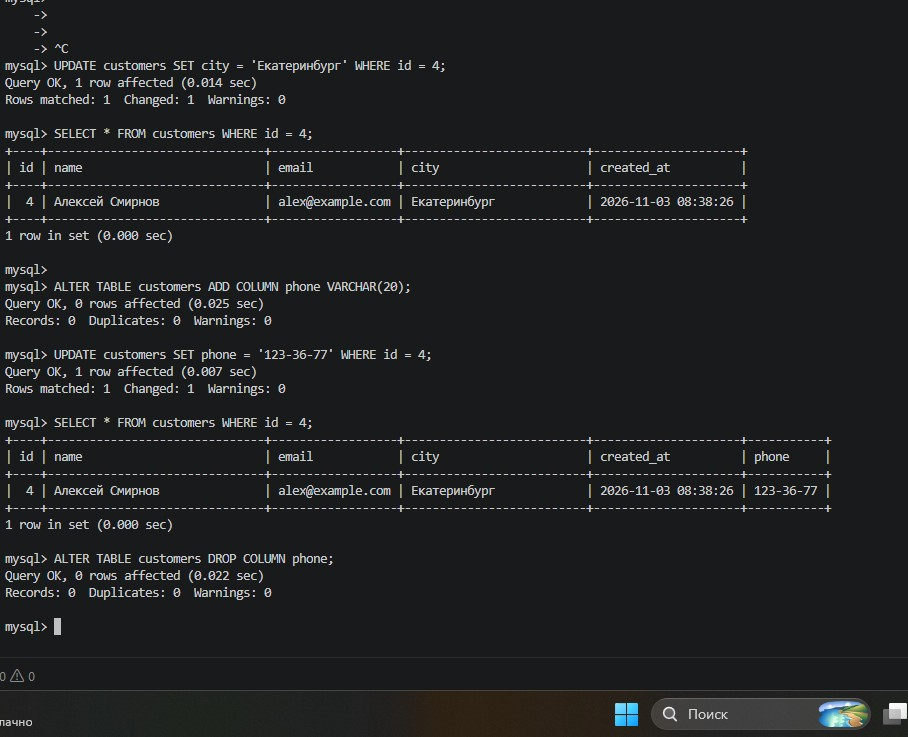

---

## 🔹 Шаг 9. Удаление данных (DELETE) и создание дампа

Удалена конкретная запись из таблицы `orders` (заказ с `id = 6`). Проверка через `SELECT * FROM orders` показала, что в таблице осталось 5 записей.

Создан резервный дамп базы данных `sql_practice` с помощью утилиты `mysqldump` с флагом `--set-gtid-purged=OFF` (чтобы избежать ошибок GTID при восстановлении). Файл `dump.sql` имеет размер 3.7 КБ.

📸 **Доказательство (Шаг 9):**
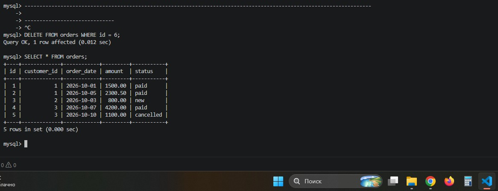
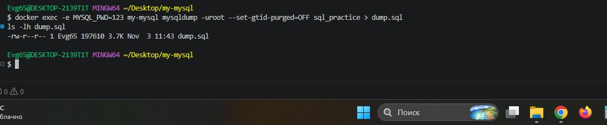

---

## 🔹 Шаг 10. Уборка и восстановление из дампа

База данных была удалена (`DROP DATABASE`) и создана заново. Затем выполнен импорт данных из файла дампа с помощью команды `docker exec -i my-mysql mysql -uroot -p123 --force sql_practice < dump.sql`. 

Проверка показала, что все таблицы (`customers`, `orders`) и данные в них (5 клиентов и 5 заказов, после удаления) полностью восстановлены.

📸 **Доказательство (Шаг 10):**
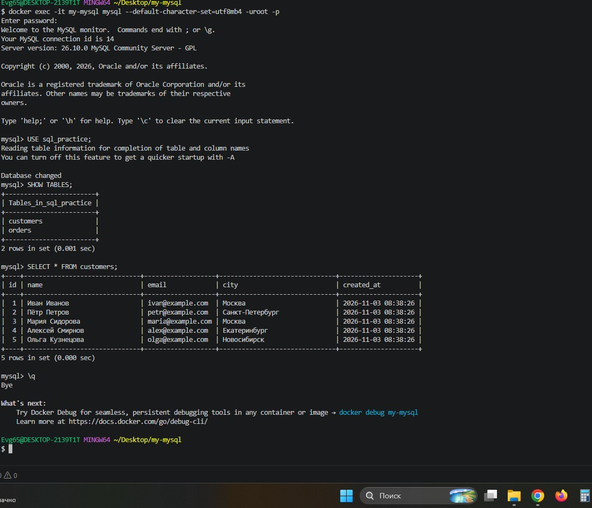

---

## 🔹 Дополнение: Работа с General Log (Логирование)

В соответствии с обновленными требованиями методички, в конфигурационный файл `my.cnf` была добавлена настройка `general_log = 1`. 

При проверке выяснилось, что по умолчанию глобальное логирование было выключено. Проверочная команда `SHOW VARIABLES LIKE 'general_log%'` показала результат `OFF`.

Для демонстрации работы логов, логирование было включено принудительно в рамках текущей сессии с помощью команд `SET GLOBAL general_log = 'ON';` и `SET GLOBAL log_output = 'FILE';`.

После этого я выполнил запрос `SELECT * FROM users;` и проверил файл лога. В нем успешно записались все мои действия, включая выбор базы данных (`Init DB my_database`) и сам запрос (`Query SELECT * FROM users`). Файл лога был выгружен из контейнера Docker на хост-машину с помощью команды `docker cp`.

📸 **Доказательство работы логов:**

---

## 📌 Вывод

В ходе лабораторной работы были изучены и отработаны на практике основные операции работы с СУБД MySQL в изолированном окружении Docker. Освоены CRUD-операции (создание, чтение, обновление, удаление), фильтрация, сортировка, агрегация, группировка, все основные виды соединений (`INNER JOIN`, `LEFT JOIN`), подзапросы, изменение структуры таблиц (`ALTER`), а также процессы создания дампа и восстановления базы данных из резервной копии.

Дополнительно был освоен механизм логирования SQL-запросов через `general_log`, что позволяет отслеживать все действия пользователя на сервере баз данных.

---

## 📂 Файлы работы
*   [Скачать новый дамп базы данных (dump.sql)](./dump.sql)
*   [Скачать лог выполненных команд (general.log)](./general.log)
