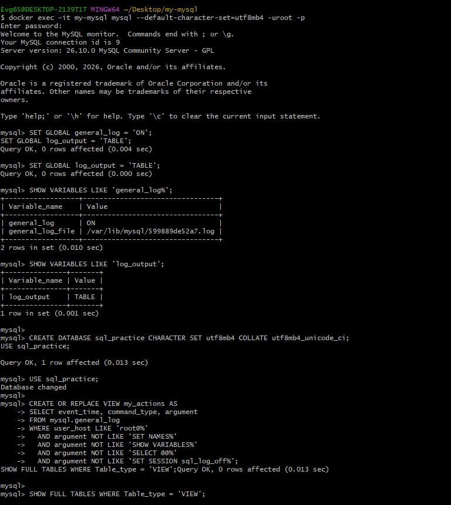
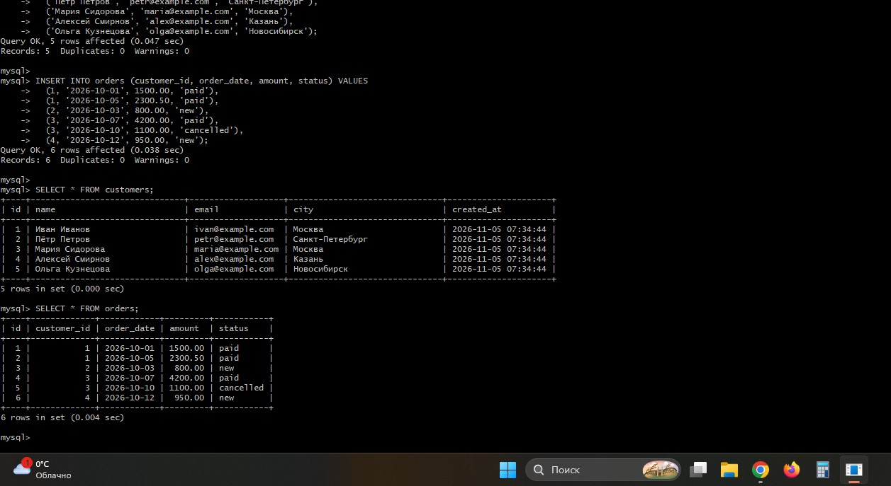
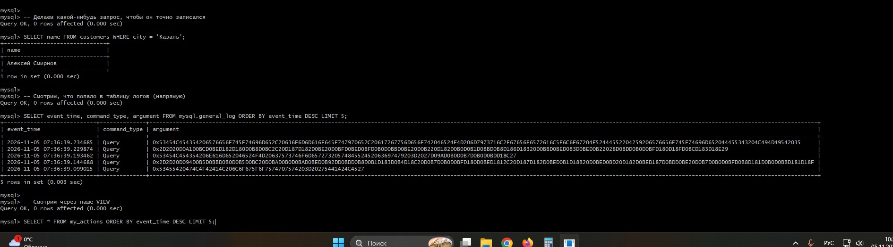
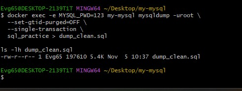
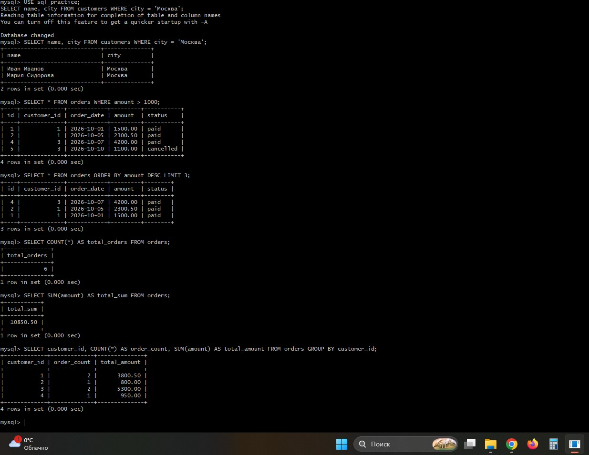
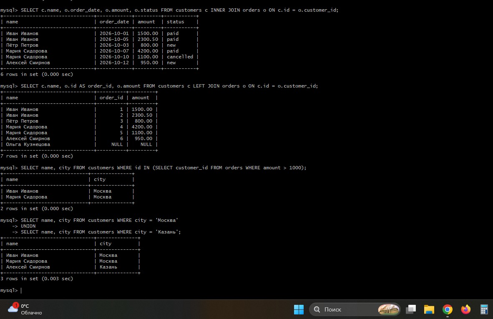
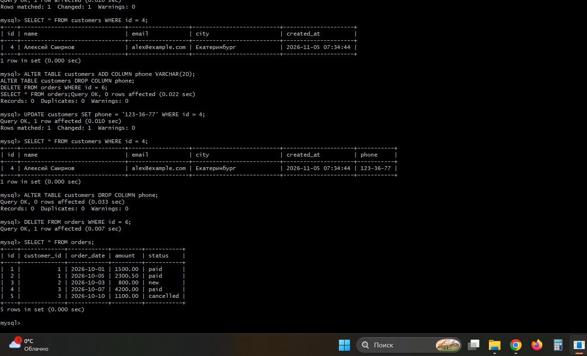
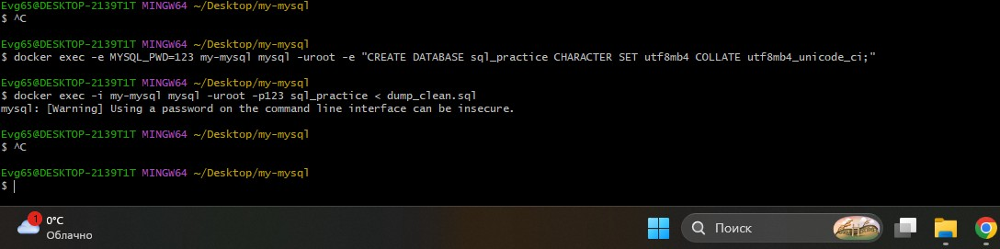
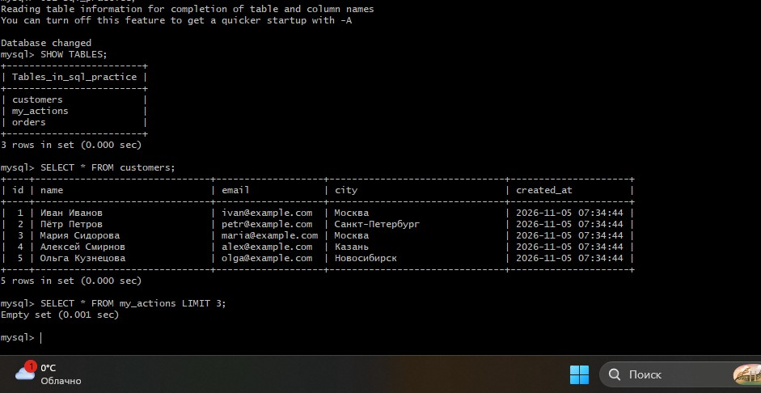

# 🎓 Отчет по лабораторной работе №2: Логирование в MySQL и VIEW

**Выполнил:** Евгений Белевитин  
**Группа:** Ипо8481  
**Дата:** 05.11.2026

---

## 📑 Содержание
1. [Настройка логов и создание VIEW](#step1)
2. [Создание таблиц и вставка данных](#step2)
3. [Проверка работы логов (mysql.general_log)](#step3)
4. [Создание дампа базы данных](#step4)
5. [Выборка данных (SELECT, WHERE, ORDER BY)](#step5)
6. [Агрегация и группировка (COUNT, SUM, GROUP BY)](#step6)
7. [Соединения (JOIN) и подзапросы](#step7)
8. [Обновление данных (UPDATE), структура (ALTER) и удаление](#step8)
9. [Просмотр логов через VIEW и восстановление БД](#step9)

---

## 🔹 1. Настройка логов (log_output = TABLE) и создание VIEW
В рамках обновленной методички было настроено логирование всех SQL-запросов в системную таблицу `mysql.general_log`. 
Для фильтрации служебной информации было создано представление (VIEW) `my_actions`.

> **Скриншот 1:** Настройка `general_log = 'ON'`, `log_output = 'TABLE'`, создание базы `sql_practice` и VIEW `my_actions`.
> 
> 

---

## 🔹 2. Создание таблиц и вставка данных
Созданы связанные таблицы `customers` и `orders` (с внешним ключом `FOREIGN KEY`). 
В таблицы добавлены тестовые данные: 5 клиентов и 6 заказов.

> **Скриншот 2:** Создание таблиц и вывод данных через `SELECT *`.
> 
> 

---

## 🔹 3. Проверка работы логов (mysql.general_log)
Сделан тестовый запрос `SELECT name FROM customers WHERE city = 'Казань'`. 
При проверке напрямую в таблице `mysql.general_log` видно, что запрос записался в лог в зашифрованном (HEX) виде.

> **Скриншот 3:** Работа системной таблицы логов.
> 
> 

---

## 🔹 4. Создание дампа базы данных
Создан резервный дамп `dump_clean.sql` с флагами `--set-gtid-purged=OFF` и `--single-transaction` для безопасного восстановления.

> **Скриншот 4:** Успешное создание дампа (виден размер файла).
> 
> 

---

## 🔹 5. Выборка данных (SELECT, WHERE, ORDER BY)
Отработаны базовые операторы:
*   Фильтрация `WHERE` (поиск клиентов из Москвы).
*   Сортировка `ORDER BY` (по убыванию суммы заказа).
*   Ограничение вывода `LIMIT` (топ-3 заказа).

> **Скриншот 5:** Результаты выборки.
> 
> 

---

## 🔹 6. Агрегация и группировка
Применены агрегатные функции: `COUNT` (всего заказов), `SUM` (общая сумма). 
Выполнена группировка `GROUP BY` для подсчета суммы по каждому клиенту.

> **Скриншот 6:** Результаты агрегации.
> 
> 

---

## 🔹 7. Соединения (JOIN) и подзапросы
Отработаны различные способы объединения данных:
*   `INNER JOIN` (только совпадающие строки).
*   `LEFT JOIN` (все клиенты, даже без заказов, с выводом `NULL`).
*   Подзапрос с `IN` и объединение `UNION`.

> **Скриншот 7:** Результаты JOIN и подзапросов.
> 
> 

---

## 🔹 8. Обновление данных, структура и удаление
Обновлен город клиента (`UPDATE`). 
Отработана команда `ALTER TABLE`: добавлен столбец `phone`, в него внесены данные, а затем столбец удален. 
Удалена одна запись из таблицы заказов (`DELETE`).

> **Скриншот 8:** Выполнение UPDATE, ALTER и DELETE.
> 
> 

---

## 🔹 9. Просмотр логов и восстановление БД
Все изменения (UPDATE, ALTER, DELETE) были зафиксированы в логе. С помощью VIEW `my_actions` отфильтрованы записи.
Также база данных была удалена, создана заново, и в нее импортирован дамп `dump_clean.sql`. Проверена целостность данных.

> **Скриншот 9:** Читаемый вывод логов через VIEW, проверка восстановленных данных.
> 
> 

---

## 📌 Вывод
В ходе работы было изучено логирование SQL-запросов в таблицу (`log_output='TABLE'`), создание VIEW для фильтрации логов, а также отработаны все основные операции: выборка, соединения (JOIN), подзапросы, обновление, удаление, изменение структуры, создание дампа и восстановление базы данных из резервной копии.

---

## 📂 Файлы работы
*   [Скачать дамп базы данных (dump_clean.sql)](./dump_clean.sql)
* [Скачать выгруженный лог (general_log.txt)](./general_log.txt)