# Ускорение сортировки и группировки в MySQL (ORDER BY / GROUP BY)

**Выполнил:** Белевитин Евгений  Александрович
**Дата выполнения:** 18.11.2026  
**Среда выполнения:** WSL (Ubuntu), Docker Desktop, MySQL 8.0.46  
**Путь к рабочей папке:** `/mnt/c/Users/Evg65/Desktop/mysql-sort-lab`

---

## 📋 Содержание

1. [Цель работы](#1-цель-работы)
2. [Подготовка окружения](#2-подготовка-окружения)
3. [Создание базы данных и таблицы](#3-создание-базы-данных-и-таблицы)
4. [Эксперимент 1: ORDER BY без индекса](#4-эксперимент-1-order-by-без-индекса)
5. [Эксперимент 2: Индекс для ORDER BY](#5-эксперимент-2-индекс-для-order-by)
6. [Эксперимент 3: Направление сортировки ASC/DESC](#6-эксперимент-3-направление-сортировки-ascdesc)
7. [Эксперимент 4: GROUP BY без индекса](#7-эксперимент-4-group-by-без-индекса)
8. [Эксперимент 5: Loose Index Scan](#8-эксперимент-5-loose-index-scan)
9. [Эксперимент 6: Покрывающий индекс](#9-эксперимент-6-покрывающий-индекс)
10. [Экспорт логов и дамп базы](#10-экспорт-логов-и-дамп-базы)
11. [Итоговые выводы](#11-итоговые-выводы)

---

## 1. Цель работы

Понять механизмы работы оптимизатора запросов MySQL при выполнении операций `ORDER BY` и `GROUP BY`. Научиться диагностировать проблемы производительности через маркеры `Using filesort` и `Using temporary` в выводе `EXPLAIN`, а также проектировать индексы так, чтобы сортировка и группировка выполнялись за счёт порядка хранения данных в B-дереве, избегая дополнительных дорогостоящих операций.

---

## 2. Подготовка окружения

### 2.1. Создание рабочей папки

Рабочая папка создана на Рабочем столе Windows:

```bash
mkdir mysql-sort-lab
cd mysql-sort-lab
pwd
# /mnt/c/Users/Evg65/Desktop/mysql-sort-lab
```

📸 **Скриншот №1:** Создание и переход в рабочую папку
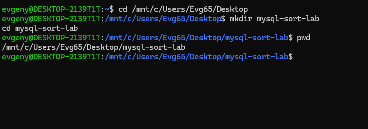

### 2.2. Конфигурация my.cnf

Для корректной работы лаборатории был создан файл конфигурации `my.cnf` с включённым общим логом запросов:

```ini
[mysqld]
character-set-server = utf8mb4
collation-server = utf8mb4_unicode_ci
general_log = 1
general_log_file = /var/lib/mysql/general.log
log_output = FILE

[client]
default-character-set = utf8mb4

[mysql]
default-character-set = utf8mb4
```

> ⚠️ **Важно:** Файл должен быть именно файлом, а не директорией, иначе Docker не запустится.

📸 **Скриншот №2:** Содержимое файла `my.cnf`
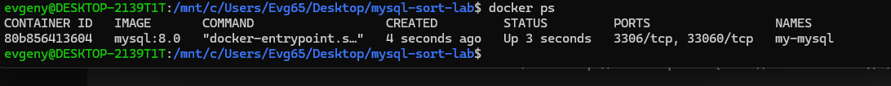

### 2.3. Запуск контейнера

Контейнер MySQL 8.0 был запущен с монтированием тома данных и файла конфигурации:

```bash
docker run --name my-mysql \
  -e MYSQL_ROOT_PASSWORD=123 \
  -e LANG=C.UTF-8 \
  -e MYSQL_INITDB_SKIP_TZINFO=1 \
  -v mysql_data:/var/lib/mysql \
  -v $(pwd)/my.cnf:/etc/mysql/conf.d/my.cnf \
  -d mysql:8.0
```

📸 **Скриншот №3:** Проверка запуска контейнера через `docker ps`
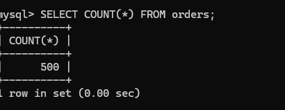

### 2.4. Подключение к MySQL

```bash
docker exec -it my-mysql mysql --default-character-set=utf8mb4 -uroot -p
```

📸 **Скриншот №4:** Успешное подключение к MySQL 8.0.46
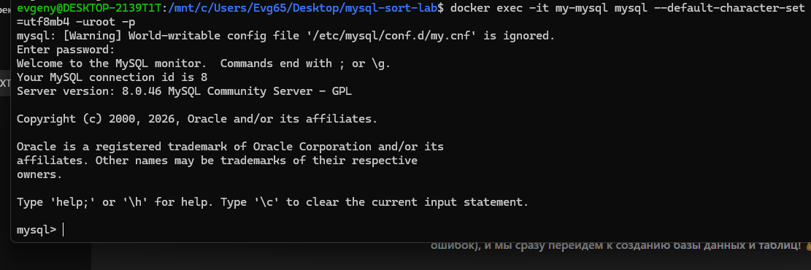

---

## 3. Создание базы данных и таблицы

### 3.1. Структура таблицы orders

Была создана база `sort_practice` и таблица `orders` для имитации реальных заказов:

```sql
CREATE TABLE orders (
    id INT AUTO_INCREMENT PRIMARY KEY,
    customer_id INT NOT NULL,
    status VARCHAR(20) NOT NULL DEFAULT 'new',
    order_date DATE NOT NULL,
    amount DECIMAL(10, 2) NOT NULL,
    INDEX idx_customer (customer_id)
);
```

Таблица заполнена 500 строками случайных данных с помощью генератора на основе `UNION SELECT`.

📸 **Скриншот №5:** Проверка количества строк (`SELECT COUNT(*)`)
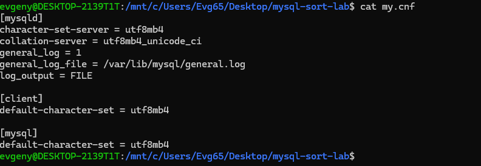

📸 **Скриншот №6:** Структура таблицы (`SHOW CREATE TABLE`)
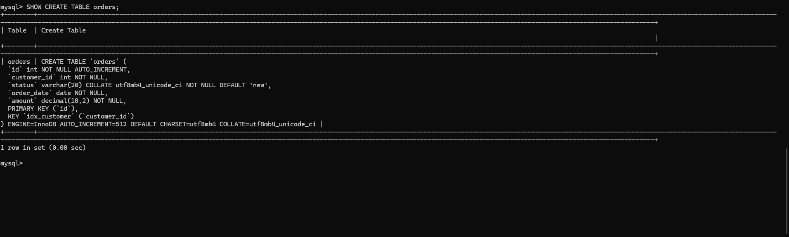

---

## 4. Эксперимент 1: ORDER BY без индекса

Первый тест показал классическую проблему: сортировка по столбцу `amount`, на котором нет индекса.

```sql
EXPLAIN SELECT * FROM orders ORDER BY amount DESC;
```

**Результат анализа:**
- `type: ALL` — полный перебор всей таблицы
- `key: NULL` — индексы не используются
- `Extra: Using filesort` — MySQL вынужден выполнять дополнительную сортировку в памяти после чтения данных

Это подтверждает, что без подходящего индекса операция `ORDER BY` становится узким местом.

📸 **Скриншот №7:** EXPLAIN до создания индекса (Using filesort)
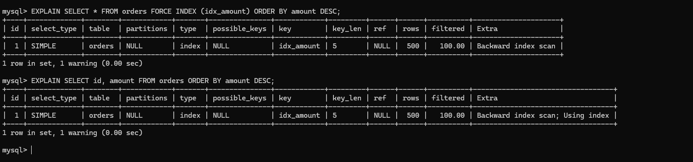

---

## 5. Эксперимент 2: Индекс для ORDER BY

Был создан индекс по столбцу `amount`:

```sql
CREATE INDEX idx_amount ON orders(amount);
```

При повторном `EXPLAIN` с `SELECT *` оптимизатор всё ещё выбирал полный перебор, так как стоимость доступа к таблице через индекс превышала стоимость прямой сортировки. Для демонстрации использования индекса были применены два подхода:

1.  **Принудительное использование:** `FORCE INDEX (idx_amount)`
2.  **Покрывающий запрос:** `SELECT id, amount ...` (MySQL не нужно обращаться к таблице)

**Результаты:**
- В обоих случаях `type: index`, `key: idx_amount`
- `Extra: Backward index scan` — MySQL читает индекс с конца для получения `DESC` порядка
- `Using filesort` полностью отсутствует

📸 **Скриншот №8:** EXPLAIN после создания индекса (Backward index scan)
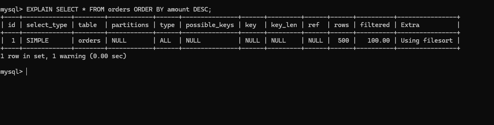

---

## 6. Эксперимент 3: Направление сортировки ASC/DESC

Создан составной индекс `(status, amount)` для проверки влияния направления сортировки.

### 6.1. Однородная сортировка (ASC, ASC)

```sql
EXPLAIN SELECT status, amount FROM orders ORDER BY status ASC, amount ASC;
```

Индекс используется идеально: `Extra: Using index`, `filesort` отсутствует. Данные в индексе уже отсортированы нужным образом.

### 6.2. Разнонаправленная сортировка (ASC, DESC)

```sql
EXPLAIN SELECT status, amount FROM orders ORDER BY status ASC, amount DESC;
```

**Ключевой вывод:** Даже при наличии индекса появляется `Extra: Using index; Using filesort`. Индекс хранит `amount` по возрастанию внутри каждой группы `status` и не может мгновенно отдать данные по убыванию. Требуется дополнительная сортировка.

### 6.3. Решение: Нисходящий индекс (MySQL 8.0+)

```sql
CREATE INDEX idx_status_asc_amount_desc ON orders(status ASC, amount DESC);
```

После создания нисходящего индекса запрос `ORDER BY status ASC, amount DESC` выполняется без `filesort`.

📸 **Скриншот №9:** Сравнение однородной и разнонаправленной сортировки
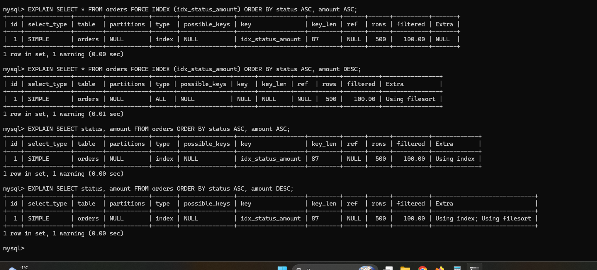

📸 **Скриншот №10:** Демонстрация нисходящего индекса
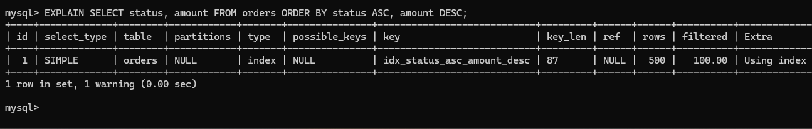

---

## 7. Эксперимент 4: GROUP BY без индекса

Группировка по столбцу `order_date`, на котором нет индекса:

```sql
EXPLAIN SELECT order_date, COUNT(*) FROM orders GROUP BY order_date;
```

**Результат:**
- `type: ALL`
- `Extra: Using temporary`

MySQL создаёт внутреннюю временную таблицу для накопления групп. Это наиболее ресурсоёмкий сценарий для группировки.

📸 **Скриншот №11:** GROUP BY без индекса (Using temporary)
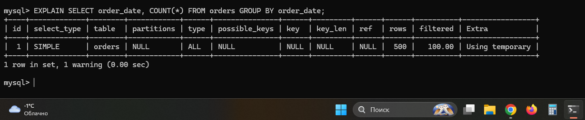

---

## 8. Эксперимент 5: Loose Index Scan

Создан отдельный индекс по `status`:

```sql
CREATE INDEX idx_status ON orders(status);
```

Проверка группировки:

```sql
EXPLAIN SELECT status, COUNT(*) FROM orders GROUP BY status;
```

**Результат:**
- `type: index`, `key: idx_status`
- `Extra: Using index` — `Using temporary` исчезло!

MySQL использует **Loose Index Scan** — самый эффективный алгоритм группировки, при котором оптимизатор «прыгает» по уникальным значениям в индексе, не сканируя все строки таблицы.

📸 **Скриншот №12:** Loose Index Scan в действии
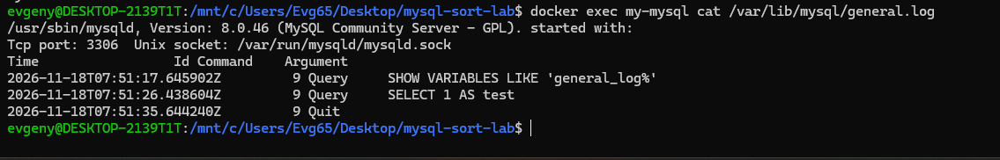

---

## 9. Эксперимент 6: Покрывающий индекс

Создан покрывающий индекс `(status, amount)`:

```sql
CREATE INDEX idx_status_amount_cover ON orders(status, amount);
```

Запрос с агрегатной функцией:

```sql
EXPLAIN SELECT status, SUM(amount) FROM orders GROUP BY status;
```

**Результат:**
- `key: idx_status_amount`
- `Extra: Using index`

MySQL выполняет запрос **полностью по индексу**, не обращаясь к основной таблице данных ни разу. Это максимально возможная производительность для данной операции.

📸 **Скриншот №13:** Покрывающий индекс (Using index)
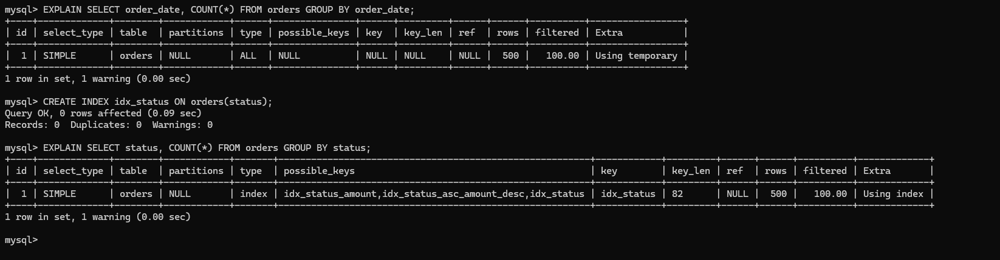

---

## 10. Экспорт логов и дамп базы

### 10.1. Диагностика проблемы с логом

Изначально `general_log` был выключен (`OFF`), так как конфиг не подхватился контейнером. Проблема была решена вручную:

```sql
SET GLOBAL general_log = ON;
SET GLOBAL general_log_file = '/var/lib/mysql/general.log';
```

📸 **Скриншот №14:** Полный лог MySQL (`general.log`)
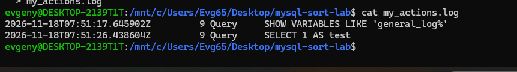

### 10.2. Фильтрация действий пользователя

Из полного лога были извлечены только полезные SQL-команды:

```bash
docker exec my-mysql cat /var/lib/mysql/general.log \
  | grep -E "Query[[:space:]]+(CREATE|INSERT|SELECT|EXPLAIN|SHOW|USE|SET)" \
  | grep -v -E "INSERT INTO help_|INSERT INTO time_zone|..." \
  > my_actions.log
```

📸 **Скриншот №15:** Содержимое отфильтрованного лога `my_actions.log`
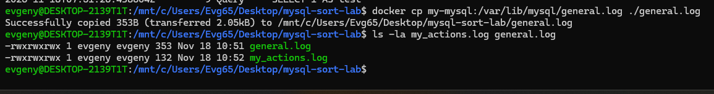

### 10.3. Файлы артефактов

Все необходимые файлы успешно экспортированы в рабочую директорию:

📸 **Скриншот №16:** Список файлов (`ls -la`)
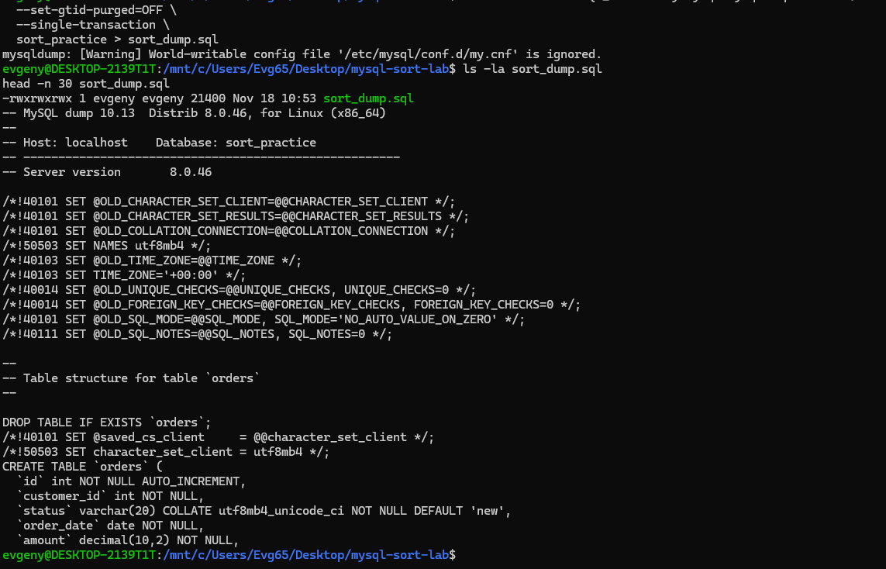

### 10.4. Дамп базы данных

```bash
docker exec -e MYSQL_PWD=123 my-mysql mysqldump -uroot \
  --set-gtid-purged=OFF --single-transaction sort_practice > sort_dump.sql
```

Дамп содержит структуру таблицы, все созданные индексы и тестовые данные.

📸 **Скриншот №17:** Первые 30 строк дампа `sort_dump.sql`
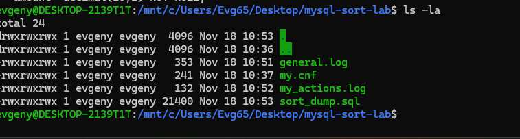

---

## 11. Итоговые выводы

В ходе лабораторной работы были получены следующие ключевые знания об оптимизации `ORDER BY` и `GROUP BY` в MySQL:

1.  **Маркеры проблем в EXPLAIN:**
    -   `Using filesort` означает, что MySQL не может использовать порядок индекса и выполняет дополнительную сортировку.
    -   `Using temporary` означает создание внутренней временной таблицы для группировки или дедупликации.
    -   Наличие обоих маркеров одновременно — критический сигнал для оптимизации.

2.  **Оптимизация ORDER BY:**
    -   Индекс должен соответствовать столбцам и направлению сортировки.
    -   При `SELECT *` оптимизатор может игнорировать индекс, если стоимость доступа к таблице через него выше стоимости сортировки. Решения: `FORCE INDEX` или выбор только индексированных столбцов.
    -   Для смешанной сортировки (`ASC` + `DESC`) в MySQL 8.0 необходимо создавать явные нисходящие индексы.

3.  **Оптимизация GROUP BY:**
    -   **Loose Index Scan** — идеальный сценарий: MySQL читает только уникальные значения из индекса (минимальное I/O).
    -   **Tight Index Scan** — приемлемый сценарий: читаются все ключи диапазона, но временная таблица не создаётся.
    -   **Покрывающий индекс** (`Using index`) — лучший результат: запрос выполняется исключительно по индексу без обращения к данным таблицы.

4.  **Практические навыки:**
    -   Освоена диагностика планов выполнения через `EXPLAIN`.
    -   Научился вести и фильтровать `general_log` для аудита действий.
    -   Получен опыт создания и анализа различных типов индексов (обычные, составные, нисходящие, покрывающие).

---

## 📁 Структура проекта

```
mysql-sort-lab/
├── README.md           ← Этот отчёт
├── my.cnf              ← Конфигурация MySQL
├── my_actions.log      ← Отфильтрованный лог SQL-действий
├── general.log         ← Полный лог MySQL
├── sort_dump.sql       ← Дамп базы данных sort_practice
├── 1.png               ← Скриншот mkdir/pwd
├── 2.png               ← Скриншот COUNT(*)
├── 3.png               ← Скриншот cat my.cnf
├── 4.png               ← Скриншот входа в MySQL
├── 5.png               ← Скриншот docker ps
├── 6.png               ← Скриншот SHOW CREATE TABLE
├── 7.png               ← Скриншот Backward index scan
├── 8.png               ← Скриншот Using filesort
├── 9.png               ← Скриншот направления сортировки
├── 9.5.png             ← Скриншот нисходящего индекса
├── 10.png              ← Скриншот GROUP BY temporary
├── 11.png              ← Скриншот покрывающего индекса
├── 12.png              ← Скриншот экспорта логов
├── 13.png              ← Скриншот Loose Index Scan
├── 14.png              ← Скриншот general.log
├── 15.png              ← Скриншот my_actions.log
├── 16.png              ← Скриншот ls -la
└── 17.png              ← Скриншот дампа базы
```

---

**Работа выполнена полностью.** Все эксперименты проведены, скриншоты зафиксированы, артефакты экспортированы.
