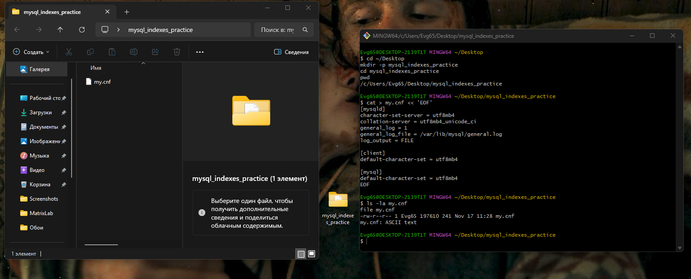
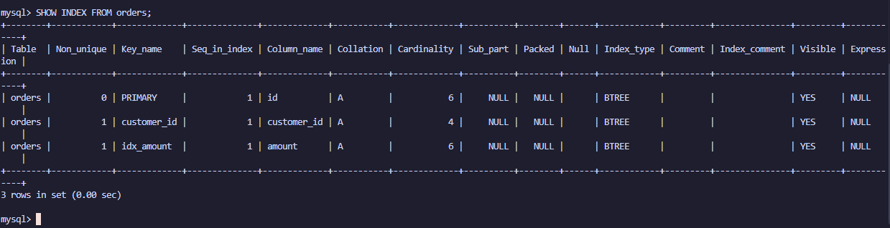
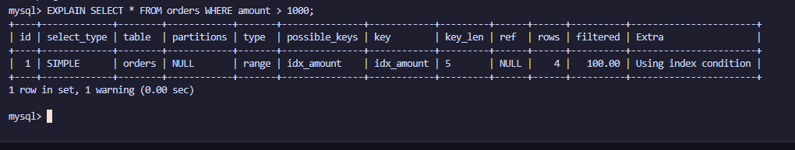
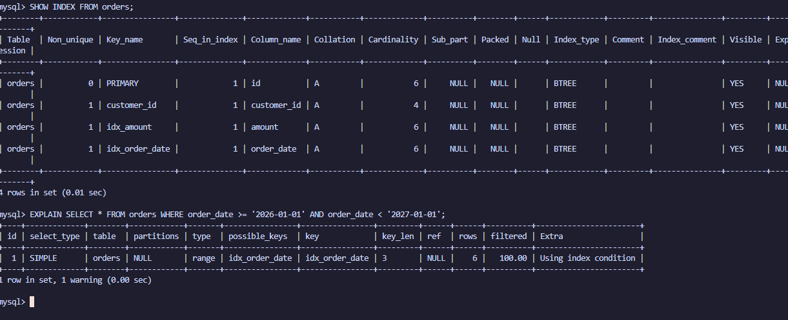
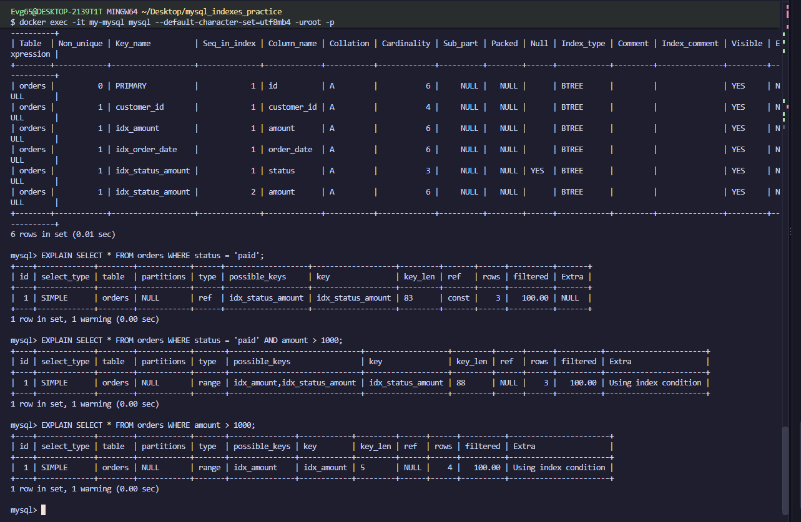
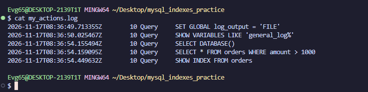
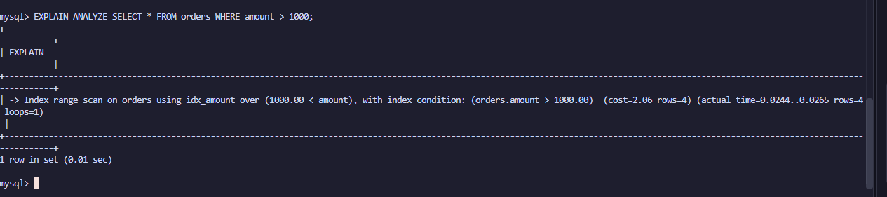
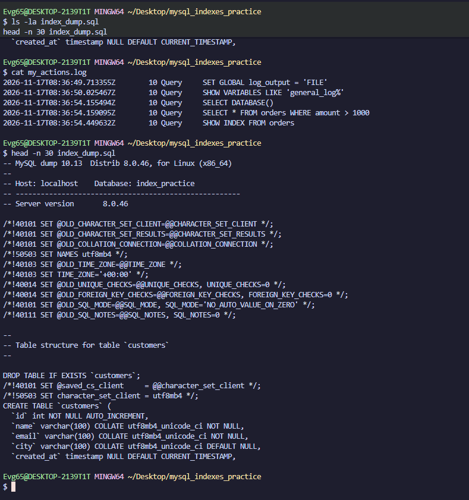

# Отчет по лабораторной работе: Индексы в MySQL

**Студент:** Евгений Белевитин  
**Группа:** Ипо8481  
**Дата:** 17 ноября 2026 г.  
**Среда:** WSL (Ubuntu), Docker, MySQL 8.0.46

---

## 🎯 Цель работы
Научиться создавать индексы в MySQL, анализировать план выполнения запросов (`EXPLAIN`, `EXPLAIN ANALYZE`), понимать влияние функций и порядка столбцов на производительность, а также вести логирование действий пользователя.

---

## 🛠️ 1. Подготовка окружения

Для работы был настроен Docker-контейнер с MySQL 8.0. Важнейшим этапом стало создание файла конфигурации `my.cnf` для включения общего лога (`general_log`) и настройки кодировки `utf8mb4`.

👇 **Создание директории и файла my.cnf:**

После настройки контейнера была создана база данных `index_practice`, таблицы `customers` и `orders`, а также загружены тестовые данные (5 клиентов, 6 заказов).

👇 **Создание БД, таблиц и загрузка данных:**

---

## 🔍 2. Эксперименты с индексами

### 2.1. Анализ полного сканирования (Full Table Scan)
До создания каких-либо индексов (кроме первичного и внешнего ключа) был проверен запрос поиска заказов по сумме.

👇 **Начальное состояние индексов (SHOW INDEX):**
Видны только системные индексы `PRIMARY` и `customer_id`. Индекса по `amount` нет.

👇 **Результат EXPLAIN до оптимизации:**
Тип доступа — `ALL` (полный перебор всех строк). Ключ не используется (`key: NULL`).

### 2.2. Оптимизация через простой индекс
Был создан индекс `idx_amount` по полю `amount`.

👇 **Проверка появления индекса:**
В списке появился `idx_amount`.

👇 **Результат EXPLAIN после создания индекса:**
Тип доступа изменился на `range` (диапазонный поиск). Используется ключ `idx_amount`. Количество просматриваемых строк сократилось с 6 до 4.

### 2.3. Влияние функций на индексацию
Проверено поведение индекса при использовании функции `YEAR()` в условии `WHERE`.

👇 **Проблема с функцией YEAR():**
Запрос `WHERE YEAR(order_date) = 2026` игнорирует индекс (`type: ALL`), так как функция применяется к значению столбца.

👇 **Решение через диапазон дат:**
Переписанный запрос `order_date >= '2026-01-01' AND ...` успешно использует индекс `idx_order_date` (`type: range`).

### 2.4. Составные индексы и правило левого префикса
Создан составной индекс `idx_status_amount (status, amount)`.

👇 **Финальный список всех индексов:**
Видны все созданные индексы, включая составной `idx_status_amount` и покрывающий `idx_customer_amount`.

👇 **Тестирование составного индекса:**
1. Поиск по `status` (первый столбец) — работает (`ref`).
2. Поиск по `status` и `amount` — работает (`range`).
3. Поиск только по `amount` — составной индекс не используется (нарушение левого префикса), но работает отдельный `idx_amount`.
 *(Примечание: если 12.png это тесты, а 9.png список)* -> *Уточнение: На скрине 9 виден список, на скрине 12 видны EXPLAIN-ы для составного индекса.*

### 2.5. Покрывающий индекс (Covering Index)
Создан индекс `idx_customer_amount (customer_id, amount)`.

👇 **Демонстрация Covering Index:**
Запрос агрегации `SUM(amount)` выполняется исключительно по индексу. В поле `Extra` видно **`Using index`**. Таблица данных не читается.

### 2.6. Реальный анализ времени (EXPLAIN ANALYZE)
Использована команда `EXPLAIN ANALYZE` для получения фактических метрик.

👇 **Результат EXPLAIN ANALYZE:**
Видно реальное время выполнения (~0.02 мс) и фактическое количество прочитанных строк (4 строки).

---

## 📂 3. Артефакты и файлы отчета

Все необходимые файлы сгенерированы и находятся в корне папки с работой:

| Файл | Описание | Ссылка |
| :--- | :--- | :--- |
| **Лог действий** | Отфильтрованный `general.log`, содержащий только мои SQL-команды. | [my_actions.log](my_actions.log) |
| **Дамп БД** | Полный дамп базы `index_practice` со всеми индексами. | [index_dump.sql](index_dump.sql) |
| **Конфиг** | Файл настроек MySQL с включенным логированием. | [my.cnf](my.cnf) |

👇 **Содержимое лога и начало дампа:**

---

## 💡 Основные выводы
1.  **Индексы ускоряют чтение:** Переход от `ALL` к `range` критически важен для больших таблиц.
2.  **Функции ломают индексы:** Избегайте `WHERE func(col) = val`. Используйте диапазоны.
3.  **Порядок столбцов важен:** В составных индексах работает правило левого префикса.
4.  **Covering Index — идеал:** Если индекс содержит все нужные поля, таблица не читается вообще (`Using index`).
5.  **EXPLAIN ANALYZE:** Показывает реальное время, а не теоретическую оценку.

---
*Работа выполнена самостоятельно. Все скриншоты и логи являются оригинальными результатами выполнения заданий в среде WSL.*