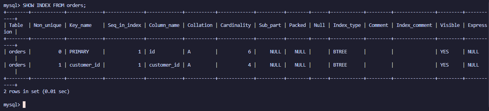
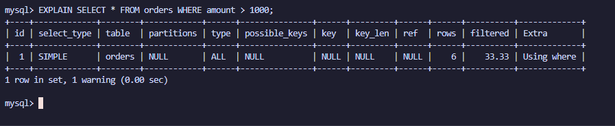
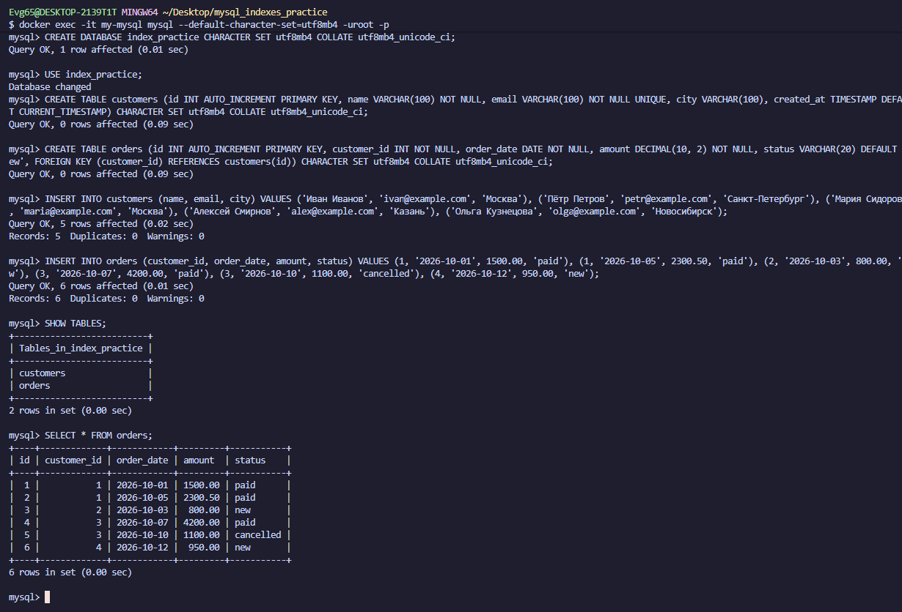
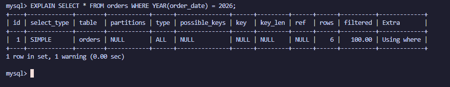
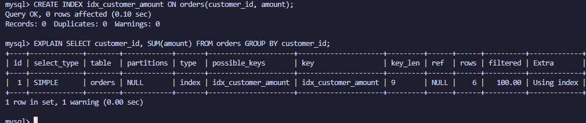

# Отчет по лабораторной работе: Индексы в MySQL

**Студент:** Евгений Белевитин  
**Группа:** Ипо8481  
**Дата:** 17 ноября 2026 г.  
**Среда:** WSL (Ubuntu), Docker, MySQL 8.0.46

---

## 🎯 Цель работы
Освоить механизмы индексации в MySQL: создавать индексы, анализировать планы запросов (`EXPLAIN`, `EXPLAIN ANALYZE`), понимать влияние функций и порядка столбцов, а также вести логирование действий.

---

## 🛠️ 1. Подготовка окружения

Для работы был настроен Docker-контейнер. Ключевой этап — создание `my.cnf` для включения логов (`general_log`) и настройки `utf8mb4`.

👇 **Настройка my.cnf и структуры папок:**

Далее была создана БД `index_practice`, таблицы и загружены тестовые данные.

👇 **Инициализация БД и данных:**

---

## 🔍 2. Эксперименты с индексами

### 2.1. Анализ полного сканирования (Full Scan)
Проверка запроса до создания индексов.

👇 **Начальное состояние индексов (только PK и FK):**

👇 **EXPLAIN до оптимизации:**
Запрос `WHERE amount > 1000` делает полный перебор (`type: ALL`).

### 2.2. Оптимизация простым индексом
Создан индекс `idx_amount`.

👇 **Подтверждение создания индекса:**

👇 **EXPLAIN после оптимизации:**
Тип доступа сменился на `range`, используется `idx_amount`.

### 2.3. Влияние функций (Anti-pattern)
Проверка гипотезы о ломке индекса функциями.

👇 **Проблема с YEAR():**
`WHERE YEAR(order_date) = 2026` игнорирует индекс (`type: ALL`).

👇 **Решение через диапазон:**
Переписанный запрос использует `idx_order_date` (`type: range`).

### 2.4. Составные индексы
Создан `idx_status_amount (status, amount)`.

👇 **Тесты составного индекса:**
1. По `status` (первый столбец) — работает (`ref`).
2. По `status` + `amount` — работает (`range`).
3. По `amount` (второй столбец) — составной не используется (нарушение префикса), но работает отдельный `idx_amount`.

### 2.5. Покрывающий индекс (Covering Index)
Создан `idx_customer_amount (customer_id, amount)`.

👇 **Демонстрация Covering Index:**
Запрос агрегации выполняется только по индексу (`Extra: Using index`). Таблица не читается.

### 2.6. Реальный анализ (EXPLAIN ANALYZE)
👇 **Результат EXPLAIN ANALYZE:**
Показано фактическое время выполнения (~0.02 мс) и реальное кол-во строк.

---

## 📂 3. Артефакты и файлы

Все результаты сохранены в файлах проекта:

*   📄 **[my_actions.log](my_actions.log)** — Очищенный лог действий (SQL-команды).
    *   *Скриншот содержимого:* 
*   💾 **[index_dump.sql](index_dump.sql)** — Дамп базы данных со структурой и индексами.
    *   *Скриншот начала дампа:* 
*   ⚙️ **[my.cnf](my.cnf)** — Конфигурация MySQL.

---

## 💡 Выводы
1.  **Индексы ускоряют чтение:** Переход от `ALL` к `range` критичен.
2.  **Функции ломают индексы:** Избегайте `WHERE func(col) = val`.
3.  **Порядок важен:** Правило левого префикса для составных индексов.
4.  **Covering Index — идеал:** `Using index` означает отсутствие чтения таблицы.
5.  **EXPLAIN ANALYZE:** Показывает реальные метрики, а не оценку.

---
*Работа выполнена самостоятельно. Все скриншоты и логи — оригинальные результаты.*
