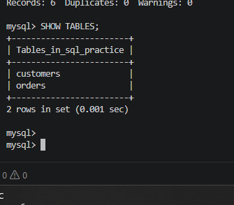
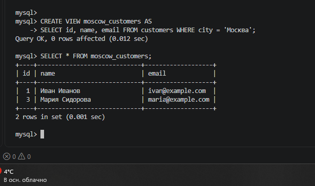
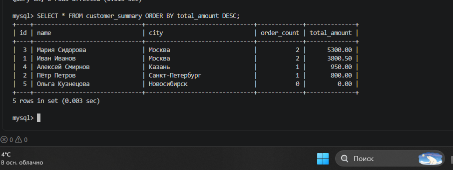
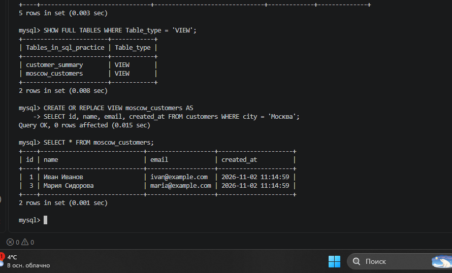
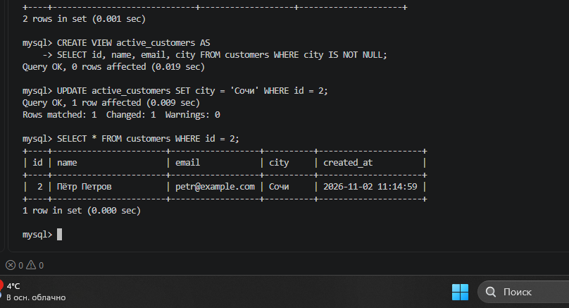
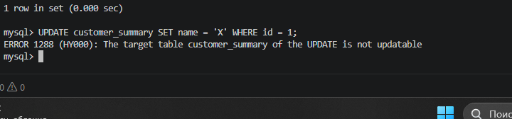
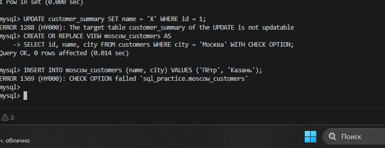
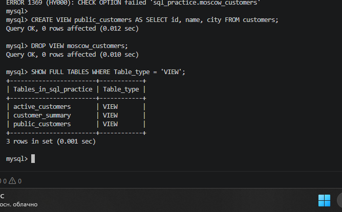
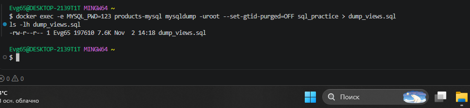

# 🎓 Отчет по лабораторной работе: Представления (VIEW) в MySQL

**Выполнил:** Евгений Белевитин
**Группа:** Ипо8481
**Дата:** 02.11.2026

---

## 🔹 1. Подготовка БД
Создана база данных `sql_practice`. В ней созданы таблицы `customers` (клиенты) и `orders` (заказы), а также добавлены тестовые данные. Проверка через `SHOW TABLES` подтверждает успешное создание структуры.

---

## 🔹 2. Создание простого VIEW
Создано представление `moscow_customers`, которое фильтрует клиентов только из Москвы. При обращении к VIEW данные берутся из базовой таблицы.

---

## 🔹 3. VIEW с JOIN и агрегацией
Создано представление `customer_summary`. Внутри него выполняется `LEFT JOIN` таблиц `customers` и `orders`, а также агрегация (подсчет количества заказов `COUNT` и суммы `SUM`). Это позволяет получать готовую сводку одной командой.

---

## 🔹 4. Просмотр и изменение VIEW
Проверен список существующих представлений с помощью `SHOW FULL TABLES`. Затем использована команда `CREATE OR REPLACE VIEW` для изменения `moscow_customers` — в него был добавлен столбец `created_at`.

---

## 🔹 5. Обновление данных через VIEW
Создано обновляемое представление `active_customers`. Проверено, что команда `UPDATE`, примененная к VIEW, успешно изменяет данные в базовой таблице `customers` (город Петра изменился на «Сочи»).

---

## 🔹 6. Ограничения VIEW (Ошибка 1288)
Выполнена попытка обновить представление `customer_summary`, которое содержит агрегатные функции (`COUNT`). MySQL выдал ошибку `ERROR 1288`, подтверждая, что VIEW с агрегацией не является обновляемым.

---

## 🔹 7. WITH CHECK OPTION (Ошибка 1369)
Создано представление `moscow_customers` с условием `WITH CHECK OPTION`. Попытка вставить клиента из Казани вызвала ошибку `ERROR 1369`, так как вставляемые данные не соответствуют фильтру `WHERE city = 'Москва'` внутри VIEW.

---

## 🔹 8. Удаление и права доступа
Создано представление `public_customers`, скрывающее столбец `email` для ограничения доступа. Представление `moscow_customers` удалено командой `DROP VIEW`. Проверка списка подтвердила успешное удаление.

---

## 🔹 9. Создание дампа
Выполнен экспорт базы данных `sql_practice` в текстовый файл `dump_views.sql` с помощью утилиты `mysqldump`. По умолчанию все созданные VIEW включаются в дамп.

---

## 📌 Вывод
В ходе лабораторной работы были изучены представления (VIEW) в MySQL. Освоены навыки создания простых и сложных VIEW (с JOIN и агрегацией), их изменения и удаления. Изучены ограничения: невозможность обновления VIEW с агрегатами (ошибка 1288) и защита от вставки неподходящих данных с помощью `WITH CHECK OPTION` (ошибка 1369). Также отработан экспорт базы данных со всеми представлениями в дамп.

---

## 📂 Файлы работы
*   [Скачать дамп базы данных (dump_views.sql)](./dump_views.sql)